# Day 1 — Bubble.io: the PanelWatch Admin System

> **Understand it by hand, then let the AI build it:** this morning you learn Bubble's building blocks
> and its API Connector in a small practice app. Then Bubble AI builds the PanelWatch admin system on
> top of the course's Firebase database, and you check its work.

**Use case for the whole course:** **PanelWatch** monitors three electrical panels — `PNL-01`,
`PNL-02` and `PNL-03`. Every 30 seconds a simulator inside **Firebase** writes five readings for each
panel — `temperature`, `humidity`, `voltage`, `current` and `vibration` — and works out power, status
and a health summary. The whole class shares the same data.

Today you build the **admin system** in **Bubble.io**: a dashboard of the panels and a page per panel
with its summary, readings and chart. It works on a desktop and on a phone browser.
Tomorrow you build the supervisors' **mobile app** in FlutterFlow on the same data.

## Before you start
- [ ] You can sign in to **bubble.io** — the **Free** plan is all you need.
- [ ] You have this repo open, especially **`firebase-api.md`**.
- [ ] The Firebase **project ID** is `panelwatch-class` — already filled in to every link below.
- [ ] **No outside AI tools** — no ChatGPT, Claude or Gemini. Only the AI built into Bubble and
      FlutterFlow.

---

# Part A — Basics (practice app, by hand)

## Topic 1 — How PanelWatch fits together (concept)

**Goal:** see the whole system before building any part of it.

```
                         Firebase (run by the trainer)
   ┌─────────────────────────────────────────────────────────────────────┐
   │  Simulator (Cloud Function)  ──writes every 30 s──►  Firestore database │
   │  3 panels, rules, status                          devices · readings │
   └─────────────────────────────────────────────────────────────────────┘
            ▲ REST API (reads)                         ▲ built-in connection (live)
   Bubble admin system (today)                FlutterFlow mobile app (Day 2)
   desktop + phone browser                    Android APK · emulator · iPhone web app
```

An **IoT** (Internet of Things) system has four layers:

| Layer | In a real factory | In PanelWatch |
|---|---|---|
| **Device** | A sensor board (e.g. ESP32 + SHT31 + PZEM-004T) that also applies simple rules | The **simulator** in Firebase — 3 panels; it calculates power, status and a summary |
| **Data** | A cloud database and its API | **Firebase Firestore** — see `firebase-api.md` |
| **Admin** | Web pages for engineers: devices and their readings | **Bubble.io** — today |
| **Supervisor app** | A phone app on the factory floor | **FlutterFlow** — Day 2 |

**Why these tools?**

| | **Bubble.io** | **FlutterFlow** |
|---|---|---|
| Best at | Web pages full of logic and forms | Polished mobile screens |
| How it reaches the data | **API Connector** — calls Firestore's REST API | **Built-in Firebase connection** — live lists |
| Built-in AI (the only AI we use) | AI app generator + **Bubble Agent** (500 credits a month on Free) | **Generate with Designer** — screens and components from a prompt |

An **API** (Application Programming Interface) is a door another program can use. A **REST API** uses
web addresses and the HTTP (Hypertext Transfer Protocol) methods **GET** (read) and **POST** (send
something — in PanelWatch, a search).

**Checkpoint ✅** Say where a reading of `temperature = 62` goes, and which two apps show it.

---

## Topic 2 — Bubble's building blocks, by hand (practice app)

**Goal:** build a tiny to-do app yourself, so you recognise every part when the AI builds PanelWatch.

### 2.1 — Create the practice app
1. On **bubble.io**, click **Create new project** → **Web app** → **Create a blank app** → **Get
   started** → name it `practice-bubble-<yourname>`. Skip any tour.
2. The editor's tabs, down the left side:

| Tab | What lives there |
|---|---|
| **Design** | Pages and elements (text, inputs, buttons, repeating groups) |
| **Workflow** | Logic: *When* something happens → *do* these actions |
| **Data** | Bubble's own database: data types, option sets, privacy rules |
| **Styles** | Reusable looks |
| **Plugins** | Add-ons — including the **API Connector** (Topic 3) |
| **Settings** | App-wide settings |

Click any element and its settings open on the right, in three tabs: **Visual** (content, data,
look), **Interaction** (workflows, visibility) and **Conditional** (changes when something is true).

You build in the **Development** version (at `…/version-test`). That's all we need.

### 2.2 — A data type
**Data → Data types → New type** `Task`, with fields `title` (text) and `done` (yes/no). On `done`, set
**Default value** to **no** — without it, new tasks have an empty `done`.
Bubble adds the built-in fields `Creator`, `Modified Date`, `Created Date` and `Slug` itself.

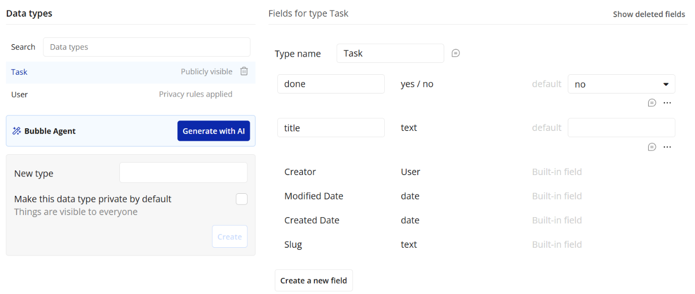

### 2.3 — A page, an input and a workflow
1. **Design →** on `index`, drag in an **Input** (name it `Input Title`) and a **Button** **Add**.
2. Click the button → **Add workflow** → **Data (Things) → Create a new thing** → type `Task`,
   `title = Input Title's value`.
3. Second action: **Element actions → Reset relevant inputs** — it clears the box, so you can see the
   click worked (without it, people click again and add duplicates).
4. Click the event *When Button Add is clicked* → **Only when** `Input Title's value is not empty` — no
   blank tasks.

> **One workflow, two steps.** Add step 2 with the **+** under step 1. Pressing **Add workflow** again
> makes a *second* workflow on the same button — both run on every click.

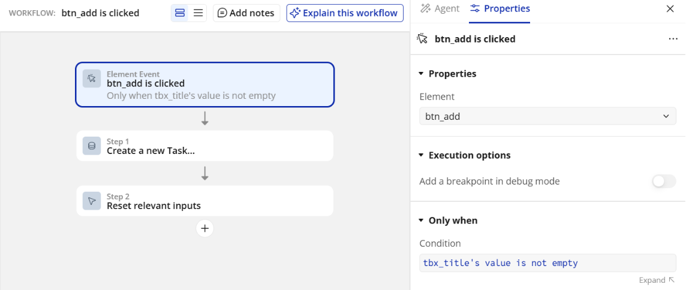

### 2.4 — A repeating group (a list)
1. Drag in a **Repeating group**: Type of content **Task**, Data source **Do a search for → Task** (it
   then reads *Search for Tasks*),
   **Container layout** **Row** (so each cell's items sit side by side).
2. In the first cell, a **Checkbox** and, to its right, a **Text** showing `Current cell's Task's title`.
3. Select the Checkbox → **Interaction** → **Add workflow** (*Checkbox … is clicked*) → **Data (Things)
   → Make changes to a thing** → Thing to change `Current cell's Task` → **Fields**: `done = This
   Checkbox is checked`.

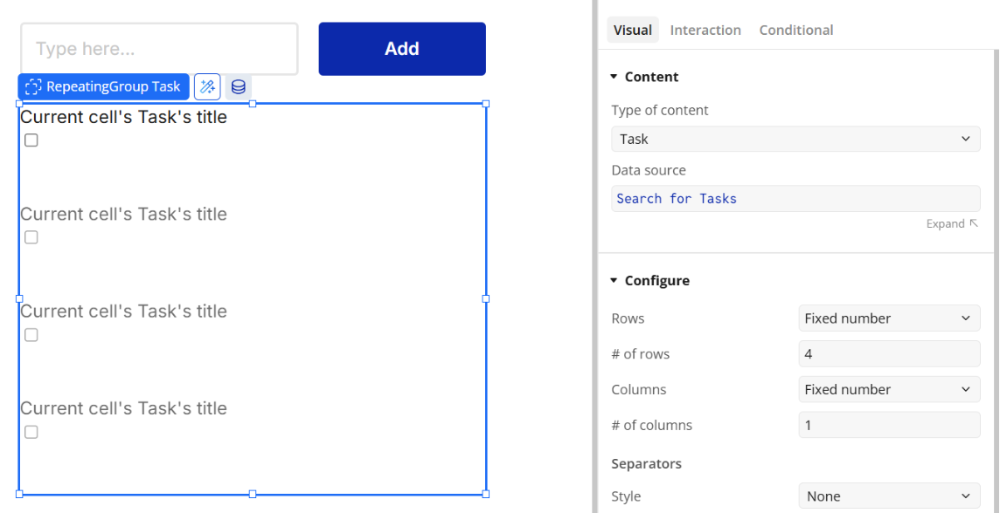

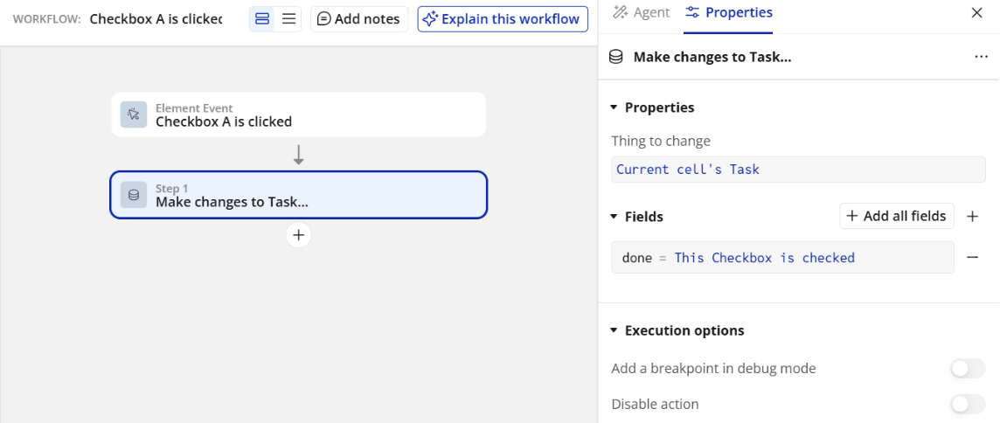

### 2.5 — A conditional
Select the cell's Text → **Conditional** tab → **+** → **When** `Current cell's Task's done is yes` →
**Change another property** → **Font color** grey.

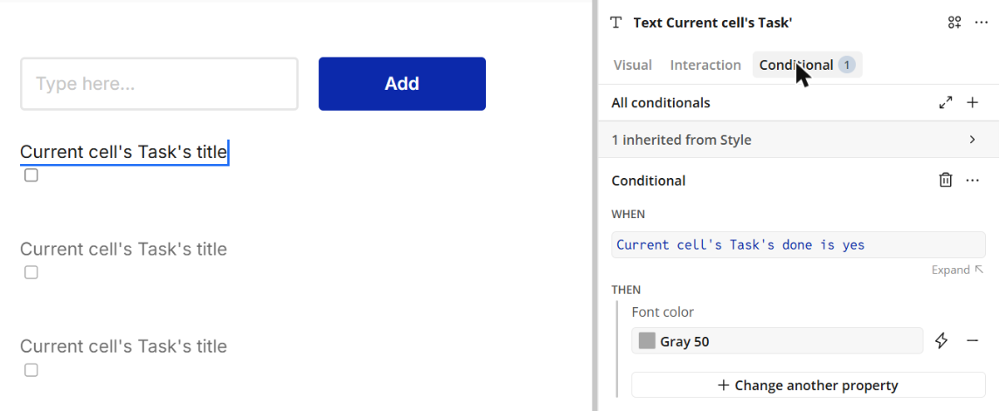

### 2.6 — Responsive layout (desktop *and* phone)
- A **Group** set to **Column** stacks children vertically; **Row** puts them side by side.
- **Min width / Max width** stop things getting too narrow or too wide.

1. Put the input and button in a Group set to **Row**; give the page a **Max width** of `800`, centred.
2. Click **Responsive** (top of the editor) and drag the width down to **390** (a phone).
3. **Break it on purpose:** give the input a fixed width of `600` px → at 390 the page scrolls
   sideways. Change it to **min width 150, max width ∞** → it shrinks to fit.

**Try it** — **Preview**: add three tasks, tick one; it turns grey. Resize the browser — the layout
holds. **Data → App data → All Tasks** shows exactly what you added. Blank or duplicate rows mean
step 2.3's condition or reset is missing; delete them there.

**Checkpoint ✅** By hand: a data type, a workflow, a list, a conditional and a responsive row.

---

## Topic 3 — The API Connector, by hand (practice app)

**Goal:** make Bubble read data from another system — exactly how PanelWatch will read Firebase.

1. Open **API Connector** — the **{ }** icon in the left sidebar.
2. **The collection** (one per API): **+ New** creates one with a draft call inside. Rename it with
   the **⋯** next to it → **Rename** → `Weather`. The **▸** before **COLLECTION: …** at the top shows
   **Authentication** — leave it **None or self-handled**.
3. **The call** — use that draft *API Call* (don't add a second one), top to bottom: click the name next to **API Call:** → `Current`;
   **Method** *GET*; paste the URL into the box next to it; **RESPONSE → Use as** *Data*, **Data type**
   *JSON*.

```text
https://api.open-meteo.com/v1/forecast?latitude=3.14&longitude=101.69&current=temperature_2m,relative_humidity_2m
```

4. Click **Initialize** (at the bottom). Bubble shows the response fields — `current temperature_2m`,
   `current relative_humidity_2m`. Click **Save**.

   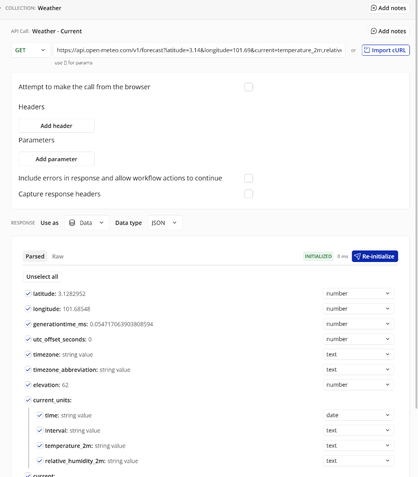
5. A page of its own: **Design** → the page dropdown (top left, showing `index`) → **Add a new page**
   → name `weather`, **Clone from** blank → **Create**.
6. On `weather`, add a **Group**. Its **Visual** tab → **Type of content** `Weather - Current`, **Data
   source** **Get data from an external API → Weather - Current**. Set this first — until the group has
   a type, *Parent group's…* isn't offered inside it.

   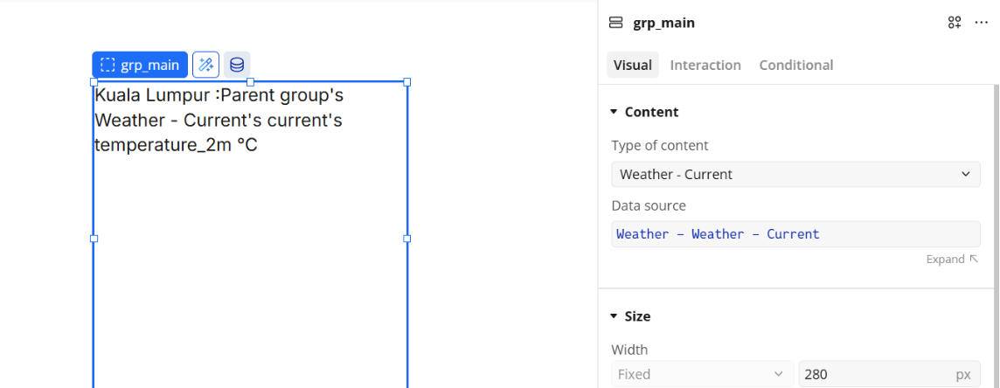
7. Inside the group, a **Text** → **Visual** tab → click at the end of the text in its content box,
   type `Kuala Lumpur: `, click **Insert dynamic data** → **Parent group's Weather - Current → current
   temperature_2m**, then type ` °C`.

**Try it**
1. **Preview** the `weather` page (`…/version-test/weather`) — the live Kuala Lumpur temperature
   appears.

   
2. **Break it on purpose:** change `latitude=3.14` to `latitude=abc` and click **Initialize** —
   the API answers with an error (*400 Bad Request*). Bad input is rejected by the other system. Put it
   back.

| Piece | Meaning |
|---|---|
| **Use as: Data** | The call *reads* something you show on a page |
| **Use as: Action** | The call *does* something — used in workflows |
| **Initialize** | Bubble calls once to learn the shape of the response |

**Checkpoint ✅** A Bubble page shows data that lives in another system.

---

## Topic 4 — PanelWatch's data and API (concept)

**Goal:** know what's in the Firebase database before connecting to it.

1. Read **`firebase-api.md`** sections 1–3: the three panels, the two collections you use (`devices`
   and `readings`), every field, and the rules.
2. The trainer shows the **Firebase console** on the projector — documents appearing every 30 seconds.
3. Open the list of panels in your browser — a plain **GET**:

```text
https://firestore.googleapis.com/v1/projects/panelwatch-class/databases/(default)/documents/devices
```

4. Reload after 30 seconds — the `latest_…` values have changed.

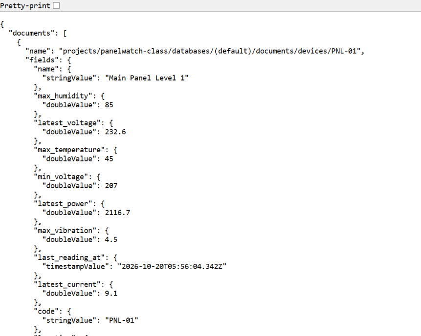

Notice how every value is wrapped with its type — `"stringValue"`, `"doubleValue"`,
`"booleanValue"`, `"timestampValue"`. Bubble shows those names in its expressions.

**Checkpoint ✅** You can name the four collections and say which program writes each one.

---

# Part B — The PanelWatch admin, built with Bubble AI

**How the prompts work.** The admin is built in **stages, one prompt each**: base layout → style → one
feature at a time. The AI builds what you **see**; after each prompt you check it and build what it
**does** (the workflows) by hand — so everyone's app works the same way, even when the AI's layouts
differ. Every prompt is in the notes where you use it, with a table explaining why it's written that
way. Copy it as it is first; if you change it, note what and why — on Day 2 you present one prompt and
what the AI got wrong. Four rules behind every prompt:
- Say **what the data is called** and where it comes from — the AI can't see Firebase.
- Say **what not to build** (log-in, sample data, extra pages).
- Ask for **one thing at a time**, check it, then ask for the next.
- The AI's version is a first draft. You check it against the notes' checklist.

## Topic 5 — Create the admin app and connect it to Firebase

**Goal:** a new Bubble app, its layout generated by AI, and seven calls to Firestore set up by hand —
the bridge everything else is built on.

### 5.1 — The base layout with Bubble AI
1. Bubble dashboard → **Create new project** → **Web app** → **Create with AI** → **Get started**.

   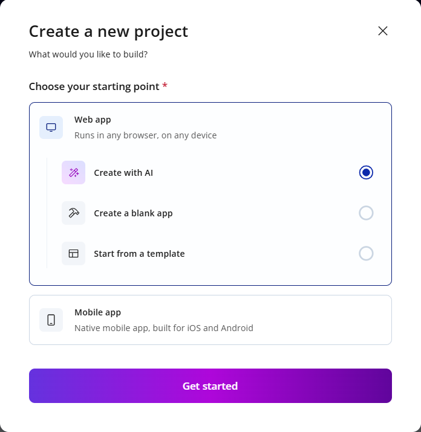
2. On **What will you build?**, paste **Prompt 1** (below) into *Describe your app idea* → **Enter**.
   Ignore the suggestion chips. If asked for a name, `panelwatch-admin-<yourname>`.

   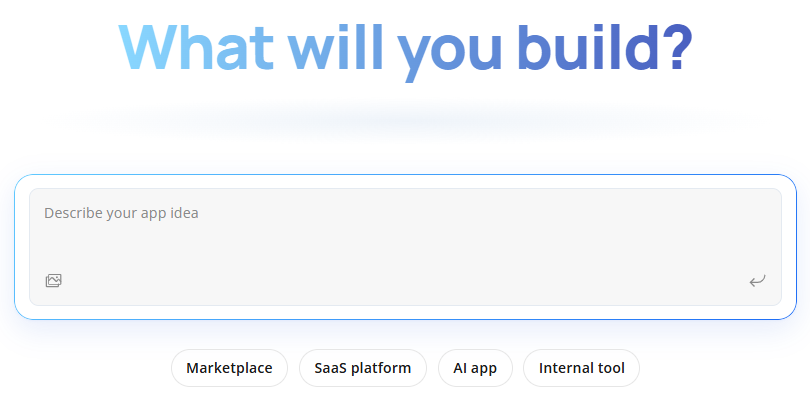
   *(Generating an app uses no AI credits.)*
3. Bubble AI shows a **Plan** first — **Features** and **Scenarios**. Check both: two pages, nothing
   else — no log-in, sign-up, payments, charts or data. Remove anything extra by typing in *Refine
   your app idea*. You don't need to answer its "refine anything?" question.

   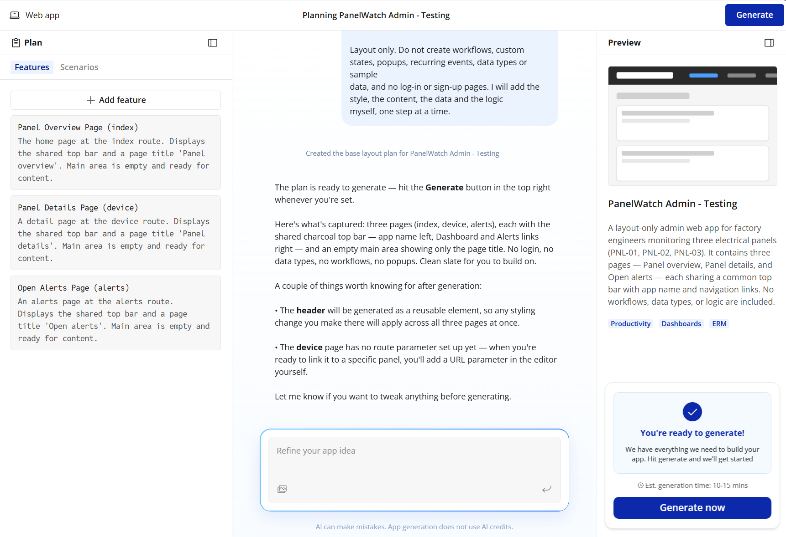
4. Click **Generate** (top right). It takes **10–15 minutes** — read 5.3 while you wait. The top bar
   comes out as a **reusable element**, so styling it once changes both pages.

**Where each prompt goes:** Prompt 1 on this planning screen only. After generation the editor opens:
Prompts 2–5 go in the **Agent** tab of the right-hand pane (next to *Properties*), **one at a time** —
paste, wait until the Agent says it's done, check, do the by-hand steps, then the next prompt.

**Prompt 1 — Base layout** (Bubble AI app generator)
```text
Build the base layout of an admin web app called "PanelWatch Admin" for engineers who monitor three
electrical panels in a factory (PNL-01, PNL-02, PNL-03). It must work on a desktop and on a phone.

Two pages. Each has the same top bar - the app name on the left and a "Dashboard" link (to index)
on the right - and below it an empty main area with only a page title:
1. "index" - title "Panel overview"
2. "device" - title "Panel details"

Layout only. Do not create workflows, custom states, popups, recurring events, data types or sample
data, and no log-in or sign-up pages. I will add the style, the content, the data and the logic
myself, one step at a time.
```
**Why it's written this way** — the app is built in stages: **base layout → style → one feature at a
time**. This prompt is only the first stage.

| Part of the prompt | Why |
|---|---|
| *"an admin web app … for engineers who monitor three electrical panels in a factory"* | Says **who** uses it and **what for**, so the AI's wording fits an engineers' tool — even for a bare layout |
| *"It must work on a desktop and on a phone"* | Without this, generators often build a fixed desktop page. Fixing that later is harder than asking now |
| *"the same top bar … a "Dashboard" link (to index)"* | One navigation on both pages. A link only needs its destination page — no workflow |
| *"index" / "device"* | **Exact page names**, because every later prompt uses them. `index` is Bubble's home page — the dashboard belongs there |
| *"an empty main area with only a page title"* | Everyone in the room gets the **same nearly empty pages**. Each feature is added later by its own prompt, so your app keeps matching the notes |
| *"Layout only. Do not create workflows, custom states, popups, recurring events"* | Left alone, the generator **guesses the logic** — loading popups, timers, error handlers — differently for every person, and it clashes with the logic you build by hand |
| *"data types or sample data"* | The AI can't see Firebase. Its own database and fake rows would get mixed up with the real data |
| *"no log-in or sign-up pages"* | Generators add sign-in by default. PanelWatch has none |
| *"I will add … myself, one step at a time"* | Tells the AI the plan, so it keeps this step small |

> **Catch the AI** — open each page and **Workflow**:
> - Each page should have only the top bar and its title. Delete anything else it added.
> - **Workflow** tab: delete **every** workflow on every page, and any popup in the Elements Tree. A
>   loading popup the AI added never closes — there's no data yet.
> - **Data** tab: if it created data types (e.g. `Device`), leave them; nothing will use them.

### 5.2 — Style with the Agent
1. Open the **Agent** (right side of the editor) and paste **Prompt 2**. *(The Agent uses AI credits —
   500 a month on Free; this prompt took about 30. The count is at the bottom of the Agent pane.)*
2. Check: **Styles** tab → three colour variables `Normal`, `Warning`, `Critical`; both pages still have
   only their top bar and title.

   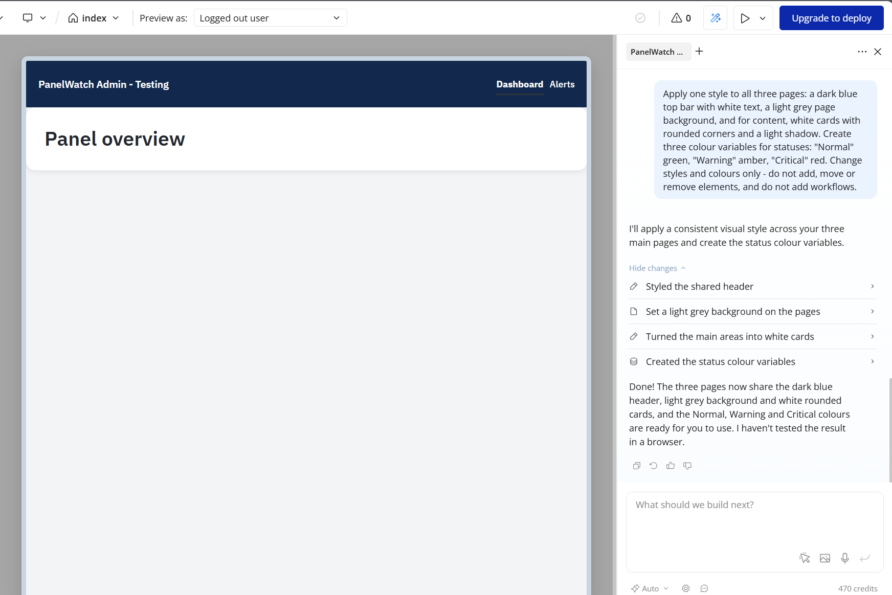

**Prompt 2 — Style** (Agent)
```text
Apply one style to both pages: a dark blue top bar with white text, a light grey page
background, and for content, white cards with rounded corners and a light shadow.
Create three colour variables for statuses: "Normal" green, "Warning" amber, "Critical" red.
Change styles and colours only - do not add, move or remove elements, and do not add workflows.
```
**Why it's written this way**

| Part of the prompt | Why |
|---|---|
| A prompt just for style | Looks are one stage, content is another. You can see exactly what this prompt changed |
| *"dark blue top bar … light grey … white cards with rounded corners"* | Concrete colours and shapes. "Make it nice" gives a different result every time |
| *"three colour variables … "Normal" green, "Warning" amber, "Critical" red"* | Named once, reused by every later prompt. The names are the **exact status words** the simulator writes (`firebase-api.md` 3) |
| *"Change styles and colours only - do not add, move or remove elements"* | Keeps the step small and checkable; the layout from 5.1 stays the same for everyone |

### 5.3 — The Firestore API, by hand
The Agent must not guess API details, so you set this up yourself.
1. Open **API Connector** (the **{ }** icon) — each app has its own, so the practice app's calls aren't
   here.
2. **The collection** (one per API): the left list already has *New Collection*. Its **⋯** →
   **Rename** → `Firestore`. The **▸** before **COLLECTION: …** at the top shows **Authentication** —
   leave it **None or self-handled**. No shared headers are needed.

   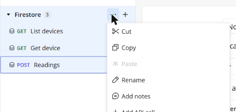
3. **The calls:** *New Collection* already holds one draft call, *API Call* — it becomes call 1. For
   each further call, click **+** next to `Firestore` in the left list. Then, top to bottom:
   - **API Call:** click the name → type the call name from the table below.
   - **Method** dropdown (GET or POST) and the **URL** box next to it — paste the URL.
   - Leave **Attempt to make the call from the browser** unticked.
   - The POST call (`Readings`): **Body type** *JSON*, then paste the body into **Body**.
   - **Parameters:** Bubble adds a row under **URL parameters** for each `[code]` in the URL, and under
     **Body parameters** for each `<code>` in the body — **Key**, **Value**, **Private**, **Allow
     blank**. Type the test **Value** and **untick Private** (ticked, the page can't set it — every
     panel page would show the test panel). **An empty test value initializes the wrong shape** — e.g.
     `Readings` with no `code` finds nothing and Bubble learns only `readTime`.
   - **RESPONSE → Use as** *Data*, **Data type** *JSON*.
   - **Initialize** (at the bottom) — Bubble calls the API once and learns the fields. After any change
     the button turns red: **Re-initialize**.

   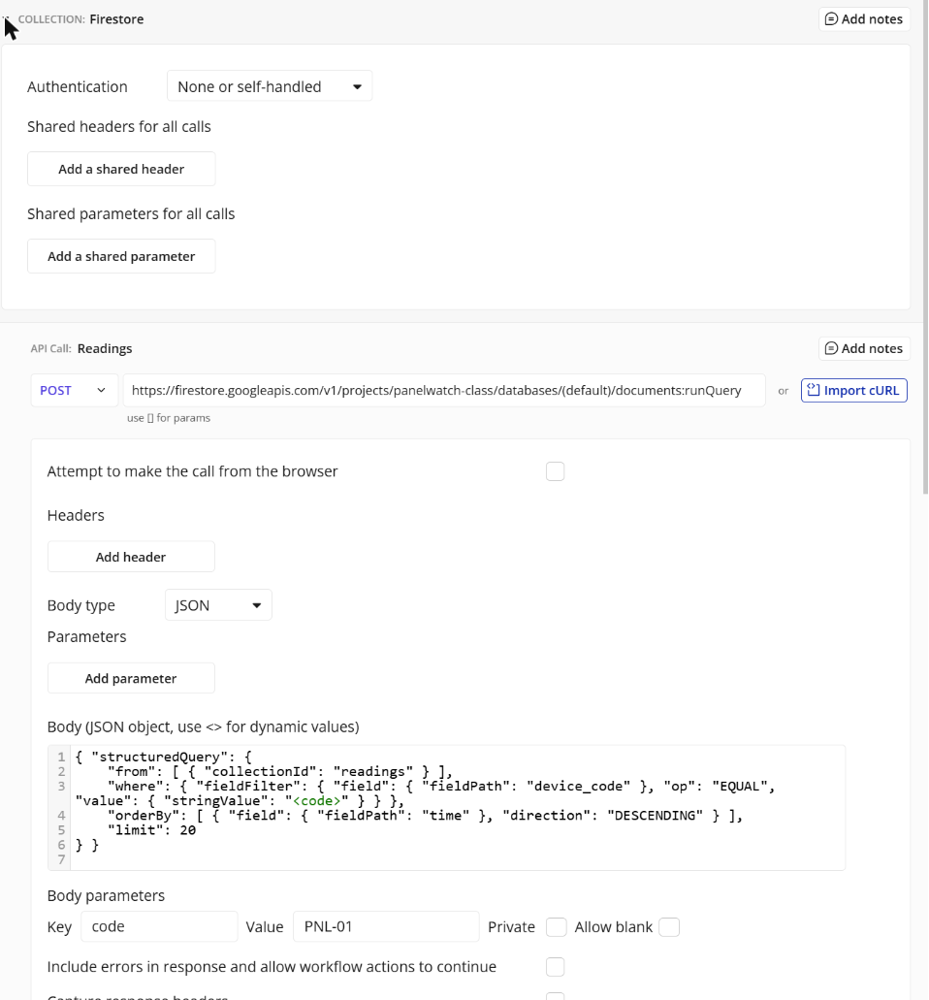

| # | Call name | Use as | Method | URL | Parameters (test values) |
|---|---|---|---|---|---|
| 1 | `List devices` | Data | GET | `https://firestore.googleapis.com/v1/projects/panelwatch-class/databases/(default)/documents/devices` | — |
| 2 | `Get device` | Data | GET | `https://firestore.googleapis.com/v1/projects/panelwatch-class/databases/(default)/documents/devices/[code]` | `code` = `PNL-01` |
| 3 | `Readings` | Data | POST | `https://firestore.googleapis.com/v1/projects/panelwatch-class/databases/(default)/documents:runQuery` | `code` = `PNL-01` |


**Body** for call 3 — the last 20 readings of one panel:
```json
{ "structuredQuery": {
    "from": [ { "collectionId": "readings" } ],
    "where": { "fieldFilter": { "field": { "fieldPath": "device_code" }, "op": "EQUAL", "value": { "stringValue": "<code>" } } },
    "orderBy": [ { "field": { "fieldPath": "time" }, "direction": "DESCENDING" } ],
    "limit": 20
} }
```

4. **Initialize** all three. Each one only **reads** — the apps in this course never write to
   Firebase.

| Piece | Meaning |
|---|---|
| `[code]` in the URL | A parameter inside the address |
| `<code>` in the body | A parameter inside the JSON body |
| `:runQuery` | Firestore's search: filter, sort, limit |

**Try it**
1. **Initialize** `List devices` → three documents, each with `fields code stringValue`,
   `fields status stringValue`, …
2. **Break it on purpose:** in `Readings`, set the test value of `code` to `PNL-99` and initialize →
   **one result with only `readTime`** — Firestore's way of saying "nothing found". You'll filter it
   out in Topic 7.2. Put `PNL-01` back.
3. **Break it on purpose:** in `Readings`, change the sort field `"time"` to `"humidity"` and
   initialize → **`FAILED_PRECONDITION: The query requires an index`**. Sorted searches need an index,
   and the trainer created only the ones PanelWatch uses. Put it back.

**Checkpoint ✅** `List devices`, `Get device` and `Readings` return real Firebase data.

---

## Topic 6 — The dashboard, built with the Agent (desktop and phone)

**Goal:** a fresh grid of the three panels: 3 cards per row on a desktop, 1 per row on a phone.

**Prompt 3 — Dashboard** (Agent)
```text
On the page "index", under the title, build the panel grid.

Use a repeating group whose data source is "Get data from an external API" -> "Firestore - List
devices"'s documents. Do not use a Bubble data type.

Each cell is a card showing, from Current cell's fields:
- code (stringValue) in bold and name (stringValue) below it
- a status badge from status (stringValue), coloured with the Normal, Warning or Critical colour
- latest_temperature °C, latest_humidity %, latest_voltage V, latest_current A,
  latest_vibration mm/s and latest_power W (each a doubleValue, 1 decimal place)
- "Last reading: " followed by last_reading_text (stringValue), in small grey text

Layout: the repeating group is a Row that wraps; each card has a minimum width of 300 px and a
maximum width of 420 px, so a desktop shows 3 cards per row and a phone shows 1.
Add a "Refresh" button at the top right of the grid.

Build the elements only - no workflows, custom states, popups or recurring events.
```
**Why it's written this way**

| Part of the prompt | Why |
|---|---|
| *"On the page "index", under the title"* | Names the page and the place, so the Agent adds to your base layout instead of starting a new page |
| *"Get data from an external API" -> "Firestore - List devices"'s documents"* | Bubble's exact wording for the data source, and the call name you created in 5.3. The Agent can't guess API names |
| *"Do not use a Bubble data type"* | Otherwise the Agent may create a `Device` type and bind the grid to it — an empty list |
| *"code (stringValue)", "latest_temperature … doubleValue"* | Each field **with its type wrapper**, exactly as Bubble lists them after **Initialize** (Topic 4). The Agent finds the right field first time |
| *"coloured with the Normal, Warning or Critical colour"* | Uses the colour variables from Prompt 2, so every page shows status the same way |
| *"1 decimal place"* | Readable numbers: `31.2`, not `31.2000001` |
| *"min 300 px, max 420 px, so a desktop shows 3 … a phone shows 1"* | Gives the numbers **and** the result you expect — you can check the Agent's work against it |
| *"Add a "Refresh" button"* | API data in Bubble doesn't update by itself. You wire the refresh by hand in 6.1 |
| *"Build the elements only - no workflows …"* | The same last line in every Agent prompt. The Agent builds what you see; you build what it **does**, the same way as everyone else |

1. Paste **Prompt 3** into the **Agent**.
2. **Check — and fix by hand if needed** (select each element; its settings open on the right):

| ✔ | Must be there |
|---|---|
| ☐ | The repeating group (e.g. *Devices panel grid*) → **Visual** → **Type of content** `List devices documents`, **Data source** `Firestore - List devices's documents` |
| ☐ | Each text shows a field from the cell, e.g. `Parent group's List devices documents's fields's latest_temperature's doubleValue :formatted as 1,028.6` — the canvas shows placeholders like *1,200*; real values appear only in **Preview** |
| ☐ | Status badge colour by **Conditional**: `… status stringValue is Critical` → Critical colour; `is Warning` → Warning colour; else Normal |
| ☐ | Layout: repeating group **Configure → Scroll direction** *wrap* (↩), **Min. column width** `300` — 3 per row at 1440 px, 1 per row at 390 px |
| ☐ | **Workflow** (left sidebar): no workflows on `index` — the Agent only built elements |

3. **Preview** (▷ top right): three cards with real values.

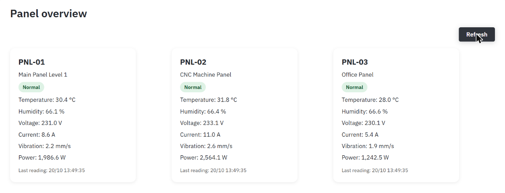

### 6.1 — Keep it fresh (by hand)
API data in Bubble doesn't refresh by itself — and the **Refresh** button does nothing yet: the Agent
built it without a workflow. The trick: a page counter `tick`, sent to Firestore as an extra header.
When `tick` changes, Bubble sees a "new" request and fetches again. Firestore ignores the header.

1. **The counter:** Elements Tree → select **index** → the **Custom States** icon at the top right of
   its Properties panel (next to **⋯**) → **+ New** → type **number** → name `tick`. Default value is
   already `0`.

   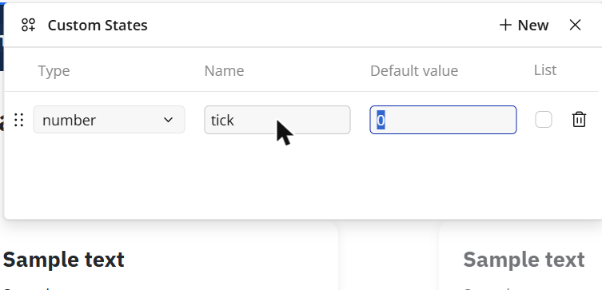

2. **The header:** **API Connector** (**{ }**) → `Firestore` → **List devices** → **Add header** → Key
   `X-Refresh`, Value `0`, untick **Private** → **Re-initialize** (it turns red after any change).

   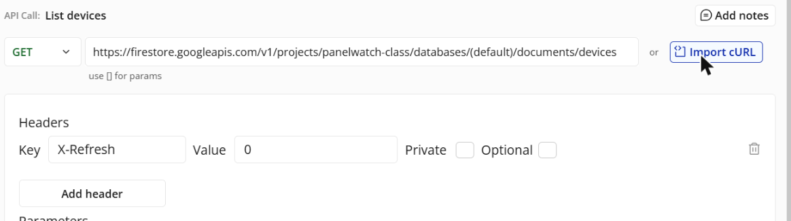

3. **Feed it to the grid:** back in Design, select the repeating group → **Visual → Data source** →
   click `Firestore - List devices` → in the window, **(header) X-Refresh** → **+ Add** (left of the
   box) → `index` → `'s tick`.

   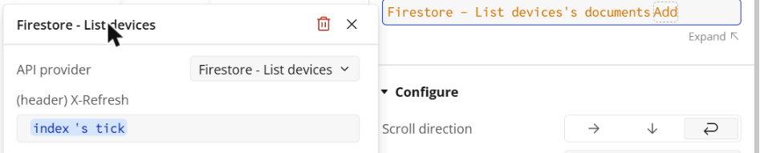

4. **The Refresh button:** select it → **Interaction** → **Add workflow** → search `Set state` → **Set
   state of an element** → Element `index` → **Custom States**: `tick` = `index's tick + 1`.

   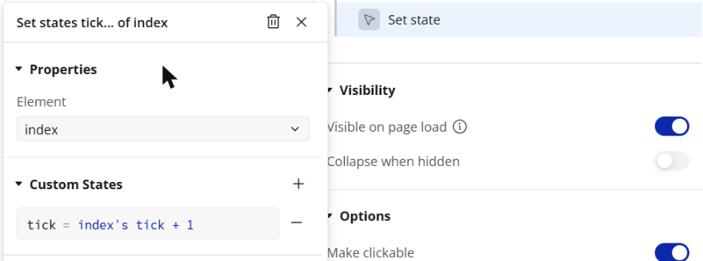

5. **The timer:** **Workflow** (left sidebar) → **+ New** → search `every` → **Do every 5 seconds** →
   **Interval (seconds)** `60` → **+** under the event → the same **Set state** as step 4.

   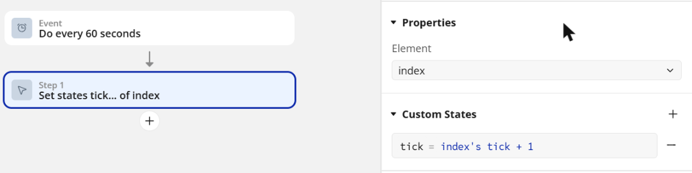

> **Building `index's tick + 1`:** click the value → type `index` → pick **index** → **'s tick** → **+**
> → type `1` → press **Enter**, then click a heading in the panel to close the list. Clicking inside
> the list instead adds a stray operator (e.g. `+ 1 *`) — click it and choose **(Clear selection)**.

> **Reads cost:** every fetch reads each document it returns, and the whole class shares the project's
> allowance. Every 60 seconds on the dashboard is plenty for an admin; elsewhere, use a **Refresh**
> button.

**Try it**
1. **Preview**: note *Last reading*, wait 30 seconds, press **Refresh** — the time and values change.
2. **Responsive** (top of the editor) at 1440 and 390 px — the cards rearrange.

**Checkpoint ✅** A fresh, responsive dashboard of the three panels.

---

## Topic 7 — The device page: summary, readings and chart

**Goal:** click a card → the panel's health summary, its last 20 readings and a chart. Two features,
one prompt each — check the first before the second.

### 7.1 — The panel and its summary

**Prompt 4 — Panel header and summary** (Agent)
```text
On the page "device", under the title, show one panel. The panel code comes from the page URL
parameter "code" (for example device?code=PNL-01). Do not use a Bubble data type.

Add a group whose type is "Firestore - Get device" and data source is "Get data from an external
API" -> "Firestore - Get device" with code = Get code from page URL. Inside it, from the group's
fields: code and name as the header, a status badge coloured with the Normal, Warning or Critical
colour, the six latest values with units (1 decimal place), and the summary (stringValue) in a
highlighted card titled "Health summary". Add a "Refresh" button next to the header and a
"Back to dashboard" link.

Build the elements only - no workflows, custom states, popups or recurring events.
```
**Why it's written this way**

| Part of the prompt | Why |
|---|---|
| *"the page URL parameter "code" (for example device?code=PNL-01)"* | One page serves all three panels. The example shows the exact address the dashboard will open |
| *"a group whose type is "Firestore - Get device" … code = Get code from page URL"* | One group fetches the panel **once**; everything inside reads it as *Parent group's…* — the pattern from Topic 3 |
| *"the summary (stringValue) in a highlighted card"* | The simulator already writes the summary — Bubble only shows it |
| *"a "Back to dashboard" link"* | A link, not a button — navigation without a workflow |

1. Paste **Prompt 4** into the **Agent**.
2. **Check:**

| ✔ | Must be there |
|---|---|
| ☐ | A group of type **Firestore - Get device**, data source **Get data from an external API → Firestore - Get device**, `code = Get code from page URL` |
| ☐ | Code, name, status badge, six latest values and **`summary stringValue`** shown from that group |

3. **Link the dashboard to this page (by hand):** on the dashboard card → **Go to page → device**, *Send
   more parameters to the page*: `code = Current cell's … fields code stringValue`.
4. **Refresh (by hand):** add the `X-Refresh` header to `Get device` and a `tick` state, as in 6.1 —
   the **Refresh** button sets `tick`. No timer here.

### 7.2 — Readings and the chart

**Prompt 5 — Readings** (Agent)
```text
On the page "device", below the "Health summary" card, add a "Readings" section:
1. An area titled "Temperature trend", 300 px high, with space for a chart I will add.
2. Below it, a repeating group of "Firestore - Readings" with code = Get code from page URL,
   filtered so only items whose document name is not empty are shown. Columns: time_text,
   temperature, humidity, voltage, current, vibration, power. A row's background is light red when
   out_of_limits (booleanValue) is yes.
On a phone, make the table scroll sideways instead of shrinking.

Build the elements only - no workflows, custom states, popups or recurring events.
```
**Why it's written this way**

| Part of the prompt | Why |
|---|---|
| *"only items whose document name is not empty"* | When nothing matches, `:runQuery` returns one empty item with only `readTime` (`firebase-api.md` 4.3). This hides it |
| *"light red when out_of_limits (booleanValue) is yes"* | Uses a field the simulator already works out — Bubble doesn't repeat the rules |
| *"with space for a chart I will add"* | The chart is set up by hand (step 3), so the Agent only keeps the space |
| *"scroll sideways instead of shrinking"* | Seven columns can't fit a 390 px phone; squeezed, they're unreadable |

1. Paste **Prompt 5** into the **Agent**.
2. **Check:**

| ✔ | Must be there |
|---|---|
| ☐ | A repeating group of **Firestore - Readings** (`code = Get code from page URL`), `:filtered` to remove the empty result (`… document name is not empty`), showing `time_text`, the five readings and power; red rows *When* `… out_of_limits booleanValue is yes` |
| ☐ | The **Refresh** button also refreshes the readings: `X-Refresh` header on `Readings` too — no timer: the readings list is the most expensive call |

3. **The chart (by hand):** in *Temperature trend*, a **chart** (the free chart plugin the trainer
   names) of `temperature doubleValue` from the same list, `:sorted by … time_unix doubleValue`
   ascending so time runs left to right.

**Try it**
1. Open `PNL-01` from the dashboard, wait 30 seconds and press **Refresh**: a new row at the top of
   the table, and the latest values change.
2. Now and then a panel has a random **event** (or the trainer sends one): its status turns
   **Warning** or **Critical**, its row turns red and the summary says what to do — on everyone's
   screen.

**Checkpoint ✅** The device page shows the summary, the last 20 readings and a chart, for whichever
panel you open.

---

## End of Day 1 — what you should have
- A practice app `practice-bubble-<yourname>` built by hand: data type, workflow, list, conditional,
  responsive row, and an **API Connector** call to a weather API.
- `panelwatch-admin-<yourname>`, built in stages — base layout by Bubble AI, style and each feature
  by the Agent, every workflow by hand — with a **Firestore** API (3 calls) and two pages: a
  responsive **dashboard** and a **device page** (summary, readings, chart).

**Security recap**
- The Firebase project has **no sign-in**: anyone with the project ID can call it. Its rules allow
  only what the course does (`firebase-api.md` 4.4), it holds only simulated data, and we never put
  real names, phone numbers or company data in it.

**Extra, if you finish early**
- Ask the Agent for a **limits** card on the device page — the six `max_…`/`min_…` values, read-only.
- Add a **power** chart under the temperature chart.

**Tomorrow (Day 2):** the supervisors' mobile app in FlutterFlow — designed mostly with AI, on the same
Firebase data, and live without any refresh button.
