# Day 2 — FlutterFlow: the PanelWatch Mobile App

> **Understand it by hand, then let the AI design it:** this morning you learn FlutterFlow's building
> blocks in a small practice app. Then FlutterFlow's built-in AI designs most of the PanelWatch mobile
> app — its screens and components — and you connect it to the Firebase data over its REST API,
> the same three calls as Bubble.
> **Carry-over:** yesterday's Bubble admin (`panelwatch-admin-<yourname>`) — keep its dashboard open next
> to the phone: both show the same panels. The Firebase project ID: `panelwatch-class`.

**Today's app:** supervisors on the factory floor see the three panels' status and latest readings,
and each panel's summary and chart — fresh each time a page opens. It's the **client** of
yesterday's admin: when the admin disables a panel, the phone hides that panel's readings.

**Your FlutterFlow plan: Basic**

| What Basic gives you | How we use it today |
|---|---|
| **50 AI generations a month** | About 4–6 today: the card, 2 pages (with their components), a chart section if needed, capstone extras |
| **APK download** | Install your own app on an Android phone (Topic 8) |
| **Web publishing** | iPhone users run the app as a web app from the home screen |

> **AI rule for this course:** only FlutterFlow's own AI — **Generate with Designer** for screens and
> components. FlutterFlow's top-bar *AI Agent* runs on your own Claude
> or Codex account — that's outside AI, so we don't use it (Topic 3.4).

**How much of PanelWatch Mobile the AI builds:** every screen, every component and the chart section —
about half the build. You do the parts AI can't do well: the API calls and the data
bindings. The app only **reads** — it never writes to the database.

## Before you start
- [ ] You can sign in to **flutterflow.io** on the **Basic** plan.
- [ ] Your Bubble admin from Day 1 opens in a browser tab.
- [ ] Your phone is on the internet. **Android users:** you're allowed to install an app from a file
      (some company phones block it — then use the web app route).

---

# Part A — FlutterFlow basics (practice app, by hand)

## Topic 1 — Getting around FlutterFlow (UI tour)

**Goal:** know where everything is — the dashboard, the editor's five areas and the buttons you'll
use all day — before you build anything.

### 1.1 — The dashboard
After you sign in you land on **Projects**: one card per app. **+ New Project** (top right) starts a
new one; click a card to open it; its **⋮** menu duplicates or deletes it.


### 1.2 — Create the practice project
**+ New Project** → type `Practice FF` in **Project name** → **Start Building**. (Not *Generate with
Designer* — this app you build by hand.) The editor opens straight away; there's no Firebase step.


### 1.3 — The editor's five areas


| # | Area | What it's for |
|---|---|---|
| 1 | **Left rail** | Switches what area 2 shows. *Build* icons at the top, *Connect* icons below, ⚙ **Settings** at the bottom |
| 2 | **Panel** | Whatever the rail shows — e.g. the **widget palette** (drag widgets from here), the **Widget Tree** or **API Calls** |
| 3 | **Canvas** | The phone screen you're designing. Click a widget to select it. The bar above it changes the zoom and the device (e.g. *iPhone 18 Pro*) |
| 4 | **Properties panel** | Settings of whatever is selected — page, widget or component |
| 5 | **Top bar** | Project name and save status, undo, issues, code, **Test** |

### 1.4 — The left rail
The icons have no labels — **click one** and its name appears. The ones this course uses:

| Icon (top to bottom) | Name | Used for |
|---|---|---|
| 1st under *Build* | **Widget palette** | Dragging in Text, Column, Row, Container, Button… |
| 2nd | **Page Selector** | Your pages and components; **+** adds a page (including *Generate with Designer*) |
| 3rd | **Widget Tree** | What is inside what. ⚠ next to a widget marks a problem. The safest place to select a widget |
| 4th | **Storyboard** | All pages and how they link — a map, nothing to edit (Topic 3) |
| 1st under *Connect* | **Firestore** | Not used — PanelWatch is read over its API |
| — | **Data Types**, **App Values** | Not used today |
| — | **API Calls** (three linked circles) | Calls to other systems — the weather API, then PanelWatch |
| — | **Tests** | Test Pilot (AI-run tests) — not used today |
| — | **Agents** | AI chat *inside* your app, for its users — not used (Topic 3) |
| last | ⚙ **Settings and Integrations** | App details, start page, platforms, web publishing |

### 1.5 — The properties panel
A row of tabs at the top. Which tabs appear depends on what is selected:

| Tab | What it holds |
|---|---|
| **Properties** | Text, size, colour, padding, **Expansion**… |
| **Actions** | What happens on tap — navigate, refresh, update state |
| **Backend Query** | Where the widget's data comes from — e.g. an API call |
| **Generate Dynamic Children** | Columns, Rows and lists only: repeat the first child once per item of a list |
| **Animations** | Movement on load or on tap — not used today |
| **State Management** | Pages only: the page's own variables (*page state*) |

> **Tip:** the small icon next to a property's name (e.g. next to **Text**) means *set from a
> variable* — that's how you put live data into a widget.

### 1.6 — The top bar

| Button | What it does |
|---|---|
| **Synced / Saved** (next to the project name) | FlutterFlow saves by itself. There's no Save button for pages |
| ↶ ↷ | Undo / redo |
| 🔍 | Search the whole project |
| 🧠 **AI Agent** | A coding agent on your own Claude or Codex — outside AI, **not used** (Topic 3) |
| ✓ with a number, ✓ with a bug | **Project Suggestions** and **Issues** — errors and warnings. Check here when something doesn't work |
| Branch icon | **Version Control** — not used today |
| `</>` | **Developer Menu** — view the code (Topic 3), **Download APK** (Topic 8) |
| ↗ | **Share Project** |
| 👁 | **Preview App** — quick look, no data |
| **⚡ ▾** | **Test** (run the app in the browser with real data) and **Run** |

**Try it** — in `Practice FF`: drag a **Text** onto the page; find it in the **Widget Tree**; change
its text in **Properties**; undo it with ↶; then **⚡ ▾ → Test**, wait for the app to start, and **End
Session**.

**Checkpoint ✅** You can name the five areas and find the Widget Tree, API Calls, Settings and Test.

---

## Topic 2 — Malaysia Weather: layout, styling and pages (practice app)

**Goal:** build a small app by hand — a **menu** of three cities, and a **page per city** with its
photo, its name as the title and two cards: the live temperature and humidity. Along the way you meet every building block
the AI uses later: layout, styling, an API call, data on screen and navigation.


> **How to follow this topic:** work in `Practice FF`. **One line = one click or one thing to type.**
> Lost? Open the **Widget Tree** (left rail, 3rd icon) — it shows everything you've built so far.
>
> **Adding a widget inside another one:** in the **Widget Tree**, point at the parent's row (e.g.
> *Column*) → click the **+** that appears on it → type the widget's name → click it. It goes exactly
> where you mean — easier than dragging.
>
> 

### 2.1 — The theme colour (1 minute)
1. Left rail → click the **palette** icon (*Theme Settings*, second from the bottom).
2. Click **Colors**.
3. Click the **Primary** colour box.
4. In **Choose a Color**, click the colour code box (next to **RGB**).
5. Delete what's there and type `010066` (the blue of the Malaysian flag).
6. Click **✕**. The **Primary** box turns dark blue — so will every app bar.


### 2.2 — The weather API call
**Create it**
1. Left rail → click **API Calls** (three linked circles).
2. Click **+ Add** → **Create API Call**.
3. **API Call Name** → type `getWeather`.
4. **Method Type** → leave **GET**.
5. **API URL** → paste:

   ```text
   https://api.open-meteo.com/v1/forecast?latitude=[lat]&longitude=[lon]&current=temperature_2m,relative_humidity_2m
   ```
6. Click the **Variables** tab (below the URL).
7. Click **+ Add Variable** → **Name** `lat` → leave **Type** *String* → **Default Value** `3.14`.
8. Click **+ Add Variable** → **Name** `lon` → **Default Value** `101.69`.
9. Click **Add Call**.

   `[lat]` in the URL is filled from the variable `lat`. The defaults are Kuala Lumpur, used when you
   test.

   ![The URL with [lat] and [lon], and the two variables](images/day2/2-call-variables.png)

**Test it and pick the temperature and humidity**

10. Click the **Response & Test** tab (top).
11. Click **Test API Call** → you see **Status: 200** and the Kuala Lumpur weather.

    
12. Scroll down to **JSON Paths** → click **Recommended** to open it.
13. On the row `$.current.temperature_2m` → click **+ Add JSON Path**.
14. Under **Selected**, click that row's **Name** box → type `temperature`.
15. Look at its **Type**. If it says *Integer* → click it → **Double** → **Update**.
16. Back in **Recommended**, scroll the list to the bottom → on the row
    `$.current.relative_humidity_2m` → click **+ Add JSON Path**.
17. Under **Selected**, its **Name** box → type `humidity`. Leave **Type** on *Integer* (humidity is a
    whole number, e.g. `90`).
18. Scroll to the very bottom → click **Save**. *Skip this and the JSON paths are lost.*

    

### 2.3 — The first city page: Kuala Lumpur
You need this table now and in 2.4:

| City | Page name | Photo **Path** | `lat` | `lon` |
|---|---|---|---|---|
| Kuala Lumpur | `KualaLumpur` | `https://upload.wikimedia.org/wikipedia/commons/thumb/1/1a/Bukit_Bintang_junction_in_2024_2.jpg/500px-Bukit_Bintang_junction_in_2024_2.jpg` | `3.14` | `101.69` |
| Johor Bahru | `JohorBahru` | `https://upload.wikimedia.org/wikipedia/commons/thumb/7/7e/Sultan_Abu_Bakar_State_Mosque.jpg/500px-Sultan_Abu_Bakar_State_Mosque.jpg` | `1.46` | `103.76` |
| Kangar | `Kangar` | `https://upload.wikimedia.org/wikipedia/commons/thumb/2/24/Perlis_State_Mosque.jpg/500px-Perlis_State_Mosque.jpg` | `6.44` | `100.20` |

*Photos: Wikimedia Commons. Keep the `500px-` size — other sizes are refused.*

**A. The page**
1. Left rail → click **Page Selector** (2nd icon).
2. Click **+** → **Add Page** → **Create Blank Page**.
3. Type `KualaLumpur` → click **Create Page**.

   > **HomePage** is the page the app opens on — it becomes the menu (you start it in step 10).
   > **Folders don't matter:** the new page appears **below** the *pages* folder, not
   > inside it. Leave it there — dragging it into *pages* is only tidying and changes nothing in the
   > app. Ignore *Flutter*, *Android* and *iOS* below it.

**B. The title and the back arrow**

4. Left rail → click **Widget Tree** (3rd icon).
5. Under **AppBar**, click **Text**.
6. Properties panel → **Text** box → type `Kuala Lumpur`.
7. In the Widget Tree, click **AppBar**.
8. Turn on **Show Default Button**.
9. Click **Default Button Color** → choose **Secondary Background** (white, so it shows on the blue).

   

**C. A way in from HomePage**

The app always opens on **HomePage**. Give it a link to Kuala Lumpur now, so you can test as you build.

10. **Page Selector** → click **HomePage**.
11. Widget Tree → **AppBar** → **Text** → type `Malaysia Weather`.
12. **+** on the page's **Column** → **Text** → **Text** box → replace *Hello World* with
    `Choose a city` → **Theme Text Style** → **Title Large**.

    *It sits top-left for now — that's fine. The Column is only as wide as its widest child, and
    right now that's this Text. In step 13 the ListTile stretches the Column to full width, and the
    Text moves to the middle by itself (a Column centres its children across by default).*
13. **+** on the page's **Column** → type `ListTile` → click **ListTile**. *Choose a city* jumps to
    the middle.
14. **Search properties…** → type `title` → **Title** `Kuala Lumpur` → **Subtitle** `Federal Territory`.
    *Don't press Enter in these boxes — it adds a blank second line and the row grows taller. Click
    anywhere else to finish.*
15. Properties panel → click the **Actions** tab (2nd icon at the top).
16. Click **+ Add Action** → **Navigate To** → **Select Page** → **KualaLumpur**.

    

**Test 1 ✅ — the page opens**

17. Top right → **⚡ ▾** → **Test**. A new tab builds the app (about a minute).
18. Tap **Kuala Lumpur** → an empty page with a blue bar, **Kuala Lumpur** and **←**. Tap **←** →
    back on the menu.
19. **Leave this Test tab open** and go back to the FlutterFlow tab.

> **Testing again later:** in the Test tab, top right:
> - **⚡ Hot Reload** — shows your latest changes and stays on the page you're on.
> - **↻ Hot Restart** — starts the app again from HomePage. Use it if Hot Reload shows nothing new.
>
> If you only ever see the menu, it's because the app *always starts on HomePage* — tap
> **Kuala Lumpur** to get to your page.

**D. The photo**

20. **Page Selector** → click **KualaLumpur**.
21. Widget Tree → **+** on the page's **Column** → type `Image` → click **Image**.
22. **Width** → click the **∞** inside the box (it fills the width).
23. **Height** → type `220`.
24. **Border Radius** → type `16`.
25. **Search properties…** (top of the panel) → type `Path` → paste the Kuala Lumpur photo address.

    

**Test 2 ✅ — the photo**

26. Test tab → **⚡ Hot Reload** → on the Kuala Lumpur page the photo shows, rounded, full width.

**E. The card**

27. Widget Tree → **+** on the page's **Column** → **Container**.
28. **Width** → click **∞**.
29. **Height** → delete the number so the box is empty (the card grows with its content).
30. **Border Radius** → `16`.
31. **Elevation** → `3`.
32. **Padding** → `16`. This is the margin *around* the card.
33. Widget Tree → **+** on the **Container** → **Column**.
34. With that new **Column** selected → **Padding** → click the square icon (*Uniform Padding*) →
    type `16`. This is the space *inside* the card, so the text doesn't touch its edges.
35. **+** on that **Column** → **Text**.
36. **+** on the same **Column** → **Text** again. You now have two Texts in the card.

**F. The data**

37. Widget Tree → click the **top Column** (the one directly under *KualaLumpur*).
38. Properties panel → click the **Backend Query** tab (3rd icon at the top).
39. Click **Add Query**.
40. **Query Type** → **API Call**.
41. **Group or Call Name** → **getWeather**.
42. Click **+ Set Additional Variable** → **Parameter Name** → `lat` → **Value** → type `3.14`.
43. Click **+ Set Additional Variable** → **Parameter Name** → `lon` → **Value** → type `101.69`.
44. Click **Confirm**.

    

**G. The temperature on screen**

45. Widget Tree → click the **first Text** in the card → **Text** box → type `Temperature now`.
46. Click the **second Text**.
47. Click the small icon next to **Text** (*set from variable*) → **Combine Text**.

    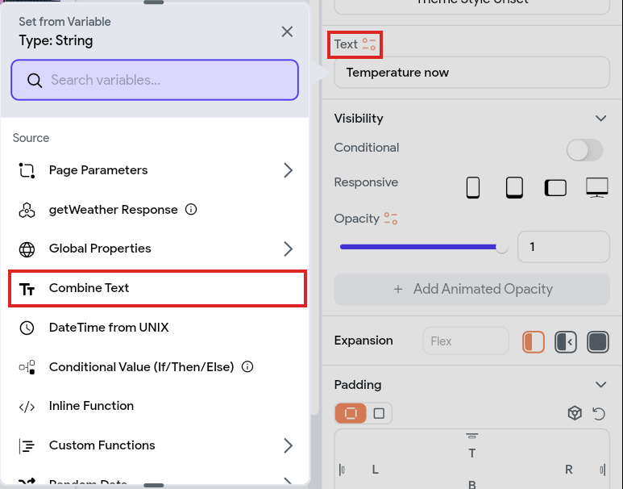
48. **Text 1** → click its small icon → **getWeather Response**.
49. **Available Options** → **Predefined Path**.
50. **Predefined Path Name** → **temperature** → leave the next **Available Options** on *No Further
    Changes* → **Default Variable Value** → type `0` → **Confirm**.

    *Without a default you get "A default value is required" and **Confirm** won't work. The `0`
    only shows if the weather call fails.*
51. The **getWeather Response** panel closes. You are back on the **Combine Text** panel: it shows
    **Text 1** = *getWeather Response*, and an **Add Text** button under it.
52. Click **Add Text** → a **Text 2** box appears under Text 1.
53. Click inside the **Text 2** box → type ` °C` (a space, then °C).
54. Click **Confirm**. Text 1 and Text 2 are glued into one line: `27.5 °C`. On the canvas it reads
    `[1] °C` until you run the app.

    

**Test 3 ✅ — the live temperature**

55. Test tab → **⚡ Hot Reload** → **←** back to the menu → tap **Kuala Lumpur** → a spinner for a
    second (the weather is loading), then the card shows *Temperature now* and a number like `27.5 °C`.
    - Shows `0 °C`? The weather call failed — recheck the URL in 2.2 and `lat`/`lon` in step 42–43.

**H. Style it**

56. Back in FlutterFlow → click the **second Text** in the card → **Theme Text Style** →
    **Display Medium**.
57. **Text Color** → **Primary**.
58. Widget Tree → click the **top Column** → **Padding** `16` → **Items Spacing** `16`.

    

**I. A second card: humidity**

Copy the finished card, then point the copy at humidity. Its style comes with it.

59. Widget Tree → right-click the card's **Container** → **Duplicate**. A second card appears under
    the first — same style, still showing the temperature.
60. In the **new** card → click the **first Text** → **Text** box → type `Humidity now`.
61. Click the new card's **second Text** → click the orange **Text Combination** in the **Text** box →
    the **Combine Text** panel opens.
62. **Text 1** → click its pencil ✎ → **Predefined Path Name** → **humidity** → **Confirm**. *(Asked
    for a default? Type `0`.)*
63. **Text 2** → change ` °C` to ` %` (a space, then %).
64. Click **Confirm**.

**Test 4 ✅ — the finished page**

65. Test tab → **⚡ Hot Reload** → on the Kuala Lumpur page: two cards, spaced apart — the
    temperature (e.g. `27.5 °C`) and the humidity (e.g. `90 %`), both big and blue.

### 2.4 — Two more pages, by copying
1. With `KualaLumpur` open → click the **copy icon** next to the page name (top of the properties
   panel) → *Page duplicated successfully*. Everything is copied: photo, both cards, query, styling.
2. Widget Tree → click the page's **top line** (the page name). *Right after copying, the name box
   ignores typing until you do this.*
3. Properties panel → page name box → type `JohorBahru`.
4. Widget Tree → **AppBar** → **Text** → type `Johor Bahru`.
5. Widget Tree → **Image** → **Path** → paste the Johor Bahru address.
6. Widget Tree → **top Column** → **Backend Query** tab → **Edit**.
7. `lat` **Value** → `1.46`. `lon` **Value** → `103.76`. → **Confirm**.

   
8. Open `KualaLumpur` again and repeat steps 1–7 for **Kangar** (`Kangar`, `6.44`, `100.20`).

   

### 2.5 — The rest of the menu
`HomePage` already has the Kuala Lumpur row (2.3 C). Add the other two the same way.
1. **Page Selector** → click **HomePage**.
2. **+** on the page's **Column** → type `ListTile` → click **ListTile**.
3. **Search properties…** → type `title` → **Title** `Johor Bahru` → **Subtitle** `Johor`.
4. **Actions** tab → **+ Add Action** → **Navigate To** → **Select Page** → **JohorBahru**.
5. Repeat steps 2–4 for `Kangar` / `Perlis` → **Kangar**.

   

### 2.6 — Run it
1. Test tab still open → **↻ Hot Restart** (a clean start after adding pages). Closed → top right
   **⚡ ▾** → **Test** (about a minute).
2. Tap **Kuala Lumpur** → its photo, name, live temperature and humidity. Tap **←** to go back.
3. Do the same for **Johor Bahru** and **Kangar** — each shows its own weather.
4. Click **End Session** when done.


**Try it** — change the theme's **Primary** colour again: every app bar and every temperature change
together. That's why styles live in the theme.

### 2.7 — What you just used
**Flutter layout, in three rules:** a parent tells its children how much space they may use;
children choose their size within that; the parent decides where they go.

| You used | Where | What it does |
|---|---|---|
| **Column** / **Row** | Page, card | Stack children vertically / side by side. *Items Spacing* = gap between them |
| **Container** | The card | A box: padding, colour, rounded corners, shadow (*Elevation*) |
| **Image** | The photo | A picture from a web address (*Network*) |
| **ListTile** | The menu | A ready-made row: title, subtitle and an arrow |
| **∞ Width** | Photo, card | Fill the space the parent gives. (*Expanded* does the same inside a Row) |
| **Theme colour / Theme Text Style** | Primary, Display Medium | Set once, used everywhere |
| **Backend Query** | Page Column | Where the data comes from — the API call |
| **Combine Text** | Temperature | Live data + fixed text (` °C`) |

**Checkpoint ✅** By hand: a theme, a layout of Image, Container and Text, an API call with variables,
data on screen, three pages and a menu that navigates between them.

---

## Topic 3 — FlutterFlow's other tools (look, don't build)

**Goal:** know what FlutterFlow offers beyond designing screens: a map of your app, the Flutter code
it writes, how to bring in code you already have, and its two AI agents.

> **How to follow this topic:** open `Practice FF` and look along with the trainer. Nothing here
> changes your app, and nothing is used again today except **Download APK** (Topic 8).

### 3.1 — Storyboard: the map of your app
1. Left rail → **Storyboard** (4th icon under *Build*).
2. You see **HomePage** with three arrows → **JohorBahru**, **Kangar**, **KualaLumpur**. Each arrow is
   a **Navigate To** action — the ones you added on the ListTiles.
3. Click a page → the arrows into and out of it turn blue. Double-click a page → it opens in the editor.

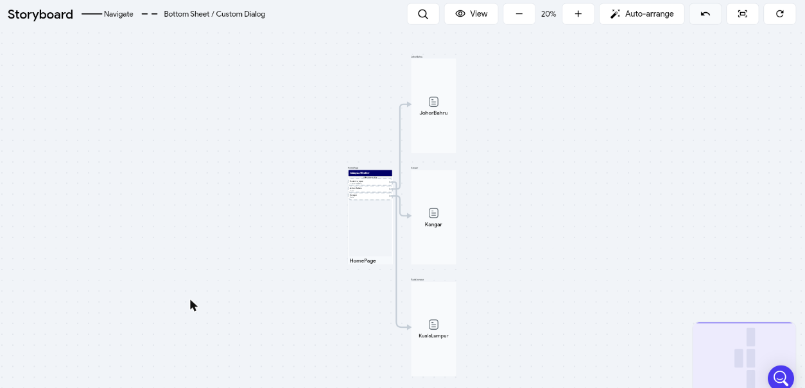

- **Use it for:** checking nothing is a dead end (a page with no way in or out) before you test.
- *"Unable to initialize Storyboard"* → the app has no start page: ⚙ **Settings** → **App Details** →
  **Initial Page**.

### 3.2 — The Flutter code FlutterFlow writes
Every page you build is real Flutter (Dart) code. Top bar → **`</>`** → **Developer Menu**:

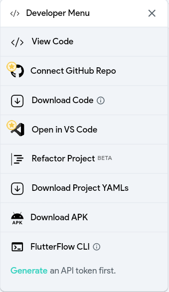

| Item | What it does |
|---|---|
| **View Code** | Opens the code in a new tab — read-only. Pick a page on the left; **Widget** / **Model** switch the file; ⧉ copies it |
| **Download Code** | The whole Flutter project as a `.zip`, to open in VS Code or Android Studio |
| **Connect GitHub Repo** ⭐ | Pushes the code to a GitHub repository. ⭐ = higher plan |
| **Open in VS Code** ⭐ | Edit your custom code (3.3) in VS Code. ⭐ = higher plan |
| **Refactor Project** (Beta) | Not covered |
| **Download Project YAMLs** | The project in FlutterFlow's own format — not Flutter code |
| **Download APK** | The Android app file — Topic 8 |
| **FlutterFlow CLI** | Command-line access — needs an API token (higher plan) |

**Try it** — **View Code** → **KualaLumpur**. Scroll down: find `'Temperature now'` and `getWeather`.
That's your card and your API call, as code. The phone on the right is a live preview.

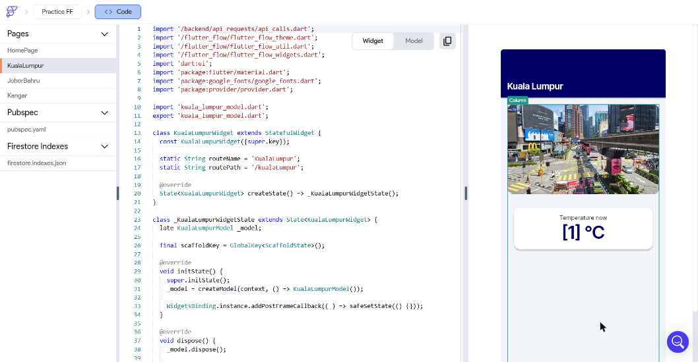

> **The code is one-way.** FlutterFlow → Flutter. If you download the code and change it, FlutterFlow
> doesn't see your changes — the next download overwrites them.

### 3.3 — Bringing in Flutter code you already have
**You can't import a whole existing Flutter app** into FlutterFlow's editor — it only goes the other
way (3.2). What you *can* bring in is code in pieces:

**Page Selector** → the **Custom Code** tab (4th) → **+** → **Add Custom Code** →

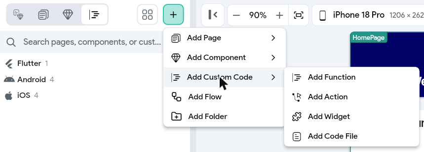

| Type | What you paste in | Example |
|---|---|---|
| **Add Widget** | A Flutter widget class | A gauge you already wrote — it then sits in the widget palette like *Text* or *Image* |
| **Add Action** | Dart code that *does* something | Call a package, save a file — run it from **Actions** like *Navigate To* |
| **Add Function** | A small calculation that returns a value | Turn `27.46` into `27.5 °C` — use it with *set from variable* |
| **Add Code File** | A plain Dart file | Shared helpers or classes for the three above |

- A designer's screens come in from **Figma** instead: **+** → **Add Page** → *from Figma* (the same
  under **Add Component**).
- **Not in this course** — everything today is built in the editor.

### 3.4 — The two AI agents (they're different)
FlutterFlow has two things called "agent". Neither is used today (see the AI rule at the top).

| | Top bar 🧠 **AI Agent** | Left rail 🤖 **Agents** |
|---|---|---|
| **Who it helps** | You, the builder | Your app's users |
| **What it does** | You chat; a coding agent builds and edits your project — pages, widgets, styling, actions | An AI chat you put *inside* your app |
| **PanelWatch example** | *"Add a humidity card to all three city pages"* | A supervisor asks *"Why is PNL-02 out of limits?"* |
| **Runs on** | **Your own Claude or Codex** account, in the **FlutterFlow Windows app** (not the browser) | An AI provider you pick (Google, OpenAI or Anthropic) and its account |
| **Your plan** | Opening it only shows *Download the Windows app* | **1 agent** (*0/1 AI Agents used*) |
| **Today** | Not used — outside AI | Not used — needs a provider account |

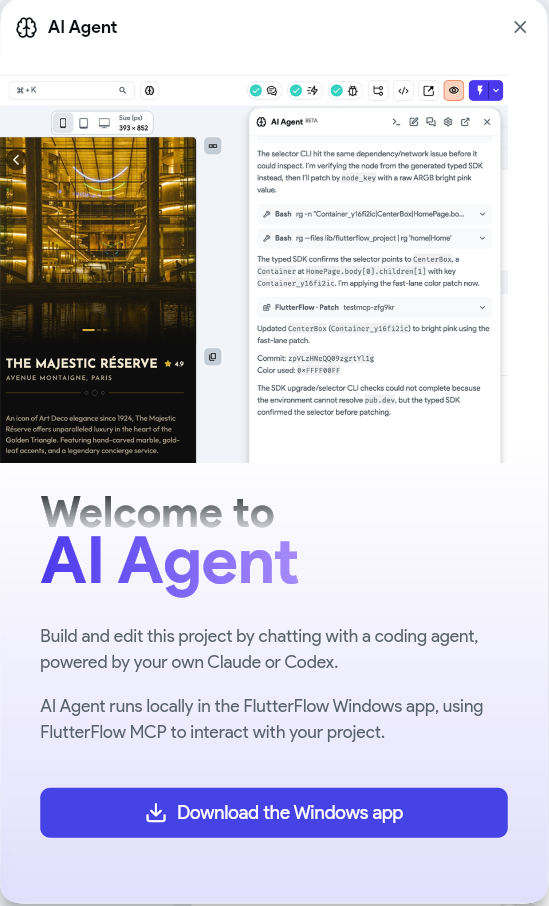

**Checkpoint ✅** You can open the Storyboard and View Code, say why downloaded code doesn't come back,
name the four kinds of custom code, and tell the two agents apart.

---

# Part B — PanelWatch Mobile, built mostly with FlutterFlow AI

## Topic 4 — The three API calls (by hand)

**Goal:** a new project with three of the Firestore calls from yesterday's Bubble admin — the three
that read. FlutterFlow reads PanelWatch the same way Bubble does — over the **REST API**. Nothing to
set up in Firebase.

1. **+ New Project** → `PanelWatch Mobile` → **Start Building**.
2. **API Calls** → **+ Add** → **Create API Call**, three times — the same way as `getWeather` in
   Topic 2.2:

| Call name | Method | API URL | Variables (tab) |
|---|---|---|---|
| `listDevices` | GET | `https://firestore.googleapis.com/v1/projects/panelwatch-class/databases/(default)/documents/devices` | — |
| `getDevice` | GET | `https://firestore.googleapis.com/v1/projects/panelwatch-class/databases/(default)/documents/devices/[code]` | `code`, String, default `PNL-01` |
| `readings` | POST | `https://firestore.googleapis.com/v1/projects/panelwatch-class/databases/(default)/documents:runQuery` | `code`, String, default `PNL-01` |

   **`readings` only — the body.** Add the `code` variable first (**Variables** tab), then:
   1. **Method Type** → **POST**. A **Body** tab appears where *Query Parameters* was.
   2. Click **Body** → leave the dropdown on **JSON** → click into the empty editor → paste the JSON
      below.
   3. Click **Format** (right, above the editor). `<code>` becomes a blue **code** chip — the variable.
      *(No chip? The variable isn't created yet — add it on the **Variables** tab.)*
```json
{ "structuredQuery": {
    "from": [ { "collectionId": "readings" } ],
    "where": { "fieldFilter": { "field": { "fieldPath": "device_code" }, "op": "EQUAL", "value": { "stringValue": "<code>" } } },
    "orderBy": [ { "field": { "fieldPath": "time" }, "direction": "DESCENDING" } ],
    "limit": 20
} }
```


3. **Every call: Advanced Settings → turn off _Use Proxy for Test_ and _Use Proxy for Run/Test
   Mode_.** Then **Add Call** (or **Save**).

> **Why the proxy must be off:** FlutterFlow sends test calls through its own server by default. That
> server can't reach Firestore — the test fails with **404** and *"Not found because of proxy error"*.
> Firestore accepts calls straight from the browser, so the proxy isn't needed.


4. Each call → **Response & Test** → **Test API Call** → **Status: 200**.


5. **JSON Paths** — as in Topic 2.2: after **Test API Call**, scroll to **Recommended** → find the row
   → **+ Add JSON Path** → under **Selected**, type its **Name**. Then **Save** at the bottom, or
   FlutterFlow asks to *discard changes*. `getDevice` needs none yet.

| Call | JSON Path (find it in **Recommended**) | Name | Type it gets | What it is |
|---|---|---|---|---|
| `listDevices` | `$.documents` | `documents` | List < Json > | The list of panels — one card each (Topic 6) |
| `readings` | `$[:].document.fields.temperature.doubleValue` | `temperatures` | List < Double > | The last 20 temperatures — the chart (Topic 7) |
| `readings` | `$[:].document.fields.time_unix.doubleValue` | `times` | List < Integer > | Their times, in milliseconds. *Integer* is right — leave it |

   *Not in the Recommended list?* The **+ Add JSON Path** button under *Selected* adds an empty row
   that holds just `$` → click it → type the rest of the path → type the **Name**. The **Type** fills
   in once the path matches.


| Piece | Meaning |
|---|---|
| `[code]` in the URL / `<code>` in the body | A variable — the panel to fetch |
| `$` | The whole response |
| `$[:]` | Every item of a list (`:runQuery` returns a list) |
| `.document.fields.temperature.doubleValue` | Firestore wraps every value with its type (`firebase-api.md` 4.1) |

**When the test fails**

| You see | Why | Fix |
|---|---|---|
| **404** — *"Not found because of proxy error"* | A proxy switch is still on | Step 3, both switches off → **Save** → test again |
| **`PERMISSION_DENIED`** (readings) | The body lost its `"limit": 20` — searches must be capped (`firebase-api.md` 4.4) | Paste the body again |
| **`FAILED_PRECONDITION`** — *requires an index* | The body sorts or filters on a different field | Paste the body again — only `device_code` + `time` has an index |
| An empty list `[ { "readTime": … } ]` | No panel with that `code` | Test with `PNL-01`, `PNL-02` or `PNL-03` |

**Checkpoint ✅** `listDevices`, `getDevice` and `readings` return real PanelWatch data in FlutterFlow.

---

## Topic 5 — Design the whole app with AI

**Goal:** the panel list, the detail page and the About page, designed with FlutterFlow's AI in one
consistent look, with a nav bar.

> **Checked on the real screen** (22 Oct 2026): all three prompts and every step below, with the
> screenshots.

| Section | What you make | How |
|---|---|---|
| 5.1 | The theme | By hand, 2 minutes |
| 5.2 | `PanelCard`, then the list on `HomePage` | AI (Prompt 1), then by hand |
| 5.3 | `DeviceDetail`, with `ValueTile` and `LimitRow` | AI (Prompt 2) |
| 5.4 | `About` | AI (Prompt 3) |
| 5.5 | The nav bar | By hand |

> **Each generation uses one of your 50 monthly AI generations.** Paste each prompt exactly as
> written — every line is there to make your result match everyone else's.

### 5.1 — Theme first (2 minutes, before any generation)
1. **Theme Settings** (palette icon, left rail) → **Colors** → **Explore Project Colors** →
   **Explore** (top right) → scroll to **Modern Business** → tick it → **Save Changes**.
   **Check:** **Primary** (first box, *Brand Colors*) reads `#105dfb`. The app bar may look the same —
   a new project is often blue already.

   
2. Same page, **Light Mode Theme** box → right half, second row: **Semantic Colors** (*Success,
   Error, Warning, Info*). Click **Info** (white, `#ffffff`) → type `#12151C` in the colour box →
   **Enter** → close.

   

   **Why:** the AI uses the *Info* colour for card titles, and every theme makes Info white. On
   white cards the titles become invisible. One change here fixes every page at once.

### 5.2 — The panel card (Prompt 1) and the list on `HomePage`

**A. Generate the card**

1. Left rail → **Page Selector** (2nd icon).
2. Click **+** (top of the panel) → **Add Component** → **Generate with Designer**.

   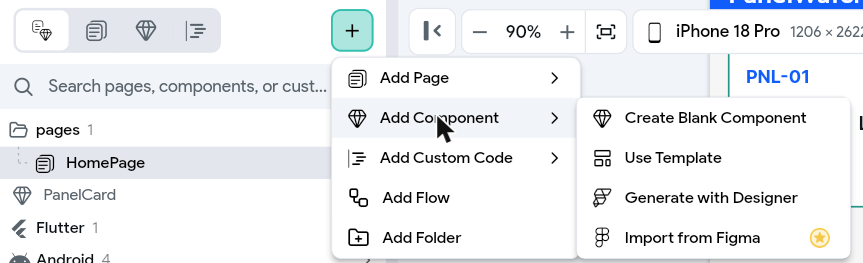
3. Copy **Prompt 1** (below) → click into the **Generate Component** box → paste.

```text
Make ONE component named "PanelCard" for "PanelWatch", a factory app that monitors electrical
panels. Full width.

Colours: project theme only. All text in Primary Text or Secondary Text. The card in Secondary
Background. Never use white text.

Parameters: code, name, status, temperature, voltage, current, power, lastReading (all String)
and enabled (Boolean).

Top to bottom, in a card with 16 padding and 12 corner radius:
1. A row: code in bold Primary colour on the left; status on the right in a small pill with an
   Accent 1 background and Primary Text.
2. name, in Title Medium.
3. A row of 4 equal columns: "Temp" above temperature + " °C", "Voltage" above voltage + " V",
   "Current" above current + " A", "Power" above power + " W".
4. "Last reading " + lastReading, small, in Secondary Text.
5. When enabled is false: hide rows 3 and 4 and show "Disabled by the admin" in Secondary Text.

Do not add: buttons, images or other components.
```

4. Click **Generate** → wait about 30 seconds. The card opens on the canvas, showing `[code]`,
   `[status]` and `[name]`.
5. **Rename it.** The AI names it itself (e.g. *OneNamedPanelcard*). Right-hand panel → the name box
   at the top → select all → type `PanelCard` → **Enter**.

**B. Check the card**

6. **Component Parameters** (top of the right panel) → **9** parameters: 8 **String** and `enabled`
   **Boolean**. Missing one → ✏ → add it.
7. Rows 3 and 4 aren't on the canvas — that's right. They sit behind the `enabled` rule (the
   eye-slash icon in the Widget Tree) and show in Test.
8. Text you can't read (white, or the same colour as its background) → select it → **Search
   properties** `color` → **Text Color** → **Primary Text**.

**C. The panel list on `HomePage` (by hand)**

`HomePage` is already the page the app opens on — it becomes the panel list.

9. **Page Selector** → click **HomePage**.
10. Widget Tree → **AppBar** → **Text** → type `PanelWatch`.
11. Widget Tree → the page's **Column** → **Search properties…** `padding` → click the second small
    square (**Uniform Padding**) → type `16` → **Enter**.
12. **+** on the **Column** → in the box that opens, the **diamond** tab (2nd, *Components*) → click
    **PanelCard**. An empty card appears, full width.
13. With the card selected → right panel, scroll to **Component Parameters** → `code` `PNL-01`,
    `status` `Normal`, `name` `Main Panel Level 1` → tick **enabled**. (Topic 6 replaces them with
    live data.)

    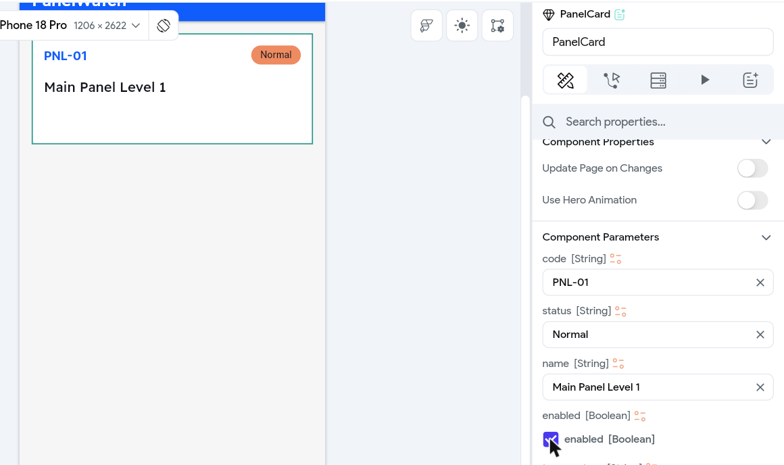

**Test 1 ✅ — the app opens on the list**

14. Top right → **⚡ ▾** → **Test** (about a minute) → `PanelWatch` and the card: code, status, name,
    and the Temp / Voltage / Current / Power row (units only — no numbers yet).

    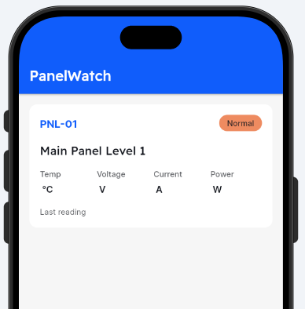
15. **Leave this Test tab open.**

> **Red Errors badge** (top bar): *"Nav bar requires at least two pages"*? The nav bar is switched on
> with only one page. **Settings** (⚙) → **Nav Bar & App Bar** → **Show Nav Bar** off for now. 5.5
> turns it back on with both pages.

**Why Prompt 1 says it**

| Part of the prompt | Why |
|---|---|
| A component, not a page | `HomePage` already opens first — no new page to set as the start page. The AI only designs what repeats |
| *"named "PanelCard""*, *"Parameters: …"* | Everyone gets the same parameters, so Topic 6's binding steps match your project. (The AI ignores the name — step 5 renames it) |
| All parameters **String** | Simple to bind: the API's values go straight in, and the units stay in the card |
| *"Full width"* | The card fills the phone's width in the Column |
| *"a row of 4 equal columns"* | Only four of the six readings fit a phone card. The detail page shows all six |
| *"enabled (Boolean)"* and line 5 | The admin's Enable / Disable from Day 1: a disabled panel stays listed, its readings hidden |
| *"a small pill with an Accent 1 background and Primary Text"* | One colour for every status — the word says Normal, Warning or Critical. Colour per status takes about 30 clicks of nested rules by hand, so we leave it out |
| *"Never use white text"* | In the dry run the AI chose white text on white cards |
| *"Do not add: …"* | Designers add buttons and images by habit. The card needs none |

### 5.3 — The detail page: `DeviceDetail` (Prompt 2)

**A. Generate the page**

1. Left rail → **Page Selector** → **+** → **Add Page** → **Generate with Designer**.
2. Copy **Prompt 2** (below) → click into the **Generate Page** box → paste.

```text
Build ONE mobile page for one electrical panel in the "PanelWatch" app.

Colours: project theme only. All text in Primary Text or Secondary Text. Cards in Secondary
Background. Never use white text.

Make exactly TWO components:
- "ValueTile" with String parameters label, value, unit: label small in Secondary Text on top,
  then value in bold Title Large with unit beside it in small text. A card, 12 padding, 12 radius.
- "LimitRow" with String parameters label, value: label on the left, value in bold on the right.

Page, scrolling, top to bottom, 16 padding, 12 between sections:
1. App bar: a back arrow and the title "PNL-01".
2. Header card: "Main Panel Level 1" in Title Medium, "Factory A, Shah Alam" in Secondary Text,
   and "Normal" in a small pill with an Accent 1 background and Primary Text on the right.
3. The text "This panel is disabled by the admin." in Secondary Text.
4. ONE Column that holds everything below, 12 between its children:
   a. A card titled "Health summary" with the text "Status: Normal. Power now 1856 W. No action
      needed."
   b. Six ValueTiles, two per row: Temperature 31.2 °C, Humidity 66.0 %, Voltage 231.5 V,
      Current 8.2 A, Vibration 1.9 mm/s, Power 1898 W.
   c. A card titled "Temperature - last 20 readings" with a line chart 220 high, in the Primary
      colour.
   d. A card titled "Limits" with six LimitRows: Max temperature 45 °C, Max humidity 85 %,
      Min voltage 207 V, Max voltage 253 V, Max current 20 A, Max vibration 4.5 mm/s.

Do not add: buttons, edit fields, images, other pages or other components.
```

   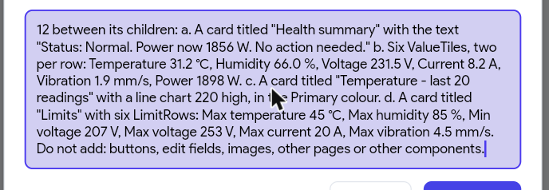
3. Click **Generate** → wait about 30 seconds. The page opens on the canvas with the AI's own name
   (e.g. *OneMobilePage*).

   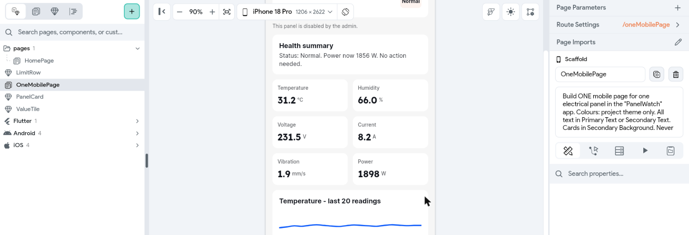
4. **Rename it.** Right-hand panel → the name box under **Scaffold** → select all → type
   `DeviceDetail` → **Enter**. The route changes with it (`/deviceDetail`).

   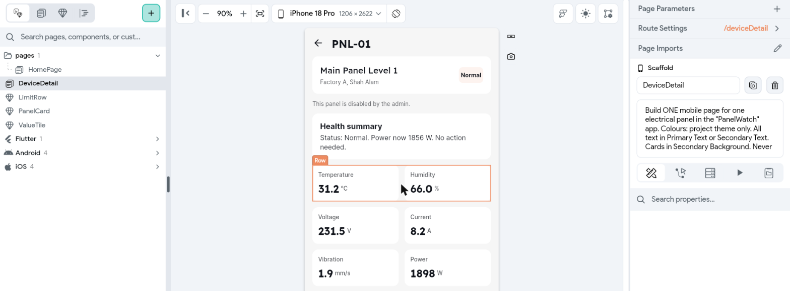

**B. Check the page**

5. **Page Selector** lists `ValueTile` and `LimitRow` — these two keep the names from the prompt.
   Click each → **Component Parameters**: `ValueTile` has `label`, `value`, `unit`; `LimitRow` has
   `label`, `value`.
6. On the canvas: the disabled text under the header; six tiles, two per row; a **Line Chart** in
   the chart card (no chart? Topic 7 adds one with Prompt 4).
7. Red-and-yellow stripes = something overflows a small phone → fix it with the Topic 2.7 rules:
   **Expanded**, or a max width.

**C. A way in: tap the card**

`DeviceDetail` isn't in the nav bar — you reach it by tapping a panel's card.

8. **Page Selector** → **HomePage** → Widget Tree → click **PanelCard**.
9. Properties panel → **Actions** tab (2nd icon at the top) → **+ Add Action**. *On Tap* is already
   chosen → in **Search for action…** type `Navigate` → click **Navigate To > DeviceDetail**.

   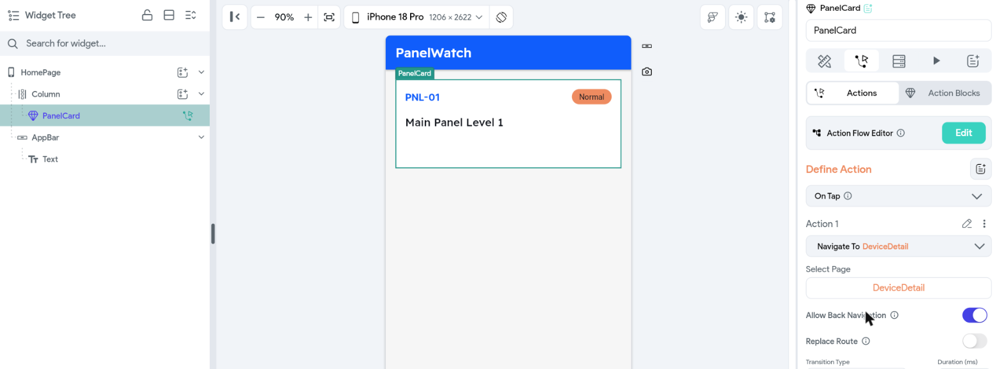

**D. The way back**

The AI draws its own **←** on `DeviceDetail`, with no action — tapping it does nothing. Give it one:

10. **Page Selector** → `DeviceDetail` → Widget Tree → the first **Row** → **Icon**.
11. **Actions** tab → **+ Add Action** → type `Navigate Back` → click **Navigate Back**.

**Test 2 ✅ — card → detail → back**

12. Test tab → **↻ Hot Restart** (circular arrow, top right) → wait until the list is back → tap the
    card → `DeviceDetail` opens with the sample values.

    > **Tap does nothing?** Press **↻ Hot Restart** again. A new page and a new action only work
    > after a restart — Hot Reload isn't enough, and **even a brand-new Test session can start on an
    > older build**. Your action is fine if Widget Tree shows the green action icon next to
    > **PanelCard**.

    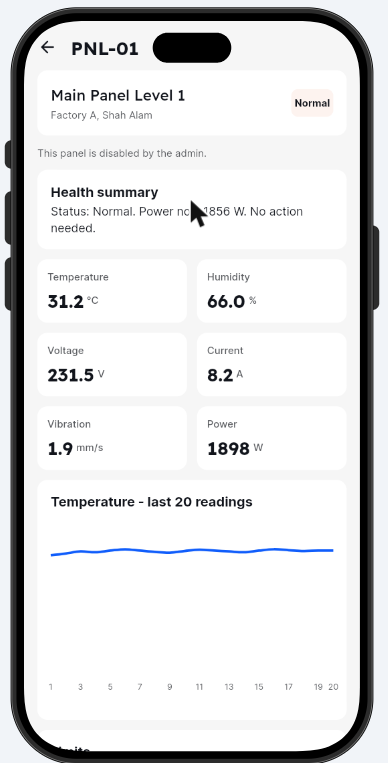
13. Tap **←** → back on the list.

Every card opens the same sample page for now — Topic 7 makes it open *the panel you tapped*.

**Why Prompt 2 says it**

| Part of the prompt | Why |
|---|---|
| *"exactly TWO components"*, each with its parameters | The six tiles and six limit rows are the same shape — one component each, filled six times |
| *"a back arrow and the title "PNL-01""* | The way back to the list, and which panel you're looking at |
| *"last 20 readings … 220 high"* | Matches the readings call (limit 20) in Topic 7, and keeps a fixed space for the chart |
| Limits as *LimitRows*, *"Do not add: buttons, edit fields"* | The phone only shows. Limits are set by the trainer; the admin's only switch is Enable / Disable |
| Line 3, and *"ONE Column that holds everything below"* | Ready for disabled panels (Topic 7): show the text when the panel is disabled, the Column when it's enabled — no wrapping by hand |
| Sample values (*"31.2"*, *"Factory A, Shah Alam"*) | Real-looking values give real sizes. Topic 7 replaces them with live data |

### 5.4 — The About page (Prompt 3)

1. Left rail → **Page Selector** → **+** → **Add Page** → **Generate with Designer**.
2. Copy **Prompt 3** (below) → click into the **Generate Page** box → paste.

```text
Build ONE simple mobile page: "About PanelWatch".

Colours: project theme only. All text in Primary Text or Secondary Text. Never use white text.
Do not create any components.

Page, top to bottom, centred, 24 padding:
1. "PanelWatch" in Headline Medium.
2. "PanelWatch shows live readings from the factory's electrical panels." in Body Large.
3. A card titled "How it works" with four lines of text:
   "1. Panels (simulator) send a reading every 30 seconds"
   "2. Firebase stores them"
   "3. The Bubble admin enables or disables each panel"
   "4. This app shows them on your phone"
4. At the bottom, in small Secondary Text: "Built in the AI-Assisted App Development course".

Do not add: images, icons, diagrams, buttons or other pages.
```

3. Click **Generate** → wait about 30 seconds. The page opens with the AI's own name (e.g.
   *OneSimpleMobilePage*).
4. **Rename it.** Right-hand panel → the name box under **Scaffold** → select all → type `About` →
   **Enter**.

   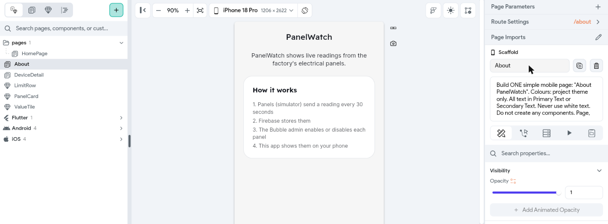
5. **Check:** no new components in Page Selector; all four "How it works" lines are there.

You test About in 5.5, once the nav bar opens it.

**Why Prompt 3 says it**

| Part of the prompt | Why |
|---|---|
| *"four lines of text"* instead of a diagram | In the dry run the AI's diagram came out with empty boxes. Four numbered lines say the same and can't break |
| *"Do not create any components"* | Nothing on this page repeats, so a component only adds things to check |

### 5.5 — The nav bar: Panels and About
1. **Settings** (⚙, bottom of the left rail) → **Nav Bar & App Bar** → **Show Nav Bar** on.
2. **Nav Bar Pages** → **Choose Page** → `HomePage` → **+ Add Page**; again for `About`. Not
   `DeviceDetail` — you reach it by tapping a card.
3. Click **›** on **HomePage** → **Label** `Panels` (the icon is already a house).
4. Click **›** on **About** → **Label** `About` → **Nav Bar Icon** (*None*) → search `info` → pick
   **Info Outline**. The red Errors badge goes.

   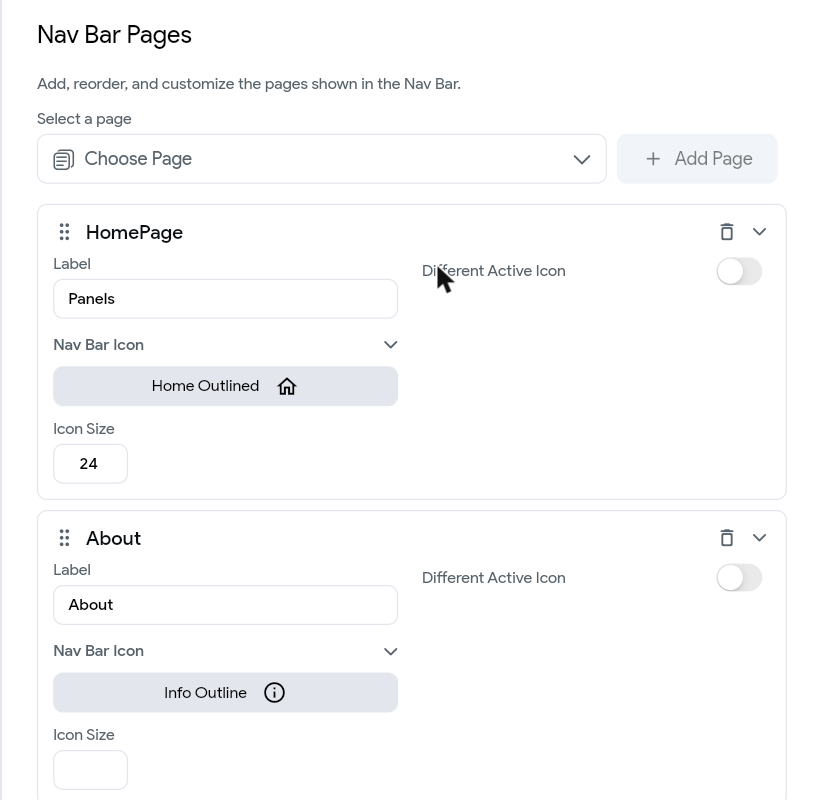

**Test 3 ✅ — the whole app**

5. Test tab → **↻ Hot Restart** (Hot Reload doesn't show a new nav bar). The nav bar appears at the
   bottom. *"Connection Interrupted"? The Test session timed out — **Retry**, then Hot Restart again.*
6. Tap the **ⓘ** → the About page. Tap the **house** → back on the list. Tap the card →
   `DeviceDetail` → **←** → the list.

   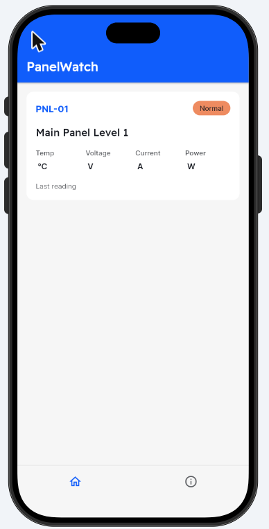 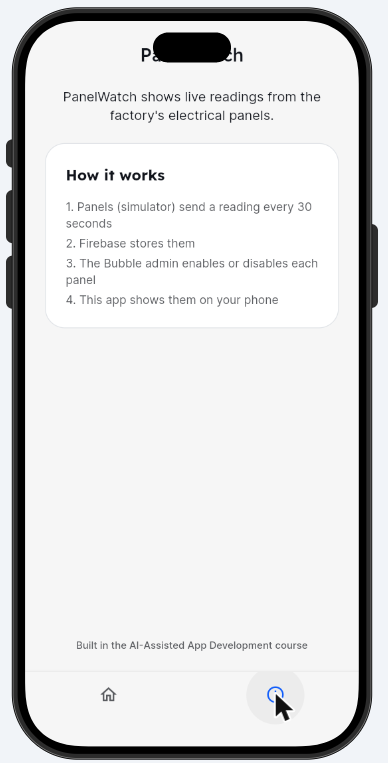

> The labels (*Panels*, *About*) don't show under the icons by default — **Styling** → **Show Labels**
> turns them on if you want them.

**Checkpoint ✅** One theme; `PanelCard`, `ValueTile` and `LimitRow` with their parameters; `HomePage`
lists the card and opens `DeviceDetail`; a nav bar with Panels and About.

---

## Topic 6 — The panel list, from the API

**Goal:** `HomePage` shows the three real panels.

**A. Get the panels**

1. **Page Selector** → **HomePage** → Widget Tree → click the **Column** (it holds the one
   `PanelCard` you added in 5.2).
2. Right panel → the **Backend Query** tab (3rd icon at the top) → **Add Query**.
3. **Query Type** → **API Call** → **Group or Call Name** → `listDevices` → **Confirm**. The panel
   now shows *API Call — listDevices*.

   

**B. One card per panel**

4. Same Column → the **Generate Dynamic Children** tab (4th icon) → **Variable Name** `panel`.
5. **Value** (*UNSET*) → **listDevices Response** → **Predefined Path Name** → `documents` →
   **Confirm**.

   
6. **Save** → **Ok** (*"This widget will now generate its children dynamically…"*). The canvas shows
   the card several times — one bright, the copies faded.

**C. Fill the card**

7. Widget Tree → click **PanelCard** → Properties (1st tab) → scroll to **Component Parameters**.
8. For `code`: the small icon next to **code [String]** → **panel Item** → **Available Options** →
   **JSON Path** → the **JSON Path** box already starts with `$` — type the rest:
   `.fields.code.stringValue` → **Confirm**. The canvas now shows `[code]`.

   
9. The same for the other **8** — in the order the right panel lists them, what you type after the
   `$`:

| # | Parameter | Type after the `$` | Extra |
|---|---|---|---|
| 1 | `status` | `.fields.status.stringValue` | |
| 2 | `name` | `.fields.name.stringValue` | |
| 3 | `enabled` | `.fields.enabled.booleanValue` | **panel Item** is further down this list (it's a yes/no) |
| 4 | `temperature` | `.fields.latest_temperature.doubleValue` | |
| 5 | `voltage` | `.fields.latest_voltage.doubleValue` | |
| 6 | `current` | `.fields.latest_current.doubleValue` | |
| 7 | `power` | `.fields.latest_power.doubleValue` | |
| 8 | `lastReading` | `.fields.last_reading_text.stringValue` | The last one — scroll down to see it |

   **Check:** all 9 parameters now read `$.fields.…` — none says *Unset* or just *panel item*.

   The sample values from 5.2 (`PNL-01`, `Normal`, …) are replaced as you go — that's right.
   Leave the **second** Available Options on **No Further Changes** — the numbers become text on
   their own.

> **A card shows a long `{name: projects/…, fields: …}` text and red-and-yellow stripes?**
>
> 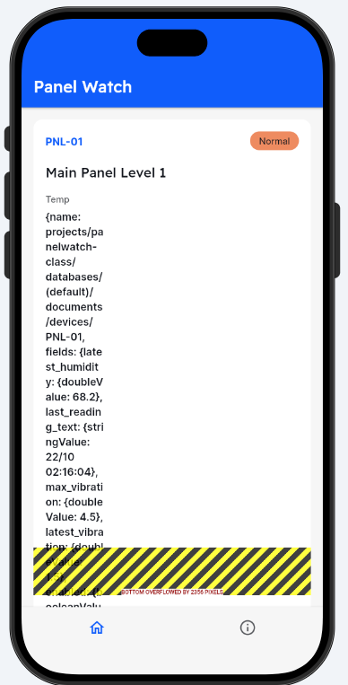
>
> **The card gets the whole panel, not one field.** First check which case you have: Widget Tree →
> **PanelCard** → **Component Parameters** → look at the parameter under the long text (e.g. **power**).
>
> **Case 1 — every parameter reads `$.fields.…`** (the most common). Your bindings are right; Test is
> running an **older build** from before you finished them. Even a brand-new Test session can start
> on one.
> 1. In the Test tab → **↻ Hot Restart** (top right). Not ⚡ Hot Reload.
> 2. Still wrong? **End Session** → **⚡ ▾ → Test** again.
>
> **Case 2 — a parameter reads just `panel item`** (no `$.fields…`). FlutterFlow saves the binding the
> moment you click **panel Item**; you stopped there, or picked *To Data Type* instead of *JSON Path*.
> 1. Click the small icon next to that parameter's name → the popup opens on **panel Item**.
> 2. The **first** Available Options → **JSON Path**.
> 3. The **JSON Path** box (starts with `$`) → type the rest from the table above.
> 4. Leave the **second** Available Options on **No Further Changes** → **Confirm**.
> 5. The parameter now reads `$.fields.…` → in the Test tab → **↻ Hot Restart**.

> **Orange warning** *"Unique Key for component PanelCard is not set"* — ignore it. It doesn't stop the
> app.

**Test ✅ — three real panels**

10. **⚡ ▾ → Test** → when the app opens, press **↻ Hot Restart** once anyway (a new session can start
    on an older build) → three cards: `PNL-01`, `PNL-02`, `PNL-03`, with their names and status. Enabled panels show the four numbers and the last-reading
    time; disabled ones show *Disabled by the admin*.

    

**Fresh data:** the list loads each time the page opens — come back from a panel (**←**), or tap
**About** and then **Panels**, to see new readings. We keep it that way on purpose: an automatic timer is extra
work by hand for little gain in class.

**Checkpoint ✅** `HomePage` shows the three real panels from the API.

---

## Topic 7 — The panel detail page

**Goal:** tap a panel → its own header, summary, six values and a chart of its last 20 temperatures —
or only *disabled by the admin*.

> **Two kinds of popup.** In Topic 6 you picked **panel Item** — its JSON Path box already starts with
> `$`. Here you pick **getDevice Response** — **JSON Path** is already chosen and the box is
> **empty**: type the **whole** path, `$` included.

**A. Which panel? — pass its code**

1. **Page Selector** → `DeviceDetail` → right panel, top → **Page Parameters** → **+** → **Add
   Parameter** → **Parameter Name** `code` → **Type** → **String** → **Default Parameter Value**
   `PNL-01` → **Confirm**.

   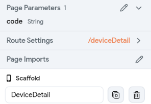
2. **Page Selector** → **HomePage** → Widget Tree → **PanelCard** → **Actions** tab (2nd icon) → the
   **Navigate To DeviceDetail** from 5.3 → **Parameters** → **Pass** → `code*` appears → click it.
3. **Value** → the small icon → **panel Item** → **Available Options** → **JSON Path** → after the
   `$` type `.fields.code.stringValue` → **Confirm**. It must read `$.fields.code.stringValue` — not
   just *panel item* (the Topic 6 trap again).

   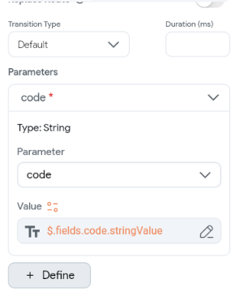

**B. Get that panel — one query for the page**

4. **Page Selector** → `DeviceDetail` → Widget Tree → click **DeviceDetail** (the top line) →
   **Backend Query** tab (3rd icon) → **Add Query** → **Query Type** → **API Call** → **Group or Call
   Name** → `getDevice`.
5. **+ Set Additional Variable** → **Parameter Name** → `code` → **Value** → the small icon → **Page
   Parameters** → `code` → **Confirm**.

   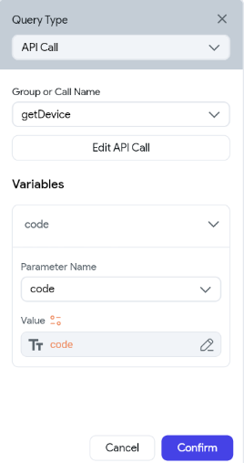

**C. Fill the page**

6. The title Text (**PNL-01**, next to ←) → Properties → **Text** → the small icon → **Page
   Parameters** → `code`.
7. Each Text below → click it on the canvas → **Text** → the small icon → **getDevice Response** → in
   the empty **JSON Path** box type the path → **Confirm**:

| Text on the canvas | JSON Path (type all of it) |
|---|---|
| *Main Panel Level 1* | `$.fields.name.stringValue` |
| *Factory A, Shah Alam* | `$.fields.location.stringValue` |
| *Normal* (the pill) | `$.fields.status.stringValue` |
| *Status: Normal. Power now…* (Health summary) | `$.fields.summary.stringValue` |

8. The six tiles: Widget Tree → each **ValueTile** → scroll to **Component Parameters** → **value** →
   the small icon → **getDevice Response** → the path → **Confirm**. Leave `label` and `unit` as they
   are.

| Tile | JSON Path |
|---|---|
| Temperature | `$.fields.latest_temperature.doubleValue` |
| Humidity | `$.fields.latest_humidity.doubleValue` |
| Voltage | `$.fields.latest_voltage.doubleValue` |
| Current | `$.fields.latest_current.doubleValue` |
| Vibration | `$.fields.latest_vibration.doubleValue` |
| Power | `$.fields.latest_power.doubleValue` |

   The canvas keeps showing sample values (`31.2` on every tile, `[$.fields…]` in the header) —
   that's normal. The real values show in Test.

> **Limits — leave them.** All three panels have the same limits (45 °C, 85 %, 207–253 V, 20 A,
> 4.5 mm/s), and Prompt 2 already typed them. If the trainer ever changes a limit in Bubble, the phone
> won't show it.

**D. The chart — its own query**

9. Widget Tree → the **Container** right above **LineChart** → **Backend Query** → **Add Query** →
   **API Call** → `readings` → **+ Set Additional Variable** → `code` → **Value** → **Page
   Parameters** → `code` → **Confirm**.
10. Click **LineChart** → Properties → **Chart Data** → **[Line] Chart Data 1** → **›** (opens it).
    **Data Source** stays *Numbers Lists*.
    - **X Data** → the small icon → **readings Response** → **Predefined Path Name** → `times` →
      **Confirm**.
    - **Y Data** → the small icon → **readings Response** → `temperatures` → **Confirm**.

    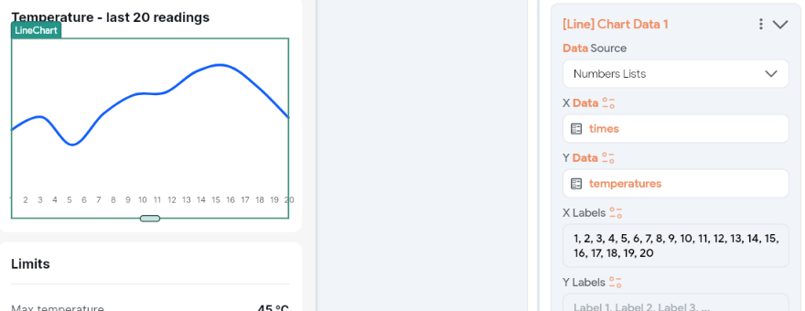
11. **Clear the AI's axis limits.** Scroll down → **Chart Properties** → **Axis Bounds** → empty all
    four boxes (**Min X**, **Min Y**, **Max X**, **Max Y**). The AI set X to 0–19, but `times` are
    milliseconds (about 1 792 000 000 000) — with the limits left in, the chart in Test is **empty**.
12. **X Axis Properties** → **Show Labels** → off. Its labels would be milliseconds.

**E. Disabled panels**

Prompt 2 already made the two parts: the Text *This panel is disabled by the admin.* and **one
Column** under it holding everything else.

13. Widget Tree → that **Column** (right under the Text) → Properties → **Visibility** →
    **Conditional** on → **Unset** → **getDevice Response** → JSON Path
    `$.fields.enabled.booleanValue` → **Confirm**. *Shown when the panel is enabled.*
14. The **Text** above it → the same, plus **Apply Opposite Statement** on → **Confirm**. It now reads
    `! $.fields.enabled.booleanValue` — *shown when the panel is **not** enabled.*

    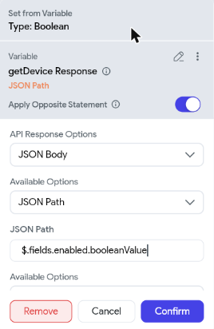

**Test ✅ — the panel you tapped**

15. **⚡ ▾ → Test** → **↻ Hot Restart** → tap an **enabled** panel → its code in the title, its name,
    location, status, summary, six live values and the chart. **←** → the list is fresh (look at
    *Last reading*).

    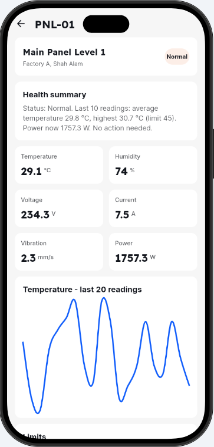
16. Tap the **disabled** panel (*Disabled by the admin* on its card) → only the header and *This panel
    is disabled by the admin.*

    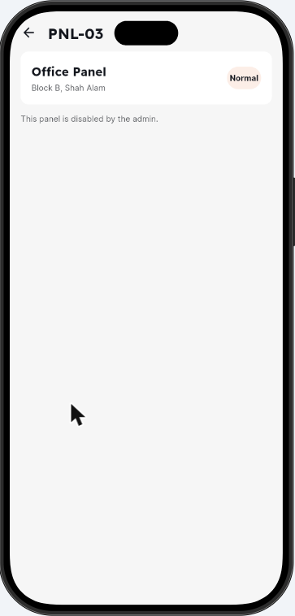

> **Chart empty in Test?** Step 11 — the Axis Bounds still hold the AI's numbers. **Whole page
> empty?** The Navigate action isn't passing `code` (step 3) — or press **↻ Hot Restart** again.

**Prompt 4 — Chart section** (only if Prompt 2 drew no chart)
```text
A card section titled "Temperature - last 20 readings" with a small grey caption "One reading
every 30 seconds", containing a line chart 220 px high with a smooth line in the primary colour, light
horizontal grid lines and no labels on the horizontal axis.
```

| Part of the prompt | Why |
|---|---|
| *"One reading every 30 seconds"* | Tells the user how far apart the points are — the simulator's interval |
| *"220 px high"* | The same space Prompt 2 left for the chart |
| *"no labels on the horizontal axis"* | The X axis is `time_unix` in milliseconds — its labels would be unreadable |
| *"in the primary colour"* | The theme colour, like every other screen |

Then steps 9–12 as above.

**Try it**
1. Open two panels one after the other: different names, values and charts.
2. Go back and open the same panel a minute later: the chart has new points.
3. Disable a panel in Bubble, then open it on the phone: only the header and *This panel is disabled
   by the admin.* Enable it again.
4. **Break it on purpose:** **API Calls** → `readings` → **Body** → change `"time"` in `orderBy` to
   `"humidity"` → **Response & Test** → **Test API Call** → **`FAILED_PRECONDITION`** — the index
   lesson from Day 1. Put it back → **Save**. (Don't create the index yourself — the project is
   shared.)

**Checkpoint ✅** Each panel's page shows its own live header, summary, values and chart — or only
*disabled by the admin*.

---

## Topic 8 — Publish and install PanelWatch

**Goal:** PanelWatch on *your* device — an Android phone, or your iPhone's (or laptop's) home screen
as a web app — ready for the capstone.

| Route | Works on | How |
|---|---|---|
| **Test mode** | Your laptop's browser | **⚡ ▾ → Test** — what you've used all day |
| **APK on an Android phone** | Android | Download the APK → install it on the phone (8.2) |
| **Web app + Add to Home Screen** | **iPhone** (Safari), Android, any laptop | Publish once, open the link, add to home screen (8.3) |
| Native iPhone app (App Store / TestFlight) | iPhone | Needs an Apple Developer account and Apple's review — not in class |
| Android emulator on the laptop | — | Not used: third-party emulators are unreliable on class laptops — use the web app instead |

> **Start the build before the break:** the APK takes a few minutes. Do 8.1, start 8.2, then go for
> coffee.

### 8.1 — Make it look like an app
1. **Icon and splash:** **Settings → App Assets**.
2. **Package name:** **Settings → App Details → Package Name**, e.g. `com.yourname.panelwatch` (lowercase letters only, no spaces).
   Yours must be different from everyone else's — add your name.

### 8.2 — Android: download and install your APK
1. **`</>`** (top bar) → **Download APK**. The build takes a few minutes; you get a `.apk` (Android
   Package) file.
2. Send it to your phone (USB cable, Google Drive, or email to yourself), open it, allow **Install
   unknown apps** when Android asks → **Install**.

> **Company phone blocks it?** Skip the APK and use the web app (8.3) on the same phone.

### 8.3 — iPhone (and anyone without an Android phone): the web app
1. **Settings** (⚙) → **Platforms** → turn on **Web**. The **⚡ ▾** menu now shows your app's web
   address (e.g. `panelwatch-mobile-xxxx.flutterflow.app`) and a **Publish** button (↑).
2. **Publish** (↑ in the **⚡ ▾** menu). In a few minutes the app is live at that address.
   *(Settings → **Web Deployment** is where you change the address.)*

   
3. **iPhone:** open the link in **Safari** → **Share** → **Add to Home Screen**. It opens full screen,
   like an installed app. **Laptop:** open the link in Chrome or Edge → the install icon in the
   address bar (or **⋮ → Cast, save and share → Install page as app**).

> **Nothing installs in time?** Run the capstone from **Test mode** on your laptop, next to the Bubble
> admin — the live flow is the same.

### 8.4 — Before a real store release

| Item | Notes |
|---|---|
| Package / bundle ID | Can't change after the first store release |
| Icon and splash | ✅ today |
| **Security** | No sign-in and open rules are fine for class only — a real app needs sign-in and per-user rules |
| Privacy policy URL | Required by both stores |
| **Android:** Google Play Console account (one-time fee) | FlutterFlow can deploy from the editor |
| **iPhone:** Apple Developer Program (yearly fee) | Apple reviews every release |

**Checkpoint ✅** PanelWatch runs from an icon on your phone (APK or web app) or your laptop — and shows the same panels as your Bubble admin.

---

## Topic 9 — Capstone & presentations

**Your requirement** — show the whole system working live:
1. **Bubble admin** (laptop) and **PanelWatch Mobile** (phone — Android APK or web app)
   open side by side.
2. The trainer sends an event to a panel. Wait 30 seconds, then reload the list on the phone (tap
   **About**, then **Panels**): it shows **Warning** or **Critical**; press **Refresh** in Bubble and
   it shows the same.
3. Open that panel on both: the same summary and the same latest values.
4. **Admin → client:** press **Disable panel** in Bubble, then reload the list on the phone: that
   panel's readings are hidden. **Enable panel** and reload: they're back.
5. **One improvement built with FlutterFlow AI** — e.g. a power chart on `DeviceDetail`
   (**Generate with Designer**), a dark theme, or an "Offline" banner when `last_reading_at` is
   older than a minute.

**Present for 5 minutes:** the live flow, your improvement and the prompt behind it, and one thing the
AI got wrong and how you caught it.

**Your capstone prompt** — use the same shape as the prompts above: **what it is**, **where it goes**,
**what it shows**, and **what not to add**.
```text

```
**What the AI got wrong, and how I caught it:**

**Checkpoint ✅** Firebase → phone and Bubble, the same data, live, and the admin's switch obeyed by
the phone — in front of the class.

---

## End of Day 2 — what you should have
- `Practice FF`, built by hand, running in Test mode.
- `PanelWatch Mobile` reading the course Firebase over its REST API, with:
  - the panel list on `HomePage`, two AI-designed pages (`DeviceDetail`, `About`) and a nav bar;
  - three AI-designed components with parameters;
  - live panels and readings from three API calls; a temperature chart; disabled panels' readings
    hidden;
  - an icon and splash, installed from your own APK or as an iPhone web app.
- Your capstone prompt, and a note of what the AI got wrong.

**Security recap**
- Without sign-in, rules can only limit **what** is read or changed, not **who** does it. Real apps add
  **sign-in** to the security rules — the next step after this course.
- Hiding a disabled panel's readings is the **app's** choice, not a lock: the readings are still in Firebase. With
  sign-in, the rules could refuse them to client users too.
- You never deployed rules or indexes to the shared project.

**Extra, if you finish early**
- Show each panel's `recent_temperatures` (its last 10, already in `listDevices`) as a mini chart on
  each `PanelCard`.
- Add a limits **warning line** on the chart.
