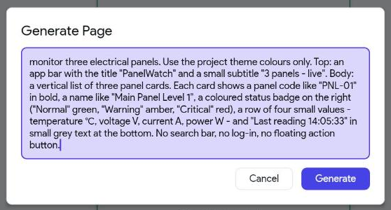
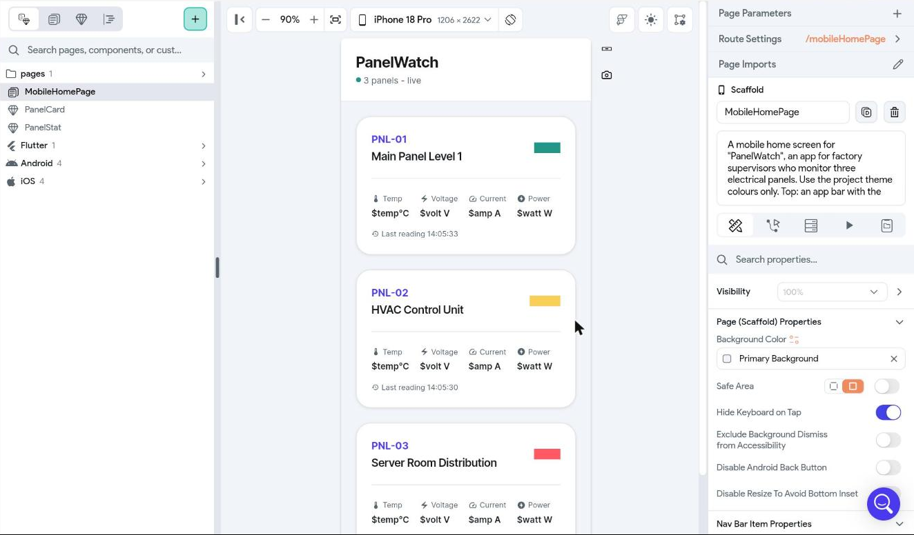
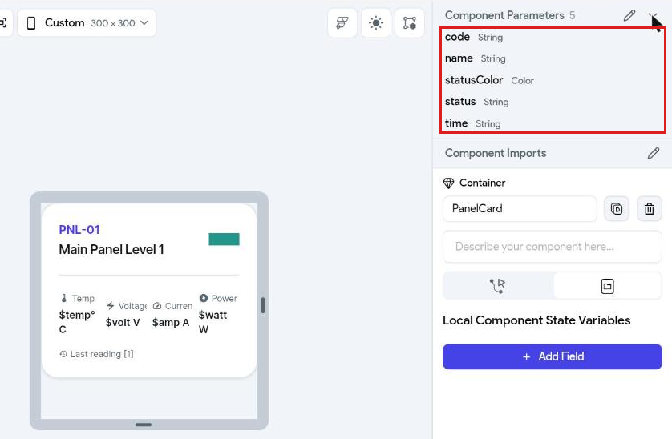

# Day 2 — FlutterFlow: the PanelWatch Mobile App

> **Understand it by hand, then let the AI design it:** this morning you learn FlutterFlow's building
> blocks in a small practice app. Then FlutterFlow's built-in AI designs most of the PanelWatch mobile
> app — screens, components and tests — and you connect it to the Firebase data over its REST API,
> the same three calls as Bubble.
> **Carry-over:** yesterday's Bubble admin (`panelwatch-admin-<yourname>`) — keep its dashboard open next
> to the phone: both show the same panels. The Firebase project ID: `panelwatch-class`.

**Today's app:** supervisors on the factory floor see the three panels' status and latest readings,
and each panel's summary and chart, refreshed every 30 seconds by itself. It's the **client** of
yesterday's admin: when the admin disables a panel, the phone hides that panel's readings.

**Your FlutterFlow plan: Basic**

| What Basic gives you | How we use it today |
|---|---|
| **50 AI generations a month** | About 8–10 today: 3 screens, 3 components, a chart section, capstone extras |
| **APK download** | Install your own app on an Android phone or in an emulator (Topics 3 and 10) |
| **Web publishing** | iPhone users run the app as a web app from the home screen |

> **AI rule for this course:** only FlutterFlow's own AI — **Generate with Designer** for screens and
> components, and **Test Pilot** for tests. FlutterFlow's *AI Agent Panel* runs on your own Claude,
> Codex or Gemini account — that's outside AI, so we don't use it.

**How much of PanelWatch Mobile the AI builds:** every screen, every component, the chart section and
the tests — about 60% of the build. You do the parts AI can't do well: the API calls and the data
bindings. The app only **reads** — it never writes to the database.

## Before you start
- [ ] You can sign in to **flutterflow.io** on the **Basic** plan.
- [ ] Your Bubble admin from Day 1 opens in a browser tab.
- [ ] Your phone is on the internet. **Android users:** you're allowed to install an app from a file
      (some company phones block it — then use the web app route).

---

# Part A — FlutterFlow basics (practice app, by hand)

## Topic 1 — Getting around FlutterFlow (UI tour)

**Goal:** know where everything is — the dashboard, the editor's five areas and the buttons you'll
use all day — before you build anything.

### 1.1 — The dashboard
After you sign in you land on **Projects**: one card per app. **+ New Project** (top right) starts a
new one; click a card to open it; its **⋮** menu duplicates or deletes it.


### 1.2 — Create the practice project
**+ New Project** → type `Practice FF` in **Project name** → **Start Building**. (Not *Generate with
Designer* — this app you build by hand.) The editor opens straight away; there's no Firebase step.


### 1.3 — The editor's five areas


| # | Area | What it's for |
|---|---|---|
| 1 | **Left rail** | Switches what area 2 shows. *Build* icons at the top, *Connect* icons below, ⚙ **Settings** at the bottom |
| 2 | **Panel** | Whatever the rail shows — e.g. the **widget palette** (drag widgets from here), the **Widget Tree** or **API Calls** |
| 3 | **Canvas** | The phone screen you're designing. Click a widget to select it. The bar above it changes the zoom and the device (e.g. *iPhone 18 Pro*) |
| 4 | **Properties panel** | Settings of whatever is selected — page, widget or component |
| 5 | **Top bar** | Project name and save status, undo, issues, code, **Test** |

### 1.4 — The left rail
The icons have no labels — **click one** and its name appears. The ones this course uses:

| Icon (top to bottom) | Name | Used for |
|---|---|---|
| 1st under *Build* | **Widget palette** | Dragging in Text, Column, Row, Container, Button… |
| 2nd | **Page Selector** | Your pages and components; **+** adds a page (including *Generate with Designer*) |
| 3rd | **Widget Tree** | What is inside what. ⚠ next to a widget marks a problem. The safest place to select a widget |
| 4th | **Storyboard** | All pages and how they link — a map, nothing to edit |
| 1st under *Connect* | **Firestore** | Not used — PanelWatch is read over its API |
| — | **Data Types**, **App Values** | Not used today |
| — | **API Calls** (three linked circles) | Calls to other systems — the weather API, then PanelWatch |
| — | **Tests** | Test Pilot (Topic 9) |
| — | **Agents** | Not used — outside AI |
| last | ⚙ **Settings and Integrations** | App details, start page, platforms, web publishing |

### 1.5 — The properties panel
A row of tabs at the top. Which tabs appear depends on what is selected:

| Tab | What it holds |
|---|---|
| **Properties** | Text, size, colour, padding, **Expansion**… |
| **Actions** | What happens on tap — navigate, refresh, update state |
| **Backend Query** | Where the widget's data comes from — e.g. an API call |
| **Generate Dynamic Children** | Columns, Rows and lists only: repeat the first child once per item of a list |
| **Animations** | Movement on load or on tap — not used today |
| **State Management** | Pages only: the page's own variables (*page state*) |

> **Tip:** the small icon next to a property's name (e.g. next to **Text**) means *set from a
> variable* — that's how you put live data into a widget.

### 1.6 — The top bar

| Button | What it does |
|---|---|
| **Synced / Saved** (next to the project name) | FlutterFlow saves by itself. There's no Save button for pages |
| ↶ ↷ | Undo / redo |
| 🔍 | Search the whole project |
| 🧠 **AI Agent** | Outside AI — **not used** in this course |
| ✓ with a number, ✓ with a bug | **Project Suggestions** and **Issues** — errors and warnings. Check here when something doesn't work |
| Branch icon | **Version Control** — not used today |
| `</>` | **Developer Menu** — view the code, **Download APK** (Topic 3) |
| ↗ | **Share Project** |
| 👁 | **Preview App** — quick look, no data |
| **⚡ ▾** | **Test** (run the app in the browser with real data) and **Run** |

**Try it** — in `Practice FF`: drag a **Text** onto the page; find it in the **Widget Tree**; change
its text in **Properties**; undo it with ↶; then **⚡ ▾ → Test**, wait for the app to start, and **End
Session**.

**Checkpoint ✅** You can name the five areas and find the Widget Tree, API Calls, Settings and Test.

---

## Topic 2 — Malaysia Weather: layout, styling and pages (practice app)

**Goal:** build a small app by hand — a **menu** of three cities, and a **page per city** with its
photo, its name as the title and the live temperature. Along the way you meet every building block
the AI uses later: layout, styling, an API call, data on screen and navigation.


### 2.1 — Layout: the three rules
FlutterFlow builds **Flutter** apps. Flutter layout follows three rules:
1. A **parent tells its children how much space they may use**.
2. **Children choose their size** within that.
3. **The parent decides where they go**.

| Widget | Use it for |
|---|---|
| **Column** / **Row** | Stack children vertically / side by side |
| **Container** | A box: padding, colour, rounded corners, a shadow, a fixed size |
| **Image** | A picture from a web address (*Network*) or from your project (*Asset*) |
| **ListTile** | A ready-made menu row: title, subtitle and an arrow |
| **Expanded** | "Take the remaining space" inside a Row or Column |

Two ways to add a widget:
- drag it from the **widget palette** onto the canvas, or
- in the **Widget Tree**, click the **+** on the row of its parent (e.g. *Column*) → pick the widget.
  It goes exactly where you mean — easier than dragging.


> **Tip:** the **Search properties…** box at the top of the properties panel filters the settings —
> type `Path`, `title` or `Padding` instead of scrolling.

### 2.2 — Style first: the theme
A theme is the app's shared look. Change it once and every page follows.

**Theme Settings** (the palette icon, second from the bottom of the left rail) → **Colors** → click
**Primary** → type `#010066` (the blue of the Malaysian flag) → close. The app bars turn that blue
at once.


| Styling | Where you set it | In this app |
|---|---|---|
| **Theme colours** | Theme Settings → Colors | Primary `#010066` — app bars, the temperature |
| **Text style** | Text → **Theme Text Style** (*Title Large*, *Display Medium*, …) | The big temperature |
| **Text colour** | Text → **Text Color** → a theme colour | Temperature in *Primary* |
| **Size** | **Width** / **Height** (∞ = fill the space) | Photo and card full width |
| **Rounded corners** | **Border Radius** | Photo and card, 16 |
| **Shadow** | Container → **Elevation** | The card, 3 |
| **Space** | **Padding** (inside), Column **Items Spacing** (between children) | 16 everywhere |

### 2.3 — One weather call for every city
The city changes, the call doesn't — so the **latitude and longitude become variables**.

1. **API Calls** → **+ Add** → **Create API Call** → **API Call Name** `getWeather`, **Method Type**
   *GET*, **API URL**:

```text
https://api.open-meteo.com/v1/forecast?latitude=[lat]&longitude=[lon]&current=temperature_2m
```

2. **Variables** tab → **+ Add Variable** twice: `lat` default `3.14`, `lon` default `101.69`
   (Kuala Lumpur — used when you test). `[lat]` in the URL is replaced by the variable `lat`.
   **Add Call**.

   ![The URL with [lat] and [lon], and the two variables](images/day2/2-call-variables.png)
3. **Response & Test** → **Test API Call** → **Status: 200** and the Kuala Lumpur weather.

   
4. Scroll to **JSON Paths** → **Recommended** → **+ Add JSON Path** next to
   `$.current.temperature_2m` → **Name** it `temperature`. If its **Type** says *Integer* (the test
   value happened to be whole), click it → **Double** → **Update**.
5. Scroll to the bottom → **Save**. *Skip this and the JSON path is lost.*

   

### 2.4 — The first city page: Kuala Lumpur

| City | Page name | Photo **Path** | `lat` | `lon` |
|---|---|---|---|---|
| Kuala Lumpur | `KualaLumpur` | `https://upload.wikimedia.org/wikipedia/commons/thumb/1/1a/Bukit_Bintang_junction_in_2024_2.jpg/500px-Bukit_Bintang_junction_in_2024_2.jpg` | `3.14` | `101.69` |
| Johor Bahru | `JohorBahru` | `https://upload.wikimedia.org/wikipedia/commons/thumb/7/7e/Sultan_Abu_Bakar_State_Mosque.jpg/500px-Sultan_Abu_Bakar_State_Mosque.jpg` | `1.46` | `103.76` |
| Perlis | `Perlis` | `https://upload.wikimedia.org/wikipedia/commons/thumb/2/24/Perlis_State_Mosque.jpg/500px-Perlis_State_Mosque.jpg` | `6.44` | `100.20` |

*Photos: Wikimedia Commons. Keep the `500px-` size — other sizes are refused.*

1. **The page:** **Page Selector** → **+** → **Add Page** → **Create Blank Page** → name `KualaLumpur`
   → **Create Page**.
2. **The title:** Widget Tree → **AppBar** → its **Text** → `Kuala Lumpur`.
3. **The back arrow:** select the **AppBar** → turn on **Show Default Button** → **Default Button
   Color** → *Secondary Background* (white, so it shows on the blue bar).

   
4. **The photo:** **+** on the page's **Column** → **Image**. **Width** ∞, **Height** `220`, **Border
   Radius** `16`, **Path** → the Kuala Lumpur address from the table.

   
5. **The card:** **+** on **Column** → **Container**. **Width** ∞, **Height** empty (it grows with its
   content), **Border Radius** → one value for all corners → `16`, **Elevation** `3`, **Padding**
   `16`. Inside it: **+** → **Column**, then **+** on that Column → **Text** twice.
6. **The data:** select the page's **Column** (the top one) → **Backend Query** → **Add Query** →
   **API Call** → `getWeather` → **+ Set Additional Variable**: `lat` = `3.14`, then `lon` = `101.69`
   → **Confirm**.

   
7. **The temperature:** first Text → `Temperature now`. Second Text → the icon next to **Text** →
   **Combine Text** → **Text 1** → its icon → **getWeather Response** → *Predefined Path*
   `temperature` → **Confirm**; **Add Text** → **Text 2** ` °C` → **Confirm**. The canvas shows
   `[1] °C` — the real value appears when you run the app.

   
8. **Style it:** that Text → **Theme Text Style** *Display Medium* → **Text Color** → *Primary*.
   The page's top **Column** → **Padding** `16`, **Items Spacing** `16`.

   

### 2.5 — Two more pages, by copying
1. With `KualaLumpur` open, click the **copy icon** next to the page name (top of the right panel) →
   *Page duplicated successfully*. Everything is copied: the photo, the card, the query, the styling.
2. **Rename** it: click the page's top line in the **Widget Tree** first, then change the name to
   `JohorBahru`. (Right after duplicating, the name box ignores edits until you do.)
3. **AppBar → Text** `Johor Bahru`; **Image → Path** → the Johor Bahru address.
4. Page **Column** → **Backend Query** → **Edit** → `lat` `1.46`, `lon` `103.76` → **Confirm**.

   
5. Again from `JohorBahru` for **Perlis**.

   

### 2.6 — The menu
`HomePage` becomes the menu.
1. **AppBar → Text** `Malaysia Weather`. Add a **Text** `Choose a city` to the Column.
2. **+** on **Column** → search `ListTile` → **ListTile**. **Title** `Kuala Lumpur`, **Subtitle**
   `Federal Territory` (type `title` in **Search properties** to find both).
3. **Actions** tab → **+ Add Action** → **Navigate To** → **KualaLumpur**.

   
4. Two more ListTiles the same way: `Johor Bahru` / `Johor` → **JohorBahru**; `Perlis` / `Kangar` →
   **Perlis**.

   

### 2.7 — Run it
**⚡ ▾** (top right) → **Test**. A new tab builds the app (about a minute). Tap each city: its photo,
its name and its own live temperature. **←** goes back to the menu. **End Session** when done.


**Try it** — change the theme's **Primary** colour again: every app bar and every temperature change
together. That's why styles live in the theme.

**Checkpoint ✅** By hand: a theme, a layout of Image, Container and Text, an API call with variables,
data on screen, three pages and a menu that navigates between them.

---

## Topic 3 — Run your app on every device: Android, iPhone and desktop

**Goal:** get the practice app onto *your* device now, so the real app later is just a repeat.

| Route | Works on | How |
|---|---|---|
| **Test mode** | Your laptop's browser | **Test** button (top right) |
| **APK on an Android phone** | Android | Download the APK → install it on the phone |
| **APK in an emulator** | Windows laptop, via **MuMu Player** | Drag the APK onto the emulator |
| **Web app + Add to Home Screen** | **iPhone** (Safari), Android, any desktop | Publish once, open the link, add to home screen |
| Native iPhone app (App Store / TestFlight) | iPhone | Needs an Apple Developer account and Apple's review — not in class |

### 3.1 — Android: download and install your APK
1. **Settings → App Details → Package Name**, e.g. `my.locx.practice.aisyah`.
2. **Download APK** (top toolbar, in the download / build options). The build takes a few minutes; you
   get a `.apk` (Android Package) file.
3. Send it to your phone (USB cable, Google Drive, or email to yourself), open it, allow **Install
   unknown apps** when Android asks → **Install**.

### 3.2 — No Android phone: MuMu Player on Windows
MuMu Player is a free Android emulator that installs your APK without a Google account.
1. Download it only from the official site, **mumuplayer.com**, and install. It needs about 4 GB of
   RAM and *virtualisation* turned on — the installer tells you if it isn't.
2. Start MuMu Player. Skip the Google sign-in — it's only for the Play Store.
3. **Drag your `.apk` file onto the MuMu window.** It installs and appears on MuMu's home screen.

> **Office laptops:** installing an emulator may need admin rights. If it's blocked, use your phone or
> the web app.

### 3.3 — iPhone (and anyone else): the web app
1. **Settings** (⚙) → **Platforms** → turn on **Web**. The **⚡ ▾** menu now shows your app's web
   address (e.g. `practice-f-f-xxxx.flutterflow.app`) and a **Publish** button (↑).
2. **Publish** (↑ in the **⚡ ▾** menu). In a few minutes the app is live at that address.
   *(Settings → **Web Deployment** is where you change the address.)*

   
3. **iPhone:** open the link in **Safari** → **Share** → **Add to Home Screen**. It opens full screen,
   like an installed app.

**Checkpoint ✅** The practice app runs on your Android phone, in MuMu, or from your iPhone's home
screen.

---

# Part B — PanelWatch Mobile, built mostly with FlutterFlow AI

## Topic 4 — The three API calls (by hand)

**Goal:** a new project with the same three Firestore calls as yesterday's Bubble admin. FlutterFlow
reads PanelWatch the same way Bubble does — over the **REST API**. Nothing to set up in Firebase.

1. **+ New Project** → `PanelWatch Mobile` → **Start Building**.
2. **API Calls** → **+ Add** → **Create API Call**, three times:

| Call name | Method | API URL | Variables (tab) |
|---|---|---|---|
| `listDevices` | GET | `https://firestore.googleapis.com/v1/projects/panelwatch-class/databases/(default)/documents/devices` | — |
| `getDevice` | GET | `https://firestore.googleapis.com/v1/projects/panelwatch-class/databases/(default)/documents/devices/[code]` | `code`, String, default `PNL-01` |
| `readings` | POST | `https://firestore.googleapis.com/v1/projects/panelwatch-class/databases/(default)/documents:runQuery` | `code`, String, default `PNL-01` |

   `readings` only: **Body** tab → **JSON** → paste, then **Format**. `<code>` becomes a blue **code**
   chip — the variable.
```json
{ "structuredQuery": {
    "from": [ { "collectionId": "readings" } ],
    "where": { "fieldFilter": { "field": { "fieldPath": "device_code" }, "op": "EQUAL", "value": { "stringValue": "<code>" } } },
    "orderBy": [ { "field": { "fieldPath": "time" }, "direction": "DESCENDING" } ],
    "limit": 20
} }
```


3. **Every call: Advanced Settings → turn off _Use Proxy for Test_ and _Use Proxy for Run/Test
   Mode_.** Then **Add Call** (or **Save**).

> **Why the proxy must be off:** FlutterFlow sends test calls through its own server by default. That
> server can't reach Firestore — the test fails with **404** and *"Not found because of proxy error"*.
> Firestore accepts calls straight from the browser, so the proxy isn't needed.


4. Each call → **Response & Test** → **Test API Call** → **Status: 200**.


5. **JSON Paths** (**+ Add JSON Path**, type the path, name it) — then **Save** at the bottom, or
   FlutterFlow asks to *discard changes*:

| Call | JSON Path | Name | What it is |
|---|---|---|---|
| `listDevices` | `$.documents` | `documents` | The list of panels — one card each (Topic 7) |
| `readings` | `$[:].document.fields.temperature.doubleValue` | `temperatures` | The last 20 temperatures — the chart (Topic 8) |
| `readings` | `$[:].document.fields.time_unix.doubleValue` | `times` | Their times |


| Piece | Meaning |
|---|---|
| `[code]` in the URL / `<code>` in the body | A variable — the panel to fetch |
| `$` | The whole response |
| `$[:]` | Every item of a list (`:runQuery` returns a list) |
| `.document.fields.temperature.doubleValue` | Firestore wraps every value with its type (`firebase-api.md` 4.1) |

**Checkpoint ✅** `listDevices`, `getDevice` and `readings` return real PanelWatch data in FlutterFlow.

---

## Topic 5 — Design the whole app with AI

**Goal:** all three screens, generated by FlutterFlow's AI with one consistent look.

1. **Theme first (by hand, 2 minutes):** **Theme Settings → Colors** → primary dark blue, background
   light grey. Every generated screen then uses the project theme.
2. **Page Selector** → **+** → **Add Page** → **Generate with Designer** for each page: paste its
   prompt into **Generate Page** → **Generate** (about 20 seconds). Then rename the page (the box at
   the top of the right-hand panel) to the name in the table.

   

   


| Prompt | Page name | What it is |
|---|---|---|
| 6 | `DeviceList` | The three panels — the home page |
| 7 | `DeviceDetail` | One panel: summary, chart, latest values, limits |
| 8 | `About` | What PanelWatch is and the system diagram |

3. **Navigation bar (by hand):** on `DeviceList` and `About`, turn on **Show on Nav Bar**
   with icons and labels *Panels* and *About*. Set `DeviceList` as the start page: **Settings** (⚙)
   → **App Details** → **Initial Page** → **Entry Page** `DeviceList`.

   


> **Each generation uses one of your 50 monthly AI generations** — read the prompt through before you
> send it. Every prompt is here with a table explaining why it's written that way; the four rules from
> Day 1 still apply (name the data, say what not to build, one thing at a time, check the draft).

**Two lines in every Day 2 prompt**

| Part of the prompt | Why |
|---|---|
| *"Use the project theme colours only"* | You set the theme in step 1. Without this, each screen picks its own colours and the app looks stitched together |
| Sample text like *"PNL-01"*, *"31.2"*, *"14:05:33"* | The designer can't see Firebase. Realistic sample text gives realistic sizes; you replace it with live data in Topics 7–8 |

**Prompt 6 — DeviceList page**
```text
A mobile home screen for "PanelWatch", an app for factory supervisors who monitor three electrical
panels. Use the project theme colours only.

Top: an app bar with the title "PanelWatch" and a small subtitle "3 panels - live".
Body: a vertical list of three panel cards. Each card shows a panel code like "PNL-01" in bold, a
name like "Main Panel Level 1", a coloured status badge on the right ("Normal" green, "Warning"
amber, "Critical" red), a row of four small values - temperature °C, voltage V, current A, power W -
and "Last reading 14:05:33" in small grey text at the bottom.

No search bar, no log-in, no floating action button.
```

| Part of the prompt | Why |
|---|---|
| *"for factory supervisors"* | Who uses it: someone walking the floor who needs status at a glance, not forms |
| *"subtitle "3 panels - live""* | Tells the user the list updates itself — every 30 seconds, no button |
| *"a row of four small values"* | Only four of the six readings fit a phone card. The detail page shows all six |
| *"No search bar, no log-in, no floating action button"* | Designers add these by habit. Three panels need none of them |

**Prompt 7 — DeviceDetail page**
```text
A mobile detail screen for one electrical panel in the "PanelWatch" app. Use the project theme
colours only.

App bar with a back arrow and the panel code "PNL-01" as the title.
Body, scrolling, in this order:
1. A header card: the panel name, its location in grey, and a large status badge.
2. A "Health summary" card with two or three lines of text.
3. A grid of six small value tiles, two per row: Temperature °C, Humidity %, Voltage V, Current A,
   Vibration mm/s, Power W.
4. A card titled "Temperature - last 20 readings" with space for a line chart, 220 px high.
5. A "Limits" card listing six read-only rows: Max temperature, Max humidity, Min voltage,
   Max voltage, Max current, Max vibration, each with its value on the right.

No edit buttons - this screen only shows information.
```

| Part of the prompt | Why |
|---|---|
| *"a back arrow and the panel code … as the title"* | The way back to the list, and which panel you're looking at |
| *"in this order: 1–5"* | The reading order — status and summary first, details last |
| *"last 20 readings … 220 px high"* | Matches the readings query (limit 20) in Topic 8, and keeps a fixed space for the chart |
| *"read-only rows"*, *"No edit buttons"* | The phone only shows. Limits are set by the trainer; the admin's only switch is Enable / Disable |

**Prompt 8 — About page**
```text
A mobile "About" screen for "PanelWatch". Use the project theme colours only.

1. The app name and one sentence: "PanelWatch shows live readings from the factory's electrical
   panels."
2. A simple diagram made of three boxes joined by arrows: "Panels (simulator)" -> "Firebase" ->
   two boxes side by side, "Bubble admin" and "This app".
3. At the bottom in small grey text: "Built in the AI-Assisted App Development course".
```

| Part of the prompt | Why |
|---|---|
| *"one sentence: "…""* | The exact text. Left to itself, the AI writes a paragraph of marketing |
| *"three boxes joined by arrows: … -> … ->"* | "A diagram" alone could be anything. Box by box, the AI draws what you mean |

**What Prompt 6 produced in the trainer's dry run:** the page *and* two components it made itself —
**PanelCard** (with parameters `code`, `name`, `statusColor`, `status`, `time`) and **PanelStat**. The
four values were plain text (`$temp°C`, `$volt V` …), not parameters.





**Catch the AI**
- **Sample data** ("Device A", "25 °C", `$temp`) — fine; you connect live data in Topics 7–8.
- **Components it made by itself** (e.g. *PanelCard*) — use them; you don't need to make the same
  card again in Topic 6.
- **Extra features** you didn't ask for (search bars, log-in, settings) — delete them.
- **Fixed sizes** that overflow on a small phone — use the Topic 2.1 rules: Expanded, or a max width.
- **Its own colours** instead of the theme — ask again with "use the project theme only".

**Checkpoint ✅** Four consistent pages and a nav bar.

---

## Topic 6 — A component kit with AI

> **Not yet checked against the current FlutterFlow** — the trainer's dry run stopped at Topic 7.
> The data now comes from the API calls of Topic 4, not a Firestore connection; this topic will be
> updated to match.

**Goal:** reusable pieces the AI designs once and you use everywhere.

1. **Components → add a component → Generate with Designer (AI)** for each, with its prompt below:

| Prompt | Component | Used on |
|---|---|---|
| 9 | `StatusBadge` | Everywhere a status appears |
| 10 | `MetricTile` | Latest values on the list and detail pages |
| 11 | `DeviceCard` | Each panel on `DeviceList` |

2. **Turn hard-coded text into parameters (by hand):** the AI writes fixed text like "PNL-01" and
   "31.2". Open each component → **Component Parameters** → add parameters, then bind the texts to them:

| Component | Parameters |
|---|---|
| `StatusBadge` | `status` (String) |
| `MetricTile` | `label`, `unit` (String), `value` (Double) |
| `DeviceCard` | `code`, `name`, `status`, `lastReading` (String); `temperature`, `voltage`, `current`, `power` (Double); `enabled` (Boolean) |

3. **StatusBadge colour (by hand):** its background → **Conditional Value**: `status` equals
   `Critical` → red, `Warning` → amber, else green. Use `StatusBadge` inside `DeviceCard`.
4. **Disabled panels (by hand):** in `DeviceCard`, select the row of four values → **Conditional
   Visibility** → `enabled` is true. Do the same for *Last reading*. Add a grey **Text** `Disabled by the
   admin` in their place → **Conditional Visibility** → `enabled` is false.

**Prompt 9 — StatusBadge**
```text
A small rounded pill badge component showing one word such as "Normal", "Warning" or "Critical",
white bold text, 12 px horizontal padding, fully rounded corners. Green background by default.
```

**Prompt 10 — MetricTile**
```text
A small square tile component for one reading: a grey label on top ("Temperature"), a large bold
number in the middle ("31.2"), and the unit next to the number in smaller text ("°C"). White card,
rounded corners, light shadow. It should fit two per row on a phone.
```

**Prompt 11 — DeviceCard**
```text
A card component for one electrical panel: the code "PNL-01" in bold and the name "Main Panel
Level 1" below it on the left, a status pill on the right, then a row of four compact values -
temperature °C, voltage V, current A, power W - each with a small grey label, and "Last reading
14:05:33" in small grey text at the bottom. Full width, rounded corners, light shadow, 16 px padding.
```

**Why the component prompts are written this way**

| Part of the prompt | Why |
|---|---|
| *"… component"* in every prompt | A reusable piece, not a page — designed once, used on every screen |
| Exact sizes (*"12 px horizontal padding"*, *"16 px padding"*, *"fully rounded"*) | The same numbers in every component, so cards and badges line up |
| Sample text (*"Normal"*, *"31.2"*, *"PNL-02"*) | Realistic sizes. In step 2 you turn each one into a parameter |
| StatusBadge: *"Green background by default"* | One colour from the AI; you add Warning and Critical by hand in step 3 — a rule the AI could get wrong |
| MetricTile: *"fit two per row on a phone"* | States the result: six tiles = three tidy rows |

**Catch the AI**
- **Every card a different size** — set the same padding and corner radius in the component, not on the
  page.

**Checkpoint ✅** Three components with parameters; `StatusBadge` changes colour with its `status`;
`DeviceCard` hides its values when `enabled` is false.

---

## Topic 7 — The panel list, from the API

**Goal:** `DeviceList` shows the three real panels.

1. **Keep one card.** Widget Tree: the AI made three copies of the card inside a **Column**. Delete
   two (select → **Delete**).
2. **The data:** select that **Column** → **Backend Query** → **Add Query** → **API Call** →
   `listDevices` → **Confirm**.

   
3. **One card per panel:** same Column → the **Generate Dynamic Children** tab (next to Backend
   Query) → **Variable Name** `panel` → **Value** → **listDevices Response** → *Predefined Path*
   `documents` → **Confirm** → **Save** → **Ok**. The canvas now shows the card repeated.

   
4. **Fill the card:** select the card → **Properties** → **Component Parameters**. For each, the
   icon next to it → **panel Item** → **Available Options** *JSON Path* → after the `$` type:

| Parameter | JSON Path |
|---|---|
| `code` | `$.fields.code.stringValue` |
| `name` | `$.fields.name.stringValue` |
| `status` | `$.fields.status.stringValue` |
| `time` | `$.fields.last_reading_text.stringValue` |


   

   

**Try it** — **⚡ ▾ → Test**: three cards with the real codes, names and last-reading times.


> **Still to finish here** (not in the dry run yet): the four values on the card, status colours
> (the AI set every card to green), refreshing every 30 seconds, and the admin's Enable / Disable.

**Checkpoint ✅** `DeviceList` shows the three real panels from the API.

---

## Topic 8 — The panel detail page

> **Not yet checked against the current FlutterFlow** — the trainer's dry run stopped at Topic 7.
> The data now comes from the API calls of Topic 4, not a Firestore connection; this topic will be
> updated to match.

**Goal:** tap a panel → its summary, latest values, a chart of the last 20 temperatures, and its limits.

1. On `DeviceDetail`, bind the header, `StatusBadge` and the summary card to the page parameter
   `device` (`code`, `name`, `status`, `summary`).
2. Fill a row of `MetricTile`s from `device`: temperature °C, humidity %, voltage V, current A,
   vibration mm/s, power W.
3. **Chart section with AI:** if the page has no good chart area, **Generate with Designer** with
   **Prompt 12** (below) and paste it in.
4. **Readings query (by hand):** on the chart's parent → **Backend Query → Query Collection →
   `readings`**: filter `device_code` **equal to** `device.code`; order by `time` **descending**;
   limit **20**. (The trainer created the index for exactly this query.)
5. **The chart (by hand):** the **Line Chart** → data from the query: **X axis** `time_unix`, **Y axis**
   `temperature`. Hide the X-axis labels (they're milliseconds).
6. **Limits:** a small table of `max_temperature`, `max_humidity`, `min_voltage`, `max_voltage`,
   `max_current`, `max_vibration` from `device` — read-only on the phone (the trainer sets them).
7. **Disabled panels (by hand):** select everything below the header card — summary, tiles, chart,
   limits — and **Wrap Widget → Column**. That Column → **Conditional Visibility** → `device.enabled`
   is true. Under the header, add a **Text** `This panel is disabled by the admin.` → **Conditional
   Visibility** → `device.enabled` is false.

**Prompt 12 — Chart section** (only if the page needs one)
```text
A card section titled "Temperature - last 20 readings" with a small grey caption "Updates every
30 seconds", containing a line chart 220 px high with a smooth line in the primary colour, light
horizontal grid lines and no labels on the horizontal axis.
```

| Part of the prompt | Why |
|---|---|
| *"Updates every 30 seconds"* | Tells the user why the line moves — the simulator's interval |
| *"220 px high"* | The same space Prompt 7 left for the chart |
| *"no labels on the horizontal axis"* | The X axis is `time_unix` in milliseconds — its labels would be unreadable |
| *"in the primary colour"* | The theme colour, like every other screen |

**Try it**
1. Tap `PNL-03`: its own chart and summary. Back; `PNL-01`: different data.
2. Leave the page open: a new point joins the chart every 30 seconds.
3. Disable `PNL-03` in Bubble, then open it on the phone: only the header and *This panel is disabled
   by the admin.* Enable it again.
4. **Break it on purpose:** change the order field from `time` to `humidity` → the query fails with a
   message that an **index is needed** — the same lesson as yesterday's `FAILED_PRECONDITION`. Put it
   back. (Don't create the index yourself — the project is shared.)

**Checkpoint ✅** Each panel's page shows its live summary, chart and limits — or only *disabled by
the admin*.

---

## Topic 9 — Test the app with AI

**Goal:** plain-English tests that FlutterFlow's AI runs for you.

1. Open **Test Pilot** and add the tests from **Prompt 13** (below), one at a time.
2. **Run** them. Test Pilot builds the app, taps through it and shows screenshots for each step.
3. Fix anything that fails, and run again.

**Prompt 13 — Tests** (Test Pilot)
```text
1. Open the app. The first screen shows three panels: PNL-01, PNL-02 and PNL-03.
2. Each panel card shows a status of Normal, Warning or Critical.
3. Tap PNL-02. A screen titled PNL-02 opens and shows a health summary and a temperature chart.
4. On the PNL-02 screen, tap the back arrow. The panel list is shown again.
5. Tap About in the bottom navigation bar. The screen shows the text "Firebase".
```
**Why it's written this way** — the data is live and shared, so the numbers always differ. Each test
checks only what must **always** be true.

| Part of the prompt | Why |
|---|---|
| One test per line | Test Pilot runs each one separately, so a failure points at one thing |
| *"shows a health summary and a temperature chart"* | True only while PNL-02 is **enabled** — check in Bubble before you run the tests |
| *"three panels: PNL-01, PNL-02 and PNL-03"* | Panel codes never change; their values do. Test the codes |
| *"a status of Normal, Warning or Critical"* | Any of the three is correct with live data |
| Written as a person would act (*"Tap PNL-02"*, *"tap the back arrow"*) | Test Pilot works like a user: plain actions, then what you should see |

**Catch the AI**
- A test that **passes for the wrong reason** — look at the screenshots, not just the green tick.

> **If Test Pilot isn't available on your plan:** use your AI generations instead for **Prompt 14**:
> "No readings yet" for the chart, a loading shimmer for the panel list, and a "Can't reach the
> server" message. Put each on the right page with conditional visibility.

**Prompt 14 — Empty, loading and error states** (fallback)
```text
Three small state components for a mobile app, using the project theme:
1. "NoReadings": a chart icon and the text "No readings yet".
2. "LoadingCards": three grey placeholder cards with a shimmer effect, the size of a panel card.
3. "OfflineMessage": a cloud-off icon, "Can't reach the server", and a "Try again" button.
```

| Part of the prompt | Why |
|---|---|
| Names in quotes (*"NoReadings"* …) | The names you'll look for in the component list |
| *"the size of a panel card"* | The page doesn't jump when the real cards replace the placeholders |
| *"a "Try again" button"* | An error message needs a way out |

**Checkpoint ✅** A passing set of AI-run tests (or AI-designed empty, loading and error states).

---

## Topic 10 — Make it a proper mobile app

**Goal:** PanelWatch installed on your device.

1. **Icon and splash:** **Settings → App Assets**.
2. **Package name:** **Settings → App Details**, e.g. `my.locx.panelwatch.aisyah`.
3. **Install it:** Android → **Download APK** and install (Topic 3.1); laptop → MuMu (3.2); iPhone →
   publish as a web app and **Add to Home Screen** (3.3).

**Store readiness checklist**

| Item | Notes |
|---|---|
| Package / bundle ID | Can't change after the first store release |
| Icon and splash | ✅ today |
| **Security** | Firebase without sign-in must get sign-in and per-user rules before any real data |
| Privacy policy URL | Required by both stores |
| **Android:** Google Play Console account (one-time fee) | FlutterFlow can deploy from the editor |
| **iPhone:** Apple Developer Program (yearly fee) | Apple reviews every release |

**Checkpoint ✅** PanelWatch runs from an icon on your phone (or in MuMu).

---

## Topic 11 — Capstone & presentations

**Your requirement** — show the whole system working live:
1. **Bubble admin** (laptop) and **PanelWatch Mobile** (phone — Android APK, emulator or iPhone web app)
   open side by side.
2. The trainer sends an event to a panel. Within 30 seconds the phone shows it **Warning** or
   **Critical** without being touched; press **Refresh** in Bubble and it shows the same.
3. Open that panel on both: the same summary, and the same newest reading at the top.
4. **Admin → client:** press **Disable panel** in Bubble. The phone hides that panel's readings
   within a second; **Enable panel** brings them back.
5. **One improvement built with FlutterFlow AI** — e.g. a power trend card (**Generate with Designer**),
   a read-only limits card, a dark theme, or an "Offline" banner when `last_reading_at` is
   older than a minute.

**Present for 5 minutes:** the live flow, your improvement and the prompt behind it, and one thing the
AI got wrong and how you caught it.

**Your capstone prompt** — use the same shape as the prompts above: **what it is**, **where it goes**,
**what it shows**, and **what not to add**.
```text

```
**What the AI got wrong, and how I caught it:**

**Checkpoint ✅** Firebase → phone and Bubble, the same data, live, and the admin's switch obeyed by
the phone — in front of the class.

---

## End of Day 2 — what you should have
- `Practice FF`, built by hand, running on your device.
- `PanelWatch Mobile` connected to the course Firebase, with:
  - three AI-designed pages (`DeviceList`, `DeviceDetail`, `About`) and a nav bar;
  - three AI-designed components with parameters;
  - live queries for panels and readings; a temperature chart; disabled panels' readings hidden;
  - AI-run tests (or AI-designed empty, loading and error states);
  - an icon and splash, installed from your own APK or as an iPhone web app.
- Your capstone prompt, and a note of what the AI got wrong.

**Security recap**
- Without sign-in, rules can only limit **what** is read or changed, not **who** does it. Real apps add
  **sign-in** to the security rules — the next step after this course.
- Hiding a disabled panel is the **app's** choice, not a lock: the readings are still in Firebase. With
  sign-in, the rules could refuse them to client users too.
- You never deployed rules or indexes to the shared project.

**Extra, if you finish early**
- Add `recent_temperatures` (**List < Double >**) to `devices` and show a mini chart on each `DeviceCard`.
- Add a limits **warning line** on the chart.
