# Day 2 — FlutterFlow: the PanelWatch Mobile App

> **Understand it by hand, then let the AI design it:** this morning you learn FlutterFlow's building
> blocks in a small practice app. Then FlutterFlow's built-in AI designs most of the PanelWatch mobile
> app — screens, components and tests — and you connect it to the Firebase data over its REST API,
> the same three calls as Bubble.
> **Carry-over:** yesterday's Bubble admin (`panelwatch-admin-<yourname>`) — keep its dashboard open next
> to the phone: both show the same panels. The Firebase project ID: `panelwatch-class`.

**Today's app:** supervisors on the factory floor see the three panels' status and latest readings,
and each panel's summary and chart — fresh each time a page opens. It's the **client** of
yesterday's admin: when the admin disables a panel, the phone hides that panel's readings.

**Your FlutterFlow plan: Basic**

| What Basic gives you | How we use it today |
|---|---|
| **50 AI generations a month** | About 4–6 today: 3 pages (with their components), a chart section if needed, capstone extras |
| **APK download** | Install your own app on an Android phone (Topic 8) |
| **Web publishing** | iPhone users run the app as a web app from the home screen |

> **AI rule for this course:** only FlutterFlow's own AI — **Generate with Designer** for screens and
> components, and **Test Pilot** for tests. FlutterFlow's *AI Agent Panel* runs on your own Claude,
> Codex or Gemini account — that's outside AI, so we don't use it.

**How much of PanelWatch Mobile the AI builds:** every screen, every component, the chart section and
the tests — about 60% of the build. You do the parts AI can't do well: the API calls and the data
bindings. The app only **reads** — it never writes to the database.

## Before you start
- [ ] You can sign in to **flutterflow.io** on the **Basic** plan.
- [ ] Your Bubble admin from Day 1 opens in a browser tab.
- [ ] Your phone is on the internet. **Android users:** you're allowed to install an app from a file
      (some company phones block it — then use the web app route).

---

# Part A — FlutterFlow basics (practice app, by hand)

## Topic 1 — Getting around FlutterFlow (UI tour)

**Goal:** know where everything is — the dashboard, the editor's five areas and the buttons you'll
use all day — before you build anything.

### 1.1 — The dashboard
After you sign in you land on **Projects**: one card per app. **+ New Project** (top right) starts a
new one; click a card to open it; its **⋮** menu duplicates or deletes it.

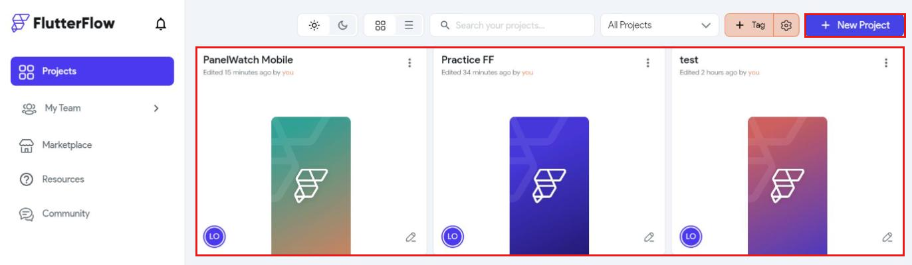

### 1.2 — Create the practice project
**+ New Project** → type `Practice FF` in **Project name** → **Start Building**. (Not *Generate with
Designer* — this app you build by hand.) The editor opens straight away; there's no Firebase step.

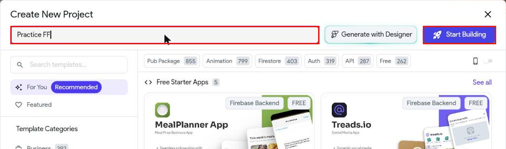

### 1.3 — The editor's five areas

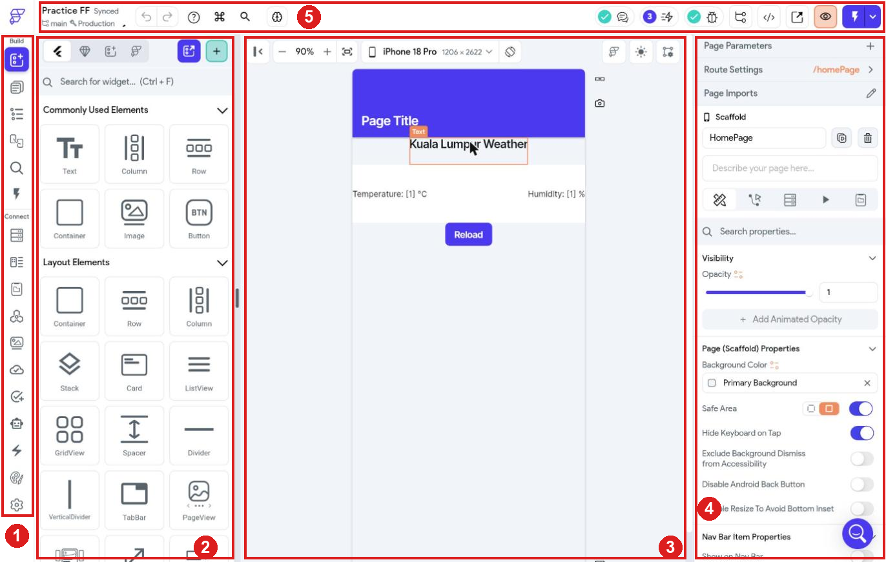

| # | Area | What it's for |
|---|---|---|
| 1 | **Left rail** | Switches what area 2 shows. *Build* icons at the top, *Connect* icons below, ⚙ **Settings** at the bottom |
| 2 | **Panel** | Whatever the rail shows — e.g. the **widget palette** (drag widgets from here), the **Widget Tree** or **API Calls** |
| 3 | **Canvas** | The phone screen you're designing. Click a widget to select it. The bar above it changes the zoom and the device (e.g. *iPhone 18 Pro*) |
| 4 | **Properties panel** | Settings of whatever is selected — page, widget or component |
| 5 | **Top bar** | Project name and save status, undo, issues, code, **Test** |

### 1.4 — The left rail
The icons have no labels — **click one** and its name appears. The ones this course uses:

| Icon (top to bottom) | Name | Used for |
|---|---|---|
| 1st under *Build* | **Widget palette** | Dragging in Text, Column, Row, Container, Button… |
| 2nd | **Page Selector** | Your pages and components; **+** adds a page (including *Generate with Designer*) |
| 3rd | **Widget Tree** | What is inside what. ⚠ next to a widget marks a problem. The safest place to select a widget |
| 4th | **Storyboard** | All pages and how they link — a map, nothing to edit |
| 1st under *Connect* | **Firestore** | Not used — PanelWatch is read over its API |
| — | **Data Types**, **App Values** | Not used today |
| — | **API Calls** (three linked circles) | Calls to other systems — the weather API, then PanelWatch |
| — | **Tests** | Test Pilot (Topic 7) |
| — | **Agents** | Not used — outside AI |
| last | ⚙ **Settings and Integrations** | App details, start page, platforms, web publishing |

### 1.5 — The properties panel
A row of tabs at the top. Which tabs appear depends on what is selected:

| Tab | What it holds |
|---|---|
| **Properties** | Text, size, colour, padding, **Expansion**… |
| **Actions** | What happens on tap — navigate, refresh, update state |
| **Backend Query** | Where the widget's data comes from — e.g. an API call |
| **Generate Dynamic Children** | Columns, Rows and lists only: repeat the first child once per item of a list |
| **Animations** | Movement on load or on tap — not used today |
| **State Management** | Pages only: the page's own variables (*page state*) |

> **Tip:** the small icon next to a property's name (e.g. next to **Text**) means *set from a
> variable* — that's how you put live data into a widget.

### 1.6 — The top bar

| Button | What it does |
|---|---|
| **Synced / Saved** (next to the project name) | FlutterFlow saves by itself. There's no Save button for pages |
| ↶ ↷ | Undo / redo |
| 🔍 | Search the whole project |
| 🧠 **AI Agent** | Outside AI — **not used** in this course |
| ✓ with a number, ✓ with a bug | **Project Suggestions** and **Issues** — errors and warnings. Check here when something doesn't work |
| Branch icon | **Version Control** — not used today |
| `</>` | **Developer Menu** — view the code, **Download APK** (Topic 8) |
| ↗ | **Share Project** |
| 👁 | **Preview App** — quick look, no data |
| **⚡ ▾** | **Test** (run the app in the browser with real data) and **Run** |

**Try it** — in `Practice FF`: drag a **Text** onto the page; find it in the **Widget Tree**; change
its text in **Properties**; undo it with ↶; then **⚡ ▾ → Test**, wait for the app to start, and **End
Session**.

**Checkpoint ✅** You can name the five areas and find the Widget Tree, API Calls, Settings and Test.

---

## Topic 2 — Malaysia Weather: layout, styling and pages (practice app)

**Goal:** build a small app by hand — a **menu** of three cities, and a **page per city** with its
photo, its name as the title and the live temperature. Along the way you meet every building block
the AI uses later: layout, styling, an API call, data on screen and navigation.

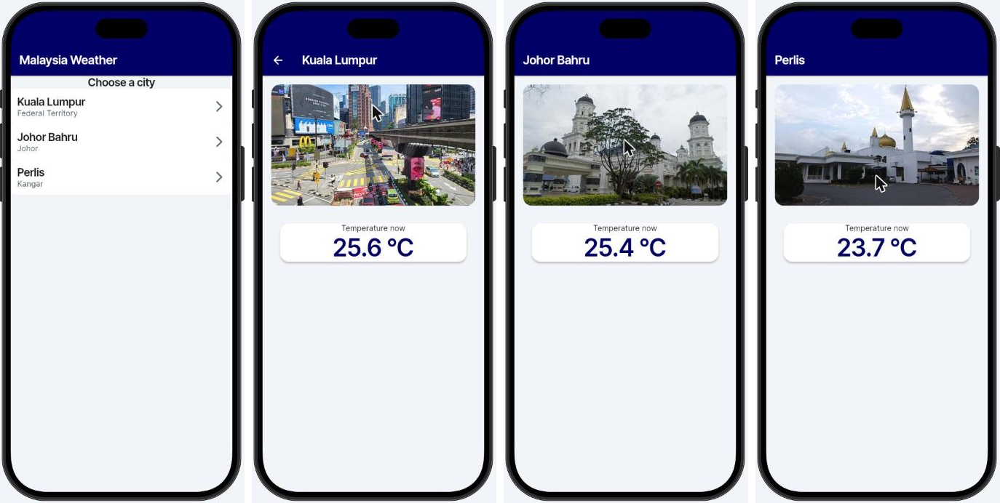

> **How to follow this topic:** work in `Practice FF`. **One line = one click or one thing to type.**
> Lost? Open the **Widget Tree** (left rail, 3rd icon) — it shows everything you've built so far.
>
> **Adding a widget inside another one:** in the **Widget Tree**, point at the parent's row (e.g.
> *Column*) → click the **+** that appears on it → type the widget's name → click it. It goes exactly
> where you mean — easier than dragging.
>
> 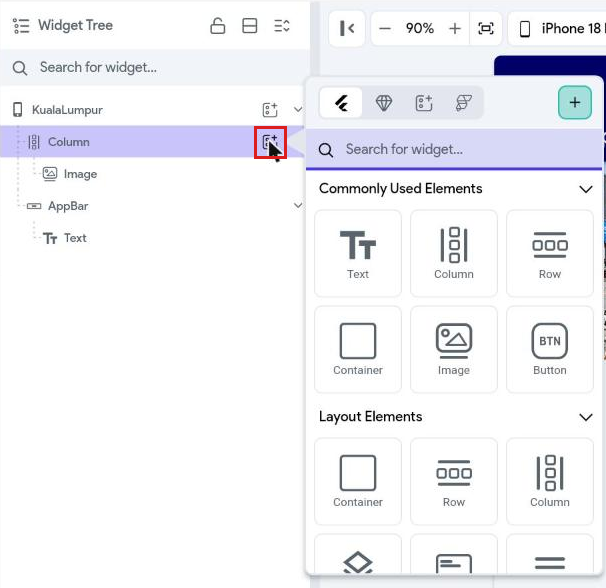

### 2.1 — The theme colour (1 minute)
1. Left rail → click the **palette** icon (*Theme Settings*, second from the bottom).
2. Click **Colors**.
3. Click the **Primary** colour box.
4. In **Choose a Color**, click the colour code box (next to **RGB**).
5. Delete what's there and type `010066` (the blue of the Malaysian flag).
6. Click **✕**. The **Primary** box turns dark blue — so will every app bar.

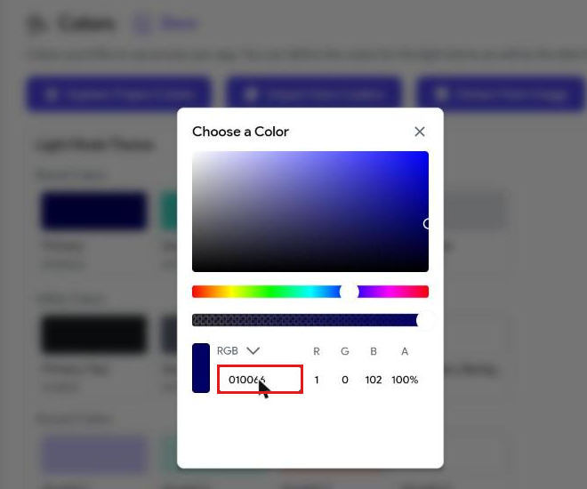

### 2.2 — The weather API call
**Create it**
1. Left rail → click **API Calls** (three linked circles).
2. Click **+ Add** → **Create API Call**.
3. **API Call Name** → type `getWeather`.
4. **Method Type** → leave **GET**.
5. **API URL** → paste:

   ```text
   https://api.open-meteo.com/v1/forecast?latitude=[lat]&longitude=[lon]&current=temperature_2m
   ```
6. Click the **Variables** tab (below the URL).
7. Click **+ Add Variable** → **Name** `lat` → leave **Type** *String* → **Default Value** `3.14`.
8. Click **+ Add Variable** → **Name** `lon` → **Default Value** `101.69`.
9. Click **Add Call**.

   `[lat]` in the URL is filled from the variable `lat`. The defaults are Kuala Lumpur, used when you
   test.

   ![The URL with [lat] and [lon], and the two variables](images/day2/2-call-variables.png)

**Test it and pick the temperature**

10. Click the **Response & Test** tab (top).
11. Click **Test API Call** → you see **Status: 200** and the Kuala Lumpur weather.

    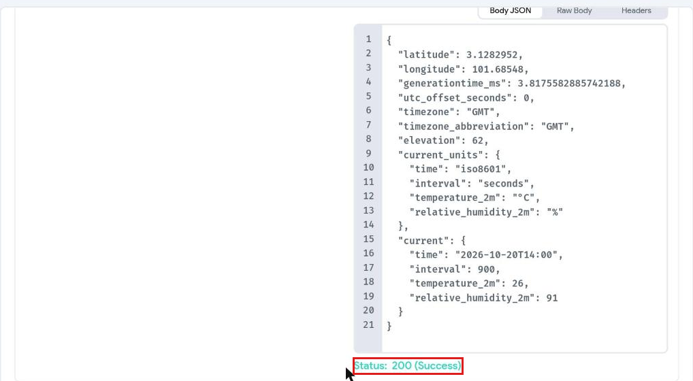
12. Scroll down to **JSON Paths** → click **Recommended** to open it.
13. On the row `$.current.temperature_2m` → click **+ Add JSON Path**.
14. Under **Selected**, click that row's **Name** box → type `temperature`.
15. Look at its **Type**. If it says *Integer* → click it → **Double** → **Update**.
16. Scroll to the very bottom → click **Save**. *Skip this and the JSON path is lost.*

    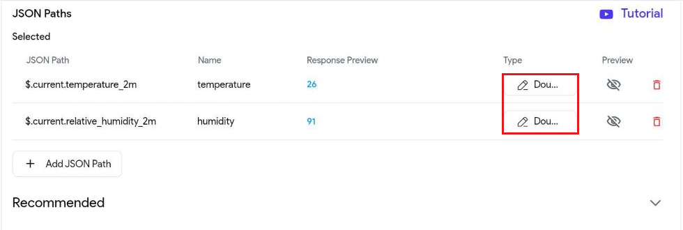

### 2.3 — The first city page: Kuala Lumpur
You need this table now and in 2.4:

| City | Page name | Photo **Path** | `lat` | `lon` |
|---|---|---|---|---|
| Kuala Lumpur | `KualaLumpur` | `https://upload.wikimedia.org/wikipedia/commons/thumb/1/1a/Bukit_Bintang_junction_in_2024_2.jpg/500px-Bukit_Bintang_junction_in_2024_2.jpg` | `3.14` | `101.69` |
| Johor Bahru | `JohorBahru` | `https://upload.wikimedia.org/wikipedia/commons/thumb/7/7e/Sultan_Abu_Bakar_State_Mosque.jpg/500px-Sultan_Abu_Bakar_State_Mosque.jpg` | `1.46` | `103.76` |
| Perlis | `Perlis` | `https://upload.wikimedia.org/wikipedia/commons/thumb/2/24/Perlis_State_Mosque.jpg/500px-Perlis_State_Mosque.jpg` | `6.44` | `100.20` |

*Photos: Wikimedia Commons. Keep the `500px-` size — other sizes are refused.*

**A. The page**
1. Left rail → click **Page Selector** (2nd icon).
2. Click **+** → **Add Page** → **Create Blank Page**.
3. Type `KualaLumpur` → click **Create Page**.

   > **HomePage stays as it is** — leave it for now. It is the page the app opens on, and in 2.5 it
   > becomes the menu. **Folders don't matter:** the new page appears **below** the *pages* folder, not
   > inside it. Leave it there — dragging it into *pages* is only tidying and changes nothing in the
   > app. Ignore *Flutter*, *Android* and *iOS* below it.

**B. The title and the back arrow**

4. Left rail → click **Widget Tree** (3rd icon).
5. Under **AppBar**, click **Text**.
6. Properties panel → **Text** box → type `Kuala Lumpur`.
7. In the Widget Tree, click **AppBar**.
8. Turn on **Show Default Button**.
9. Click **Default Button Color** → choose **Secondary Background** (white, so it shows on the blue).

   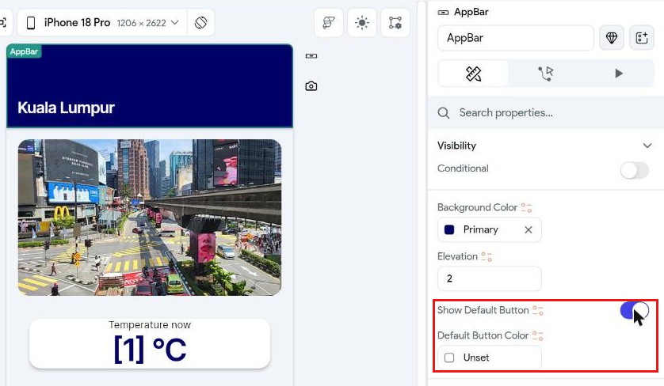

**C. The photo**

10. Widget Tree → **+** on the page's **Column** → type `Image` → click **Image**.
11. **Width** → click the **∞** inside the box (it fills the width).
12. **Height** → type `220`.
13. **Border Radius** → type `16`.
14. **Search properties…** (top of the panel) → type `Path` → paste the Kuala Lumpur photo address.

    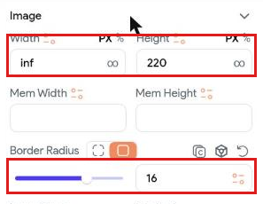

**D. The card**

15. Widget Tree → **+** on the page's **Column** → **Container**.
16. **Width** → click **∞**.
17. **Height** → delete the number so the box is empty (the card grows with its content).
18. **Border Radius** → `16`.
19. **Elevation** → `3`.
20. **Padding** → `16`.
21. Widget Tree → **+** on the **Container** → **Column**.
22. **+** on that new **Column** → **Text**.
23. **+** on the same **Column** → **Text** again. You now have two Texts in the card.

**E. The data**

24. Widget Tree → click the **top Column** (the one directly under *KualaLumpur*).
25. Properties panel → click the **Backend Query** tab (3rd icon at the top).
26. Click **Add Query**.
27. **Query Type** → **API Call**.
28. **Select API Call** → **getWeather**.
29. Click **+ Set Additional Variable** → **Parameter Name** → `lat` → **Value** → type `3.14`.
30. Click **+ Set Additional Variable** → **Parameter Name** → `lon` → **Value** → type `101.69`.
31. Click **Confirm**.

    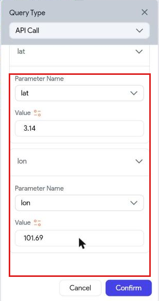

**F. The temperature on screen**

32. Widget Tree → click the **first Text** in the card → **Text** box → type `Temperature now`.
33. Click the **second Text**.
34. Click the small icon next to **Text** (*set from variable*) → **Combine Text**.
35. **Text 1** → click its small icon → **getWeather Response**.
36. **Available Options** → **Predefined Path**.
37. **Predefined Path Name** → **temperature** → **Confirm**.
38. Click **Add Text** → **Text 2** → type ` °C` (a space, then °C).
39. Click **Confirm**. The canvas shows `[1] °C` — the real number appears when you run the app.

    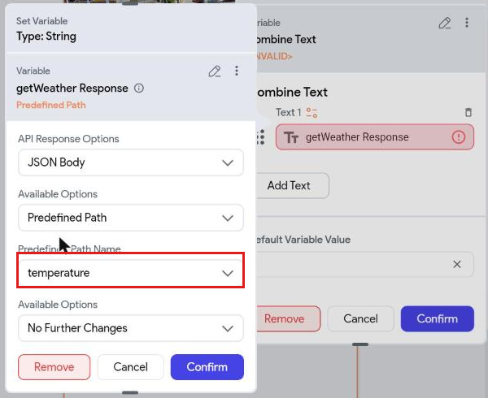

**G. Style it**

40. With the second Text still selected → **Theme Text Style** → **Display Medium**.
41. **Text Color** → **Primary**.
42. Widget Tree → click the **top Column** → **Padding** `16` → **Items Spacing** `16`.

    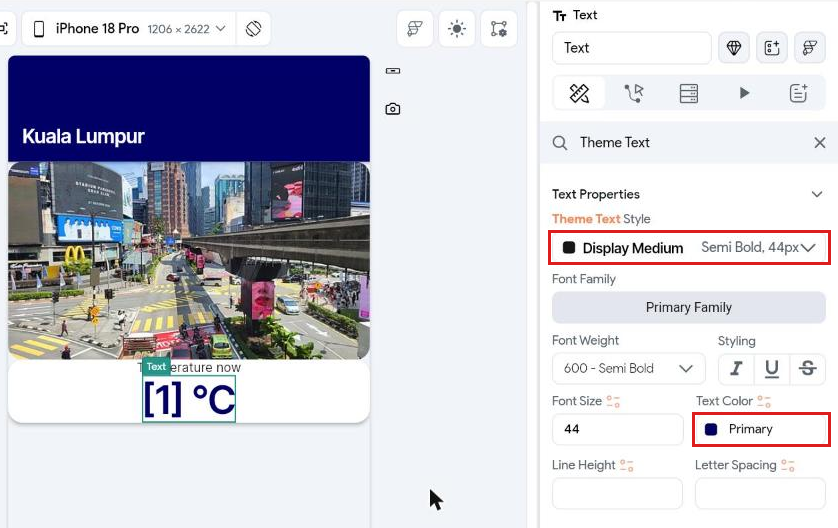

### 2.4 — Two more pages, by copying
1. With `KualaLumpur` open → click the **copy icon** next to the page name (top of the properties
   panel) → *Page duplicated successfully*. Everything is copied: photo, card, query, styling.
2. Widget Tree → click the page's **top line** (the page name). *Right after copying, the name box
   ignores typing until you do this.*
3. Properties panel → page name box → type `JohorBahru`.
4. Widget Tree → **AppBar** → **Text** → type `Johor Bahru`.
5. Widget Tree → **Image** → **Path** → paste the Johor Bahru address.
6. Widget Tree → **top Column** → **Backend Query** tab → **Edit**.
7. `lat` **Value** → `1.46`. `lon` **Value** → `103.76`. → **Confirm**.

   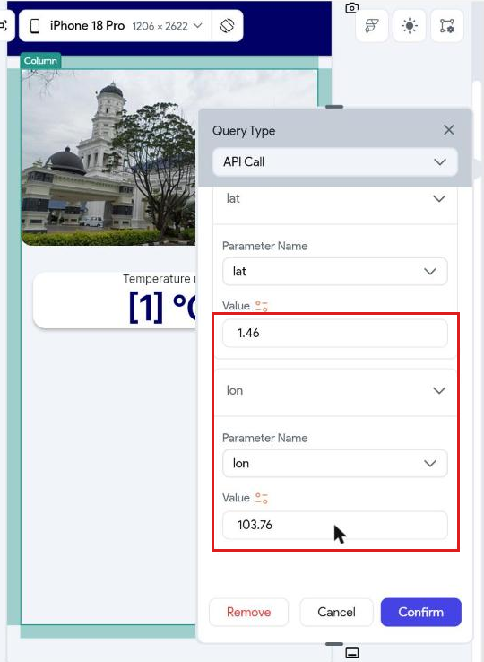
8. Open `KualaLumpur` again and repeat steps 1–7 for **Perlis** (`Perlis`, `6.44`, `100.20`).

   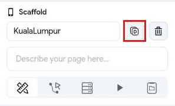

### 2.5 — The menu
`HomePage` becomes the menu.
1. **Page Selector** → click **HomePage**.
2. Widget Tree → **AppBar** → **Text** → type `Malaysia Weather`.
3. **+** on the page's **Column** → **Text** → type `Choose a city`.
4. **+** on the page's **Column** → type `ListTile` → click **ListTile**.
5. **Search properties…** → type `title` → **Title** `Kuala Lumpur` → **Subtitle** `Federal Territory`.
6. Properties panel → click the **Actions** tab (2nd icon at the top).
7. Click **+ Add Action** → **Navigate To** → **Select Page** → **KualaLumpur**.

   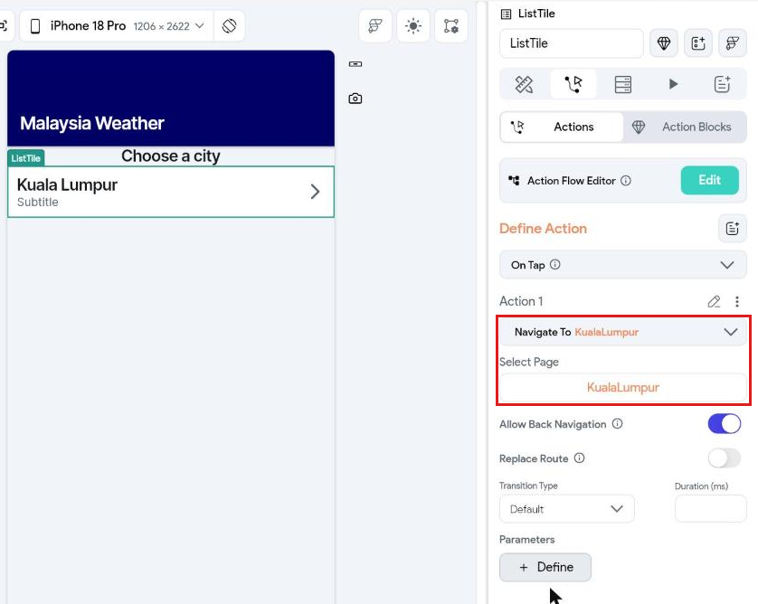
8. Repeat steps 4–7 twice:
   - `Johor Bahru` / `Johor` → **JohorBahru**
   - `Perlis` / `Kangar` → **Perlis**

   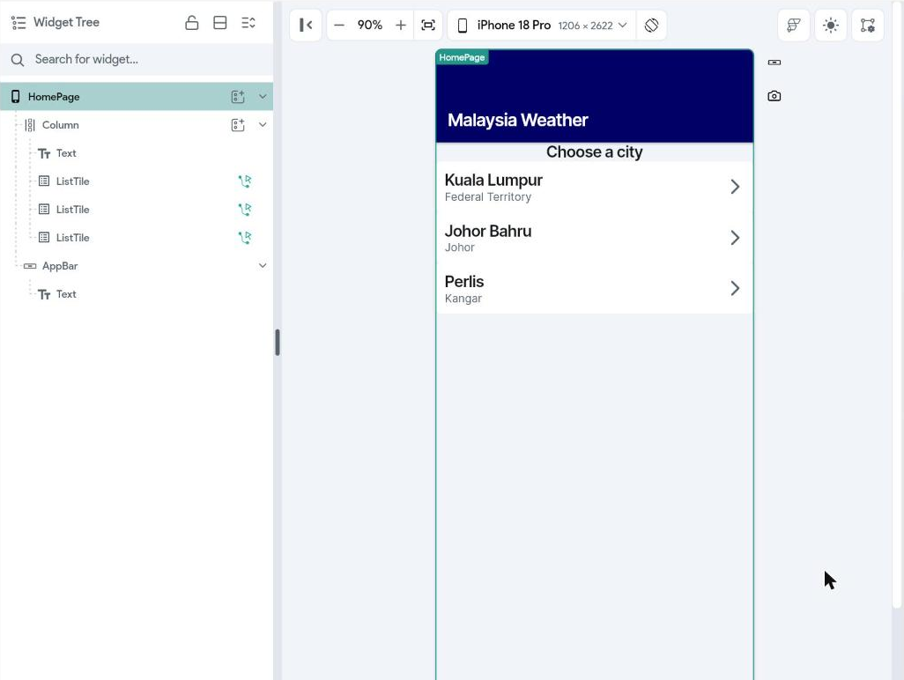

### 2.6 — Run it
1. Top right → click **⚡ ▾** → **Test**. A new tab builds the app (about a minute).
2. Tap **Kuala Lumpur** → its photo, name and live temperature. Tap **←** to go back.
3. Do the same for **Johor Bahru** and **Perlis** — each shows its own temperature.
4. Click **End Session** when done.

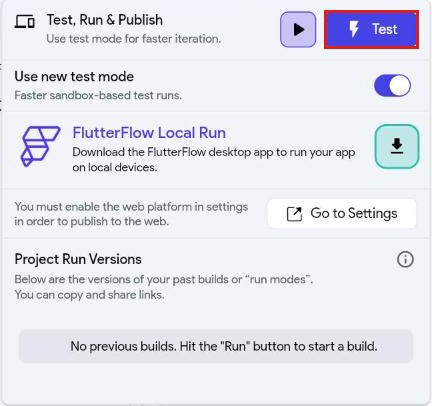

**Try it** — change the theme's **Primary** colour again: every app bar and every temperature change
together. That's why styles live in the theme.

### 2.7 — What you just used
**Flutter layout, in three rules:** a parent tells its children how much space they may use;
children choose their size within that; the parent decides where they go.

| You used | Where | What it does |
|---|---|---|
| **Column** / **Row** | Page, card | Stack children vertically / side by side. *Items Spacing* = gap between them |
| **Container** | The card | A box: padding, colour, rounded corners, shadow (*Elevation*) |
| **Image** | The photo | A picture from a web address (*Network*) |
| **ListTile** | The menu | A ready-made row: title, subtitle and an arrow |
| **∞ Width** | Photo, card | Fill the space the parent gives. (*Expanded* does the same inside a Row) |
| **Theme colour / Theme Text Style** | Primary, Display Medium | Set once, used everywhere |
| **Backend Query** | Page Column | Where the data comes from — the API call |
| **Combine Text** | Temperature | Live data + fixed text (` °C`) |

**Checkpoint ✅** By hand: a theme, a layout of Image, Container and Text, an API call with variables,
data on screen, three pages and a menu that navigates between them.

---

# Part B — PanelWatch Mobile, built mostly with FlutterFlow AI

## Topic 3 — The three API calls (by hand)

**Goal:** a new project with the same three Firestore calls as yesterday's Bubble admin. FlutterFlow
reads PanelWatch the same way Bubble does — over the **REST API**. Nothing to set up in Firebase.

1. **+ New Project** → `PanelWatch Mobile` → **Start Building**.
2. **API Calls** → **+ Add** → **Create API Call**, three times:

| Call name | Method | API URL | Variables (tab) |
|---|---|---|---|
| `listDevices` | GET | `https://firestore.googleapis.com/v1/projects/panelwatch-class/databases/(default)/documents/devices` | — |
| `getDevice` | GET | `https://firestore.googleapis.com/v1/projects/panelwatch-class/databases/(default)/documents/devices/[code]` | `code`, String, default `PNL-01` |
| `readings` | POST | `https://firestore.googleapis.com/v1/projects/panelwatch-class/databases/(default)/documents:runQuery` | `code`, String, default `PNL-01` |

   `readings` only: **Body** tab → **JSON** → paste, then **Format**. `<code>` becomes a blue **code**
   chip — the variable.
```json
{ "structuredQuery": {
    "from": [ { "collectionId": "readings" } ],
    "where": { "fieldFilter": { "field": { "fieldPath": "device_code" }, "op": "EQUAL", "value": { "stringValue": "<code>" } } },
    "orderBy": [ { "field": { "fieldPath": "time" }, "direction": "DESCENDING" } ],
    "limit": 20
} }
```

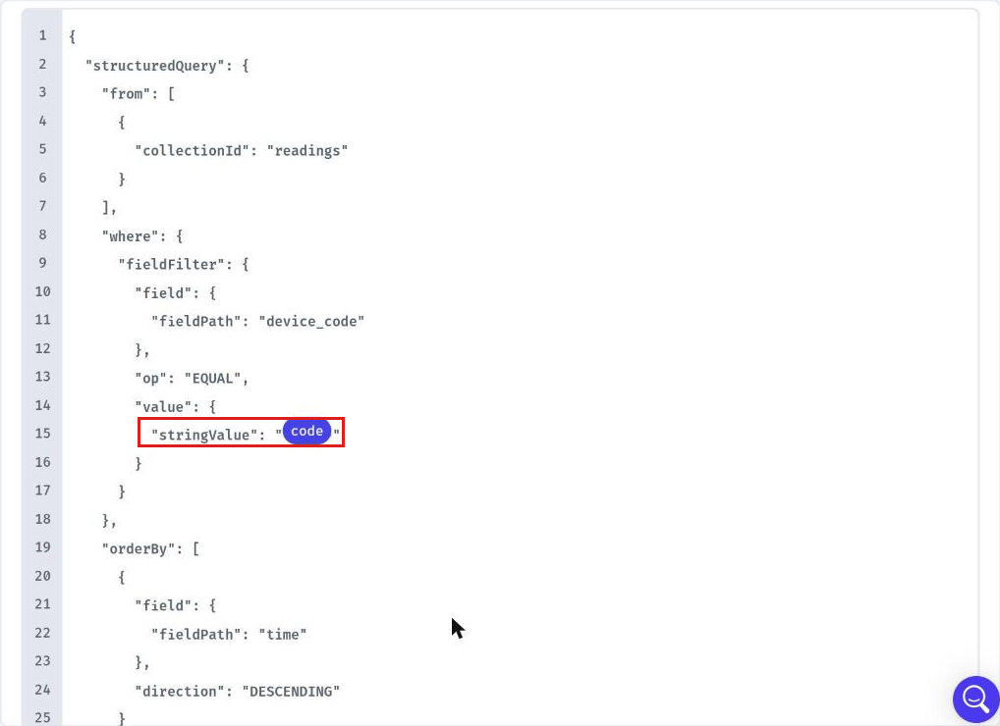

3. **Every call: Advanced Settings → turn off _Use Proxy for Test_ and _Use Proxy for Run/Test
   Mode_.** Then **Add Call** (or **Save**).

> **Why the proxy must be off:** FlutterFlow sends test calls through its own server by default. That
> server can't reach Firestore — the test fails with **404** and *"Not found because of proxy error"*.
> Firestore accepts calls straight from the browser, so the proxy isn't needed.

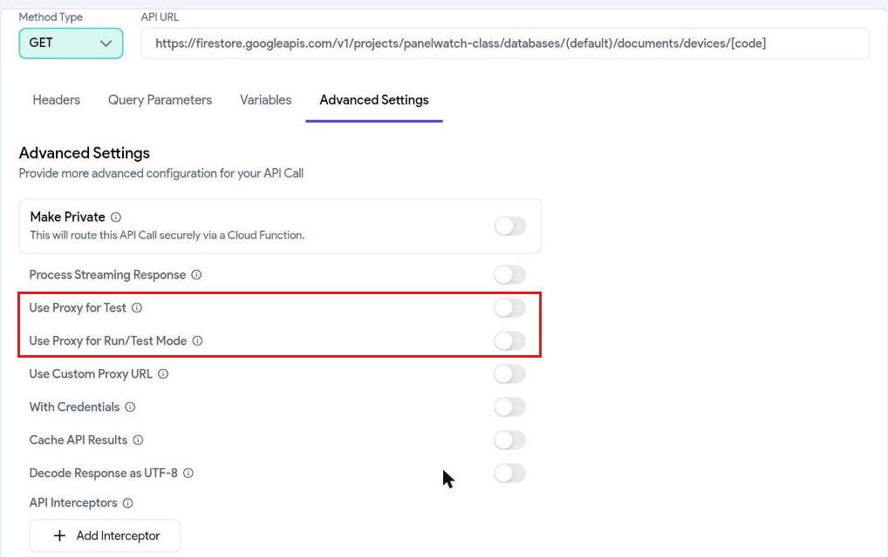

4. Each call → **Response & Test** → **Test API Call** → **Status: 200**.

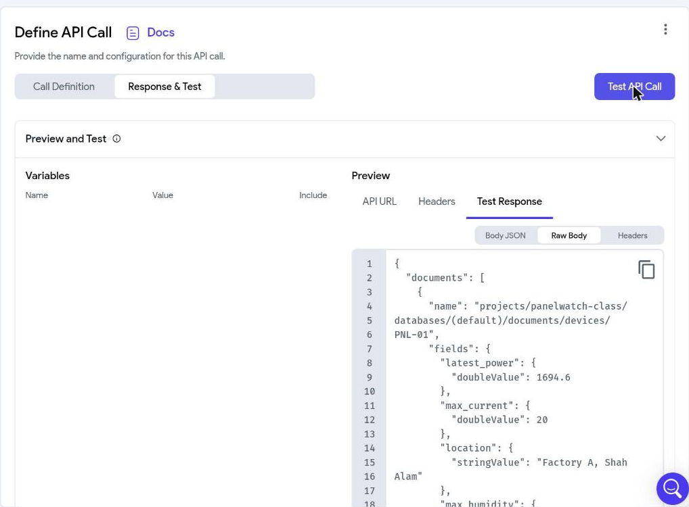

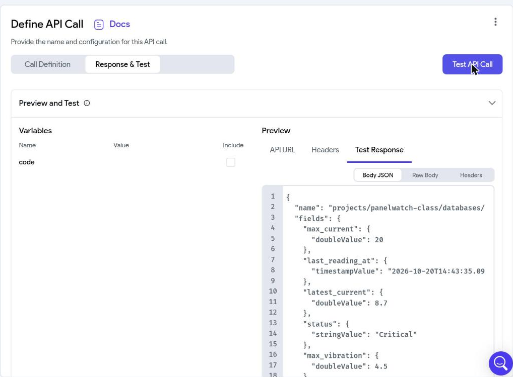

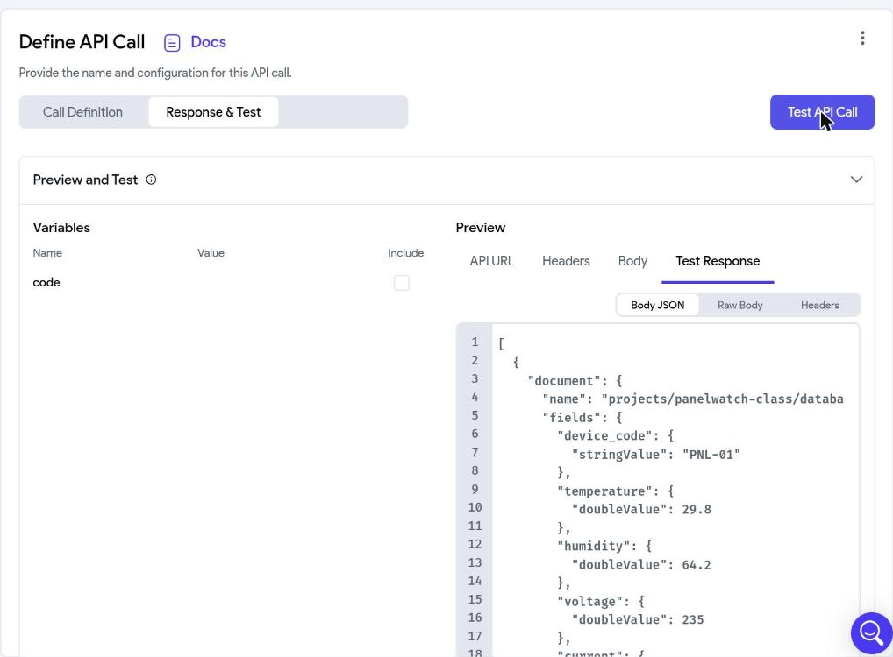
5. **JSON Paths** (**+ Add JSON Path**, type the path, name it) — then **Save** at the bottom, or
   FlutterFlow asks to *discard changes*:

| Call | JSON Path | Name | What it is |
|---|---|---|---|
| `listDevices` | `$.documents` | `documents` | The list of panels — one card each (Topic 5) |
| `readings` | `$[:].document.fields.temperature.doubleValue` | `temperatures` | The last 20 temperatures — the chart (Topic 6) |
| `readings` | `$[:].document.fields.time_unix.doubleValue` | `times` | Their times |


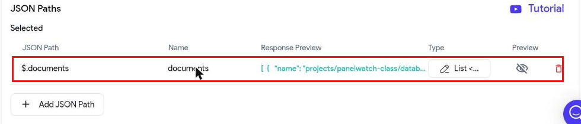

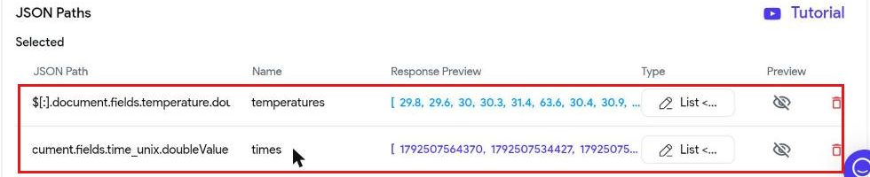

| Piece | Meaning |
|---|---|
| `[code]` in the URL / `<code>` in the body | A variable — the panel to fetch |
| `$` | The whole response |
| `$[:]` | Every item of a list (`:runQuery` returns a list) |
| `.document.fields.temperature.doubleValue` | Firestore wraps every value with its type (`firebase-api.md` 4.1) |

**Checkpoint ✅** `listDevices`, `getDevice` and `readings` return real PanelWatch data in FlutterFlow.

---

## Topic 4 — Design the whole app with AI

**Goal:** all three pages *and* their components, generated by FlutterFlow's AI with one
consistent look.

> **Prompts rewritten after the dry run** — more detailed, so everyone's result comes out the
> same. The steps around them are checked; the new prompts themselves are not run yet.

Four steps. Only step 1 and the renames are by hand, and they are clicks, not typing.

**Step 1 — Theme first (2 minutes, before any generation)**
1. **Theme Settings** (palette icon, left rail) → **Colors** → **Explore Project Colors** →
   **Explore** (top right) → scroll to **Modern Business** → tick it → **Save Changes**. The app
   bars turn blue, and you get green / amber / red for the status badges.

   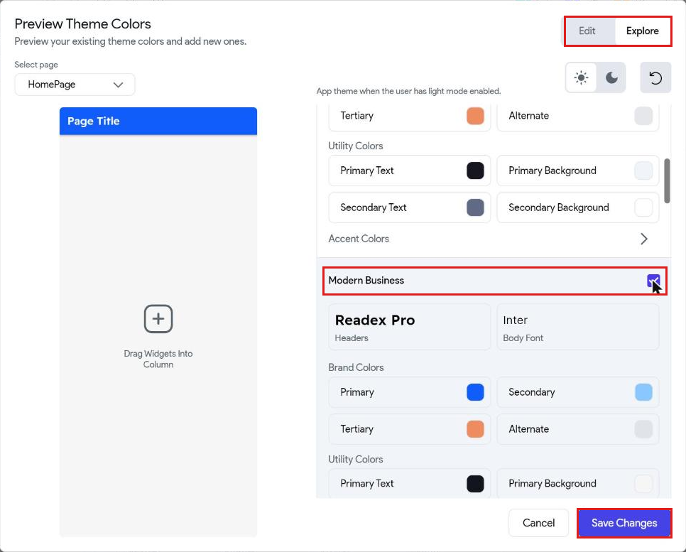
2. Still in **Colors**, under **Semantic Colors**, click **Info** → type `#12151C` in the colour box
   → **Enter** → close.

   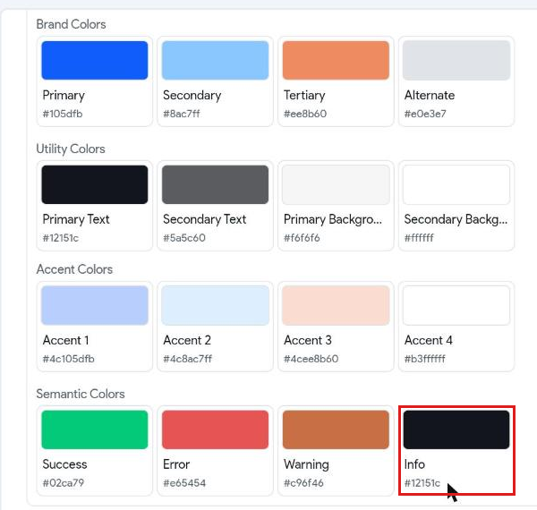

   **Why:** the AI uses the *Info* colour for card titles, and every theme makes Info white. On
   white cards the titles become invisible. One change here fixes every page at once.

**Step 2 — Generate the pages**

**Page Selector** → **+** → **Add Page** → **Generate with Designer** → paste the prompt into
**Generate Page** → **Generate** (about 20 seconds).

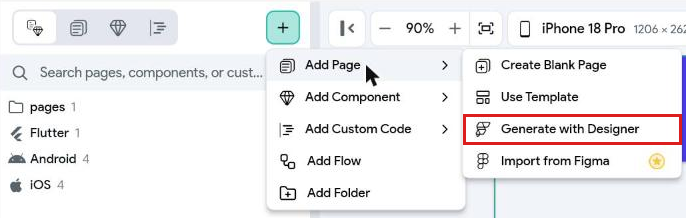

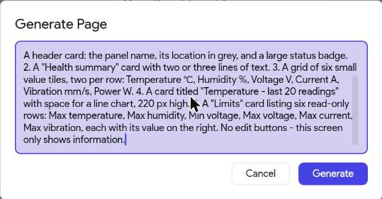

| Prompt | Page name | Components it makes | What it is |
|---|---|---|---|
| 6 | `DeviceList` | `PanelCard` | The three panels — the home page |
| 7 | `DeviceDetail` | `ValueTile`, `LimitRow` | One panel: summary, values, chart, limits |
| 8 | `About` | none | What PanelWatch is, in four lines |

**Step 3 — Check every generation (1 minute)**
1. **Rename the page** — the AI picks its own name (e.g. *MobileDetailNamedPage*), even if the
   prompt names it. Click the name box at the top of the right-hand panel → select all → type the
   name from the table → **Enter**.

   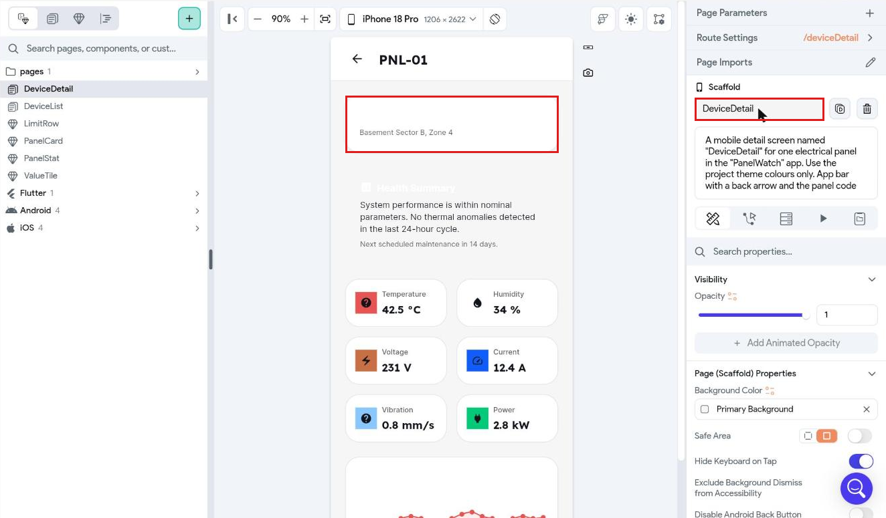
2. **Components** — **Page Selector** lists the components from the table, with exactly those
   names. Click one → **Component Parameters** (top of the right panel) lists the parameters from
   the prompt. A name is different → rename it in the same box as a page. A parameter is missing →
   **Component Parameters** → ✏ → add it (type **String**).
3. **All text visible** — an empty box or a card without a title means white text. Select it →
   **Search properties** `color` → the small square next to **Text Color** → **Primary Text**.

**Step 4 — Nav bar and start page (one settings page)**
1. **Settings** (⚙) → **Nav Bar & App Bar** → turn on **Show Nav Bar**.
2. **Choose Page** → `DeviceList` → **Add Page**; again for `About`. Not `DeviceDetail` — you reach
   it by tapping a card.
3. Click each page's **›** → **Label** `Panels` / `About` → **Nav Bar Icon** → search `dashboard` /
   `info` → pick one.

   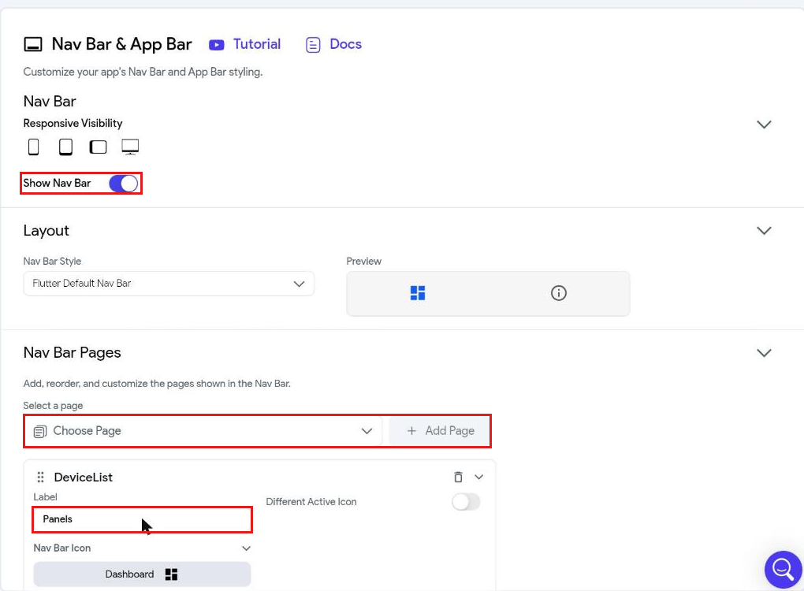
4. Start page: **Settings** → **App Details** → **Initial Page** → **Entry Page** `DeviceList`.

   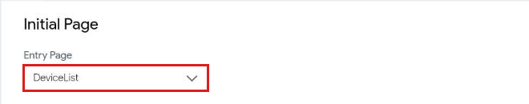

**Check it:** **⚡ ▾ → Test**. The nav bar switches between Panels and About. *(Already in a Test
session? Press **Hot Restart** — the circular arrow, top right — or the nav bar won't appear.)*


> **Each generation uses one of your 50 monthly AI generations** — read the prompt through before you
> send it. Paste it exactly as written: every line is there to make your result match everyone
> else's.

**How every Day 2 prompt is built**

| Part of the prompt | Why |
|---|---|
| *"Build ONE mobile page …"* | One page per generation — the AI doesn't spread into extra pages |
| The **Colours** line, *"Never use white text"* | Names the theme colours to use. In the dry run the AI chose white text on white cards |
| *"Make ONE component named … with these parameters"* | Everyone gets the same names, so the binding steps in Topics 5–6 match your project |
| All parameters **String** | Simple to bind: the API's values go straight in, and the units stay in the component |
| The numbered layout, top to bottom | The reading order. Each line is one part of the screen, so the AI has nothing to guess |
| Sample values in quotes (*"PNL-01"*, *"31.2"*) | Real-looking values from the PanelWatch data give real sizes. You replace them with live data in Topics 5–6 |
| *"Do not add: …"* | Designers add search bars, log-in and buttons by habit. PanelWatch needs none of them |

**Prompt 6 — DeviceList page**
```text
Build ONE mobile page for "PanelWatch", a factory app that lists 3 electrical panels.

Colours: project theme only. All text in Primary Text or Secondary Text. Cards in Secondary
Background. Never use white text.

Make ONE component named "PanelCard" with these parameters: code, name, status, temperature,
voltage, current, power, lastReading (all String) and enabled (Boolean).
PanelCard, top to bottom, in a card with 16 padding and 12 corner radius:
1. A row: code in bold Primary colour on the left; status on the right in a small pill with an
   Accent 1 background and Primary Text.
2. name, in Title Medium.
3. A row of 4 equal columns: "Temp" above temperature + " °C", "Voltage" above voltage + " V",
   "Current" above current + " A", "Power" above power + " W".
4. "Last reading " + lastReading, small, in Secondary Text.
5. When enabled is false: hide rows 3 and 4 and show "Disabled by the admin" in Secondary Text.

Page: an app bar with the title "PanelWatch" and the subtitle "3 panels". Below it, a
Column of 3 PanelCards with sample values: "PNL-01", "Main Panel Level 1", "Normal", "31.2",
"230", "12.5", "2875", "18/10 14:05:33", true.

Do not add: search, log-in, buttons, a floating button, images, other pages or other components.
```

| Part of the prompt | Why |
|---|---|
| *"a row of 4 equal columns"* | Only four of the six readings fit a phone card. The detail page shows all six |
| *"enabled (Boolean)"* and line 5 | The admin's Enable / Disable from Day 1: a disabled panel stays listed, its readings hidden |
| *"subtitle "3 panels""* | A plain subtitle. The list reloads each time the page opens — no timer to build |
| *"a small pill with an Accent 1 background and Primary Text"* | One colour for every status — the word says Normal, Warning or Critical. Colour per status takes about 30 clicks of nested rules by hand, so we leave it out |

**Prompt 7 — DeviceDetail page**
```text
Build ONE mobile page for one electrical panel in the "PanelWatch" app.

Colours: project theme only. All text in Primary Text or Secondary Text. Cards in Secondary
Background. Never use white text.

Make exactly TWO components:
- "ValueTile" with String parameters label, value, unit: label small in Secondary Text on top,
  then value in bold Title Large with unit beside it in small text. A card, 12 padding, 12 radius.
- "LimitRow" with String parameters label, value: label on the left, value in bold on the right.

Page, scrolling, top to bottom, 16 padding, 12 between sections:
1. App bar: a back arrow and the title "PNL-01".
2. Header card: "Main Panel Level 1" in Title Medium, "Factory A, Shah Alam" in Secondary Text,
   and "Normal" in a small pill with an Accent 1 background and Primary Text on the right.
3. A card titled "Health summary" with the text "Status: Normal. Power now 1856 W. No action needed."
4. Six ValueTiles, two per row: Temperature 31.2 °C, Humidity 66.0 %, Voltage 231.5 V,
   Current 8.2 A, Vibration 1.9 mm/s, Power 1898 W.
5. A card titled "Temperature - last 20 readings" with a line chart 220 high, in the Primary colour.
6. A card titled "Limits" with six LimitRows: Max temperature 45 °C, Max humidity 85 %,
   Min voltage 207 V, Max voltage 253 V, Max current 20 A, Max vibration 4.5 mm/s.

Do not add: buttons, edit fields, images, other pages or other components.
```

| Part of the prompt | Why |
|---|---|
| *"exactly TWO components"*, each with its parameters | The six tiles and six limit rows are the same shape — one component each, filled six times |
| *"a back arrow and the title "PNL-01""* | The way back to the list, and which panel you're looking at |
| *"last 20 readings … 220 high"* | Matches the readings call (limit 20) in Topic 6, and keeps a fixed space for the chart |
| Limits as *LimitRows*, *"Do not add: buttons, edit fields"* | The phone only shows. Limits are set by the trainer; the admin's only switch is Enable / Disable |

**Prompt 8 — About page**
```text
Build ONE simple mobile page: "About PanelWatch".

Colours: project theme only. All text in Primary Text or Secondary Text. Never use white text.
Do not create any components.

Page, top to bottom, centred, 24 padding:
1. "PanelWatch" in Headline Medium.
2. "PanelWatch shows live readings from the factory's electrical panels." in Body Large.
3. A card titled "How it works" with four lines of text:
   "1. Panels (simulator) send a reading every 30 seconds"
   "2. Firebase stores them"
   "3. The Bubble admin enables or disables each panel"
   "4. This app shows them on your phone"
4. At the bottom, in small Secondary Text: "Built in the AI-Assisted App Development course".

Do not add: images, icons, diagrams, buttons or other pages.
```

| Part of the prompt | Why |
|---|---|
| *"four lines of text"* instead of a diagram | In the dry run the AI's diagram came out with empty boxes. Four numbered lines say the same and can't break |
| *"Do not create any components"* | Nothing on this page repeats, so a component only adds things to check |

**Catch the AI**
- **Sample data** ("PNL-01", "31.2") — fine; you connect live data in Topics 5–6.
- **Extra features** you didn't ask for (search bars, log-in, settings) — delete them.
- **Fixed sizes** that overflow on a small phone — use the Topic 2.7 rules: Expanded, or a max width.
- **Text the same colour as its background** (in the dry run, the status word was green on a green
  pill) — select the text → **Text Color** → if it shows a parameter name, **Remove**, then pick
  **Primary Text**.

**Checkpoint ✅** Three pages in one theme; `PanelCard`, `ValueTile` and `LimitRow` with their
parameters; a nav bar with Panels and About; `DeviceList` opens first.

---

## Topic 5 — The panel list, from the API

**Goal:** `DeviceList` shows the three real panels.

1. **Keep one card.** Widget Tree: the AI made three copies of the card inside a **Column**. Delete
   two (select → **Delete**).
2. **The data:** select that **Column** → **Backend Query** → **Add Query** → **API Call** →
   `listDevices` → **Confirm**.

   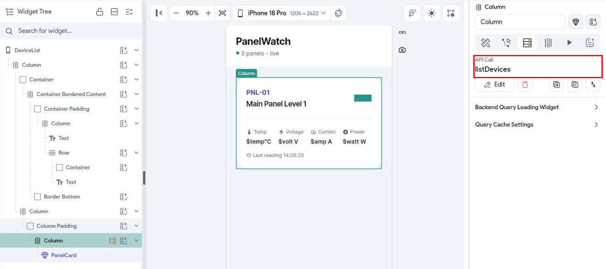
3. **One card per panel:** same Column → the **Generate Dynamic Children** tab (next to Backend
   Query) → **Variable Name** `panel` → **Value** → **listDevices Response** → *Predefined Path*
   `documents` → **Confirm** → **Save** → **Ok**. The canvas now shows the card repeated.

   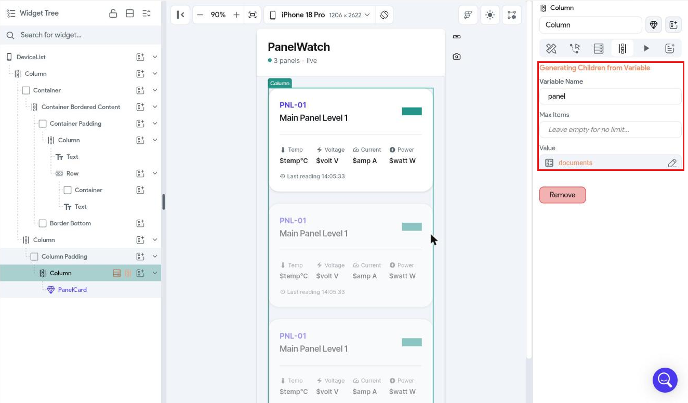
4. **Fill the card:** select the card → **Properties** → **Component Parameters**. For each, the
   icon next to it → **panel Item** → **Available Options** *JSON Path* → after the `$` type:

| Parameter | JSON Path |
|---|---|
| `code` | `$.fields.code.stringValue` |
| `name` | `$.fields.name.stringValue` |
| `status` | `$.fields.status.stringValue` |
| `lastReading` | `$.fields.last_reading_text.stringValue` |
| `temperature` | `$.fields.latest_temperature.doubleValue` |
| `voltage` | `$.fields.latest_voltage.doubleValue` |
| `current` | `$.fields.latest_current.doubleValue` |
| `power` | `$.fields.latest_power.doubleValue` |
| `enabled` | `$.fields.enabled.booleanValue` |

**The four numbers need one more setting.** For `temperature`, `voltage`, `current` and `power`:
after the JSON path, the second **Available Options** → **To Data Type** → **Data Type** `String` →
**Confirm**. Without it the card shows the whole panel record as text instead of the number.

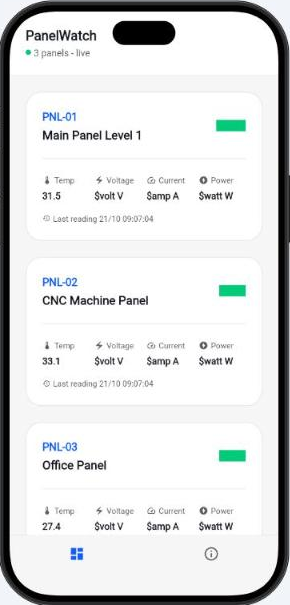

*(The screenshots below are from the dry run, before the prompt was rewritten — that card had
`time` where yours has `lastReading`.)*


   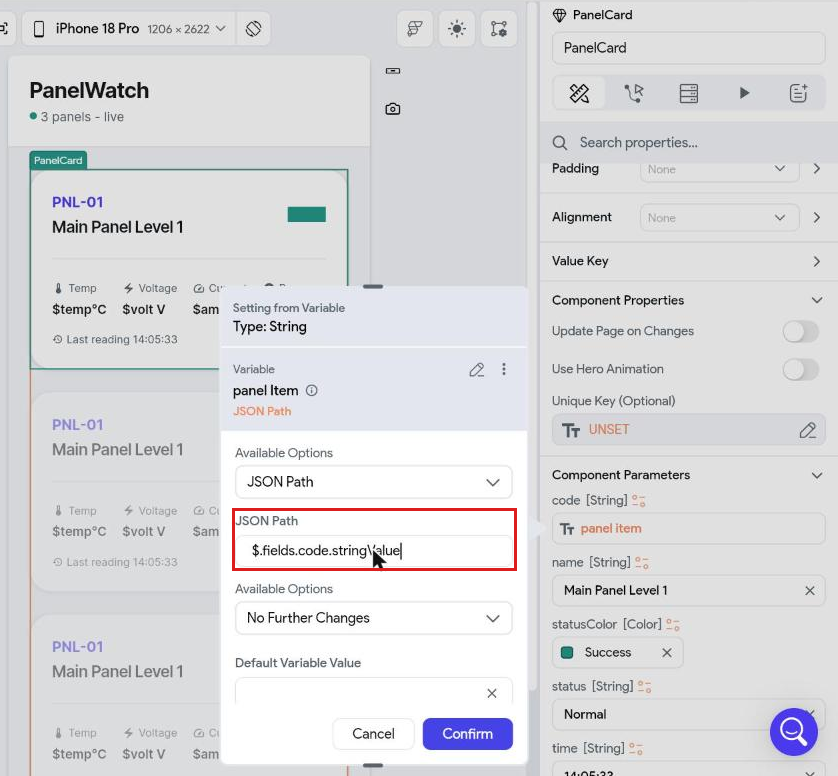

   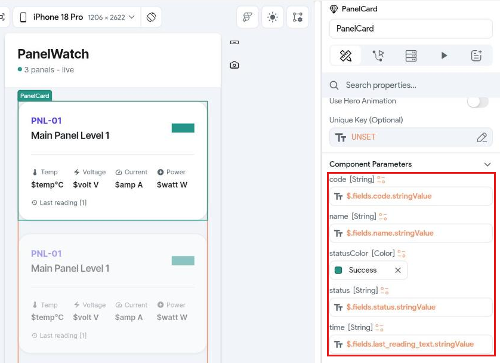

**Try it** — **⚡ ▾ → Test**: three cards with the real codes, names and last-reading times.

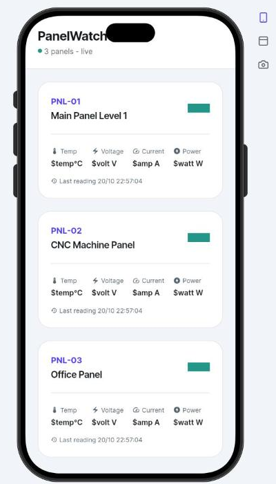

**Fresh data:** the list loads each time the page opens — come back from a panel, or tap **Panels**
in the nav bar, to see new readings. We keep it that way on purpose: an automatic timer is extra
work by hand for little gain in class.

> **Still to check** (not in the dry run yet): *Disabled by the admin* (line 5 of Prompt 6) with
> live data.

**Checkpoint ✅** `DeviceList` shows the three real panels from the API.

---

## Topic 6 — The panel detail page

> **Not yet checked against the current FlutterFlow** — the trainer's dry run stopped at Topic 5.
> The data now comes from the API calls of Topic 3, not a Firestore connection; this topic will be
> updated to match.

**Goal:** tap a panel → its summary, latest values, a chart of the last 20 temperatures, and its limits.

1. On `DeviceDetail`, bind the header (name, location, status pill) and the summary card to the
   page parameter `device` (`code`, `name`, `location`, `status`, `summary`).
2. Fill the six `ValueTile`s' `value` from `device`: `latest_temperature`, `latest_humidity`,
   `latest_voltage`, `latest_current`, `latest_vibration`, `latest_power`.
3. **Chart section with AI:** if the page has no line chart, **Generate with Designer** with
   **Prompt 9** (below) and paste it in.
4. **Readings query (by hand):** on the chart's parent → **Backend Query → Query Collection →
   `readings`**: filter `device_code` **equal to** `device.code`; order by `time` **descending**;
   limit **20**. (The trainer created the index for exactly this query.)
5. **The chart (by hand):** the **Line Chart** → data from the query: **X axis** `time_unix`, **Y axis**
   `temperature`. Hide the X-axis labels (they're milliseconds).
6. **Limits:** the six `LimitRow`s' `value` from `device`: `max_temperature`, `max_humidity`,
   `min_voltage`, `max_voltage`, `max_current`, `max_vibration` — read-only on the phone.
7. **Disabled panels (by hand):** select everything below the header card — summary, tiles, chart,
   limits — and **Wrap Widget → Column**. That Column → **Conditional Visibility** → `device.enabled`
   is true. Under the header, add a **Text** `This panel is disabled by the admin.` → **Conditional
   Visibility** → `device.enabled` is false.

**Prompt 9 — Chart section** (only if the page needs one)
```text
A card section titled "Temperature - last 20 readings" with a small grey caption "One reading
every 30 seconds", containing a line chart 220 px high with a smooth line in the primary colour, light
horizontal grid lines and no labels on the horizontal axis.
```

| Part of the prompt | Why |
|---|---|
| *"One reading every 30 seconds"* | Tells the user how far apart the points are — the simulator's interval |
| *"220 px high"* | The same space Prompt 7 left for the chart |
| *"no labels on the horizontal axis"* | The X axis is `time_unix` in milliseconds — its labels would be unreadable |
| *"in the primary colour"* | The theme colour, like every other screen |

**Try it**
1. Tap `PNL-03`: its own chart and summary. Back; `PNL-01`: different data.
2. Go back and open `PNL-03` again a minute later: the chart has new points.
3. Disable `PNL-03` in Bubble, then open it on the phone: only the header and *This panel is disabled
   by the admin.* Enable it again.
4. **Break it on purpose:** change the order field from `time` to `humidity` → the query fails with a
   message that an **index is needed** — the same lesson as yesterday's `FAILED_PRECONDITION`. Put it
   back. (Don't create the index yourself — the project is shared.)

**Checkpoint ✅** Each panel's page shows its live summary, chart and limits — or only *disabled by
the admin*.

---

## Topic 7 — Test the app with AI

**Goal:** plain-English tests that FlutterFlow's AI runs for you.

1. Open **Test Pilot** and add the tests from **Prompt 10** (below), one at a time.
2. **Run** them. Test Pilot builds the app, taps through it and shows screenshots for each step.
3. Fix anything that fails, and run again.

**Prompt 10 — Tests** (Test Pilot)
```text
1. Open the app. The first screen shows three panels: PNL-01, PNL-02 and PNL-03.
2. Each panel card shows a status of Normal, Warning or Critical.
3. Tap PNL-02. A screen titled PNL-02 opens and shows a health summary and a temperature chart.
4. On the PNL-02 screen, tap the back arrow. The panel list is shown again.
5. Tap About in the bottom navigation bar. The screen shows the text "Firebase".
```
**Why it's written this way** — the data is live and shared, so the numbers always differ. Each test
checks only what must **always** be true.

| Part of the prompt | Why |
|---|---|
| One test per line | Test Pilot runs each one separately, so a failure points at one thing |
| *"shows a health summary and a temperature chart"* | True only while PNL-02 is **enabled** — check in Bubble before you run the tests |
| *"three panels: PNL-01, PNL-02 and PNL-03"* | Panel codes never change; their values do. Test the codes |
| *"a status of Normal, Warning or Critical"* | Any of the three is correct with live data |
| Written as a person would act (*"Tap PNL-02"*, *"tap the back arrow"*) | Test Pilot works like a user: plain actions, then what you should see |

**Catch the AI**
- A test that **passes for the wrong reason** — look at the screenshots, not just the green tick.

> **If Test Pilot isn't available on your plan:** use your AI generations instead for **Prompt 11**:
> "No readings yet" for the chart, a loading shimmer for the panel list, and a "Can't reach the
> server" message. Put each on the right page with conditional visibility.

**Prompt 11 — Empty, loading and error states** (fallback)
```text
Three small state components for a mobile app, using the project theme:
1. "NoReadings": a chart icon and the text "No readings yet".
2. "LoadingCards": three grey placeholder cards with a shimmer effect, the size of a panel card.
3. "OfflineMessage": a cloud-off icon, "Can't reach the server", and a "Try again" button.
```

| Part of the prompt | Why |
|---|---|
| Names in quotes (*"NoReadings"* …) | The names you'll look for in the component list |
| *"the size of a panel card"* | The page doesn't jump when the real cards replace the placeholders |
| *"a "Try again" button"* | An error message needs a way out |

**Checkpoint ✅** A passing set of AI-run tests (or AI-designed empty, loading and error states).

---

## Topic 8 — Publish and install PanelWatch

**Goal:** PanelWatch on *your* device — an Android phone, or your iPhone's (or laptop's) home screen
as a web app — ready for the capstone.

| Route | Works on | How |
|---|---|---|
| **Test mode** | Your laptop's browser | **⚡ ▾ → Test** — what you've used all day |
| **APK on an Android phone** | Android | Download the APK → install it on the phone (8.2) |
| **Web app + Add to Home Screen** | **iPhone** (Safari), Android, any laptop | Publish once, open the link, add to home screen (8.3) |
| Native iPhone app (App Store / TestFlight) | iPhone | Needs an Apple Developer account and Apple's review — not in class |
| Android emulator on the laptop | — | Not used: third-party emulators are unreliable on class laptops — use the web app instead |

> **Start the build before the break:** the APK takes a few minutes. Do 8.1, start 8.2, then go for
> coffee.

### 8.1 — Make it look like an app
1. **Icon and splash:** **Settings → App Assets**.
2. **Package name:** **Settings → App Details → Package Name**, e.g. `my.locx.panelwatch.aisyah`.
   Yours must be different from everyone else's — add your name.

### 8.2 — Android: download and install your APK
1. **`</>`** (top bar) → **Download APK**. The build takes a few minutes; you get a `.apk` (Android
   Package) file.
2. Send it to your phone (USB cable, Google Drive, or email to yourself), open it, allow **Install
   unknown apps** when Android asks → **Install**.

> **Company phone blocks it?** Skip the APK and use the web app (8.3) on the same phone.

### 8.3 — iPhone (and anyone without an Android phone): the web app
1. **Settings** (⚙) → **Platforms** → turn on **Web**. The **⚡ ▾** menu now shows your app's web
   address (e.g. `panelwatch-mobile-xxxx.flutterflow.app`) and a **Publish** button (↑).
2. **Publish** (↑ in the **⚡ ▾** menu). In a few minutes the app is live at that address.
   *(Settings → **Web Deployment** is where you change the address.)*

   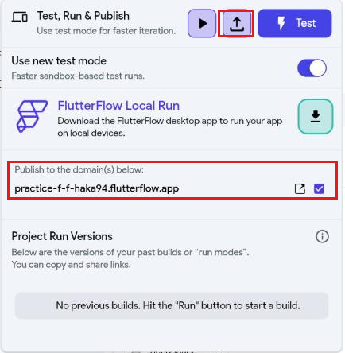
3. **iPhone:** open the link in **Safari** → **Share** → **Add to Home Screen**. It opens full screen,
   like an installed app. **Laptop:** open the link in Chrome or Edge → the install icon in the
   address bar (or **⋮ → Cast, save and share → Install page as app**).

> **Nothing installs in time?** Run the capstone from **Test mode** on your laptop, next to the Bubble
> admin — the live flow is the same.

### 8.4 — Before a real store release

| Item | Notes |
|---|---|
| Package / bundle ID | Can't change after the first store release |
| Icon and splash | ✅ today |
| **Security** | No sign-in and open rules are fine for class only — a real app needs sign-in and per-user rules |
| Privacy policy URL | Required by both stores |
| **Android:** Google Play Console account (one-time fee) | FlutterFlow can deploy from the editor |
| **iPhone:** Apple Developer Program (yearly fee) | Apple reviews every release |

**Checkpoint ✅** PanelWatch runs from an icon on your phone (APK or web app) or your laptop — and shows the same panels as your Bubble admin.

---

## Topic 9 — Capstone & presentations

**Your requirement** — show the whole system working live:
1. **Bubble admin** (laptop) and **PanelWatch Mobile** (phone — Android APK or web app)
   open side by side.
2. The trainer sends an event to a panel. Wait 30 seconds, then reopen the list on the phone (tap
   **Panels**): it shows **Warning** or **Critical**; press **Refresh** in Bubble and it shows the same.
3. Open that panel on both: the same summary, and the same newest reading at the top.
4. **Admin → client:** press **Disable panel** in Bubble, then reopen the list on the phone: that
   panel's readings are hidden. **Enable panel** and reopen: they're back.
5. **One improvement built with FlutterFlow AI** — e.g. a power trend card (**Generate with Designer**),
   a read-only limits card, a dark theme, or an "Offline" banner when `last_reading_at` is
   older than a minute.

**Present for 5 minutes:** the live flow, your improvement and the prompt behind it, and one thing the
AI got wrong and how you caught it.

**Your capstone prompt** — use the same shape as the prompts above: **what it is**, **where it goes**,
**what it shows**, and **what not to add**.
```text

```
**What the AI got wrong, and how I caught it:**

**Checkpoint ✅** Firebase → phone and Bubble, the same data, live, and the admin's switch obeyed by
the phone — in front of the class.

---

## End of Day 2 — what you should have
- `Practice FF`, built by hand, running in Test mode.
- `PanelWatch Mobile` connected to the course Firebase, with:
  - three AI-designed pages (`DeviceList`, `DeviceDetail`, `About`) and a nav bar;
  - three AI-designed components with parameters;
  - live queries for panels and readings; a temperature chart; disabled panels' readings hidden;
  - AI-run tests (or AI-designed empty, loading and error states);
  - an icon and splash, installed from your own APK or as an iPhone web app.
- Your capstone prompt, and a note of what the AI got wrong.

**Security recap**
- Without sign-in, rules can only limit **what** is read or changed, not **who** does it. Real apps add
  **sign-in** to the security rules — the next step after this course.
- Hiding a disabled panel is the **app's** choice, not a lock: the readings are still in Firebase. With
  sign-in, the rules could refuse them to client users too.
- You never deployed rules or indexes to the shared project.

**Extra, if you finish early**
- Add `recent_temperatures` (**List < Double >**) to `devices` and show a mini chart on each `PanelCard`.
- Add a limits **warning line** on the chart.
